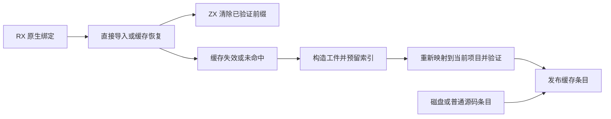
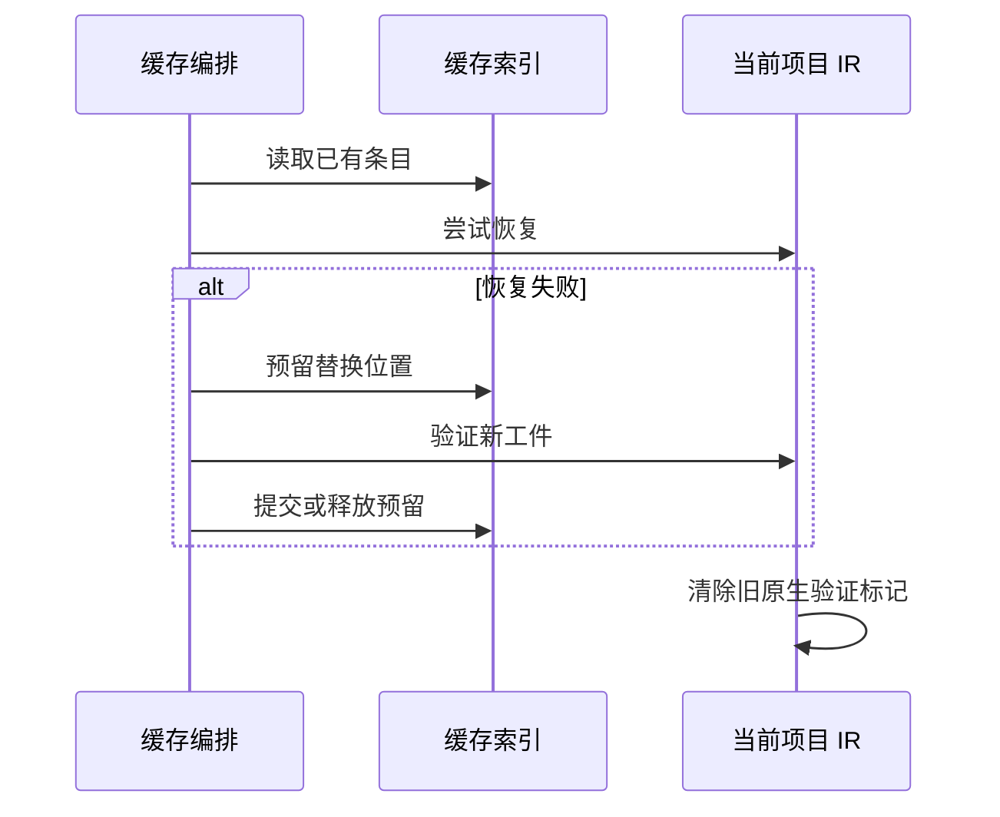

# 原生导入与缓存条目事务自举

## Intent

让正式项目的原生导入、验证失效和缓存替换共用 Source 的事务顺序。源码、磁盘和原生三类条目采用同一条预留与发布路径。

## Data

上一批已将普通项目入口的缓存选择和写回迁入 Source。`Project.importNative` 仍在 Zig 选择直接分析或使用缓存，并更新原生验证标记。`SemanticCache.native.load` 在 Zig 决定接受命中、重新提取、重新映射、提交和失败回滚。新条目与覆盖条目共用 `entries.prepare` 及 `Publication.commit`。

## Edges

摘要、编码、错误顺序和计数保持原契约。命中只有在恢复成功后才标为已验证。恢复失败可重算，资源耗尽立即返回。旧条目的结果及键保留到新工件成功验证，失败时仅释放未提交的预留与工件。原生模块登记或绑定改变后，ZX 直接写入原有验证标记，名义类型验证前缀继续复用。

## Answer

用同一引导器检查冷、热、声明变化后的原生执行和普通磁盘缓存重建。核对已有分配失败用例以及固定清单的产物、CPU、墙钟和峰值内存。保留初始 seed 路径，记录新事务依赖的通用存储和暂留接口。

### 迁移状态

- 项目的原生绑定由 RX 连到加载和验证失效。ZX 借用原函数计数及原生标记，直接清除失效前缀。
- 原生缓存的命中采用、候选准备、验证及提交交给 Source。源码、磁盘解码和原生条目共用 Source 的新增或替换顺序。Zig 管理预留键、索引容量、工件 arena 及错误解绕。
- 专用句柄保留现有内存布局。缓存条目的值和键可从 Source 的存储直接借用后，移除 `CacheSlot` 和 `NativeCacheLoad`。原生导入取得类型与成员视图后移除 `ProjectNative`。

### 引导验收

候选由 `f25c2cd7c` 的 Source 引导器生成，运行使用本批的原生导入和缓存事务。引导构建通过 26 个步骤，初始 seed 词法引导通过 14 个步骤。最终候选重编译四份清单，15,432 份产物逐字节一致。候选 SHA-256 为 `60726d33f78a989ae1777995c2d6b8eb4f06c9c104e91d4489a280c336d57db1`。检查四个生成入口，其 Source 编排调用链无临时堆分配调用。

首次增量回归在释放被替换的旧工件时崩溃。带符号复现定位到 `replaceCacheSlot` 调用 `Artifact.Result.deinit`，机器指令和寄存器显示调用使用了布尔成功值 `1` 作为地址。准备阶段改为返回实际旧条目的借用引用，提交阶段直接使用该引用，并复用同一可空指针 ABI。由此也移除了暂存事务对旧指针的重复记录。

旧条目引用修正后，正常替换、跨进程重建和原生声明重排通过。分配失败注入定位到另一条路径：可空预留对象的初始化中包含 `try`，提前写入了存在标记，分配失败后回滚进入空地址。新条目和工件分别先在局部完成分配，再把已完成的值交给事务。预留键在其后续分配失败时仍由原作用域释放。

### 回归验收

首轮通过原生声明、原生联结、名义类型、模块记录和缓存编码五组回归。修复旧条目引用后，跨进程缓存 5 项和原生 ABI 1 项集成通过。修复预留失败后，只补跑语义缓存的 7 项测试，两项逐次分配失败测试在内全部通过。最终候选的生成一致性独立验收。

### 性能对照

固定基线、上一批和最终候选各运行三轮同一份 735 入口的冻结清单，配置为 `ReleaseSmall`、16 个分区。下表记录生成阶段中位数。

| 生成指标                   | 固定基线 | 上一批 |  候选 |
| -------------------------- | -------: | -----: | ----: |
| 冷墙钟（秒）               |     2.86 |   2.67 |  2.66 |
| 冷 CPU（秒）               |    12.51 |  12.96 | 12.94 |
| 冷进程树采样峰值 RSS（MB） |    888.2 |  712.7 | 713.3 |
| 冷单进程最大 RSS（MB）     |    964.7 |  740.5 | 729.4 |
| 热墙钟（秒）               |     2.22 |   2.02 |  1.99 |
| 热 CPU（秒）               |     8.50 |   8.39 |  8.32 |

较上一批，冷生成墙钟减少 0.01 秒，CPU 减少 0.02 秒，进程树峰值增加 0.6 MB。较固定基线，冷生成墙钟累计减少 0.20 秒，CPU 增加 0.43 秒，进程树峰值下降 174.9 MB。未改动时的生成命令中位数仍为 0.03 秒。

候选与上一批的 11,753 份冻结产物一致，候选自身的冷暖产物一致，固定基线的历史差异一致。memo 载荷哈希保持 `cdf9fa7e0f33002a95dc097b2837de781d67e6e519a452fb97f89f7c0bbf3a23`。常驻编辑中位数由 0.426 秒降至 0.425 秒，峰值从 1,272.9 MB 增至 1,275.9 MB，编辑和恢复产物一致。
