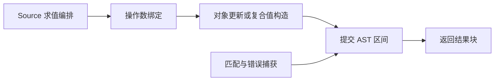
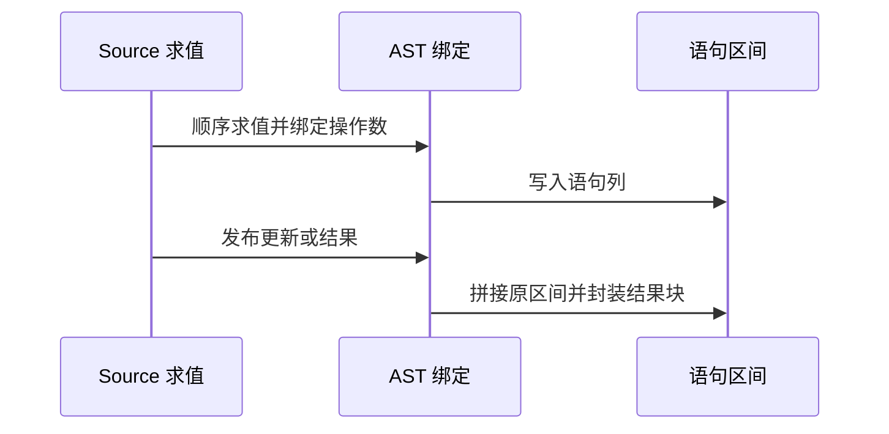

# 复合表达式正文区间自举

## Intent

让对象、元组、数组、模板、对象更新、匹配和错误捕获共用 AST 语句区间。取消这些正式入口将 Source 语句列物化为 Zig 联合体数组的往返。

## Data

对象、序列与匹配的求值次序已有 Source 入口。宿主回调仍把操作数绑定、未使用值的丢弃及捕获结果写入平坦数组。作用域内复用对象字段还为直接提交创建一个空的平坦前缀。

## Edges

保持对象操作数先求值、字段按既有顺序生成，再处理未消费的值。序列表达式编号由最终 AST 借用，持续保存这些编号。错误捕获按已提交的正文起点写出结束语句。初始 seed 维护自己的原生表示。

## Answer

对象与序列的 Source 求值流程直接写操作数绑定、指针转换和未消费值的丢弃语句。表达式收尾共用区间封装。作用域内的对象复用更新直接发布语句列，seed 保留自己的前置数组。匹配在主体求值后保留原区间，错误捕获将结束语句接到已提交的正文后。

[对象求值](../../packages/genz/src/zx/aggregate/object_execution.zig) · [序列求值](../../packages/genz/src/zx/aggregate/sequence.zig) · [作用域对象更新](../../packages/genz/src/zx/scope/reuse.zig) · [错误捕获](../../packages/genz/src/zx/capture/emit.zig)

对象更新的多字段取值及宿主结果引用仍有手写适配。投影访问、迭代消费与排序比较还有平坦接收者。

### 引导一致性

Source 引导器通过 25 个构建步骤，初始引导入口通过 19 个构建步骤。上一代 Source 引导器 `e65a91b3b` 生成候选。候选用相同输入重新生成主、增长、集合和执行四份清单，16,035 个文件逐字节一致，比较时排除工具身份戳。

候选引导器 SHA-256 为 `f34f5711554bb26c0df5546ea5026e75fc27d3a72fe70644a599ce894880504f`。

### 运行回归

同一候选引导器完成 457 个构建步骤，1,703 项测试全部通过。覆盖求值顺序、对象简写、对象 reduce 的副作用、迭代缓冲、函数更新、缓存所有权及类型化错误执行。复用既有用例。

### 性能

macOS arm64、Zig 0.17.0、ReleaseSmall。沿用 735 个入口、16 分区的冻结清单，关闭常驻，三轮交错取中位数。三套工具本体均由 Source 生成，测量时使用 Source 分析与生成。

| 场景   | 工具     | 墙钟（秒） | CPU（秒） | 进程树峰值（字节） | 单进程峰值（字节） |
| ------ | -------- | ---------: | --------: | -----------------: | -----------------: |
| 冷生成 | 固定基线 |       2.82 |     12.43 |        884,768,768 |        934,051,840 |
| 冷生成 | 上一阶段 |       2.64 |     13.01 |        661,995,520 |        687,685,632 |
| 冷生成 | 本批     |       2.63 |     13.01 |        660,701,184 |        684,670,976 |
| 热重建 | 上一阶段 |       1.93 |      8.32 |        643,842,048 |        643,874,816 |
| 热重建 | 本批     |       1.90 |      8.23 |        644,464,640 |        644,497,408 |

冷生成较同轮上一阶段快 0.01 秒，CPU 持平，进程树峰值下降 1.29 MB，单进程峰值下降 3.01 MB。较固定基线，墙钟下降 0.19 秒，CPU 累计增加 0.58 秒，进程树峰值下降 224.07 MB。无改动的墙钟和 CPU 均为 0.03 秒。 [固定基线](AST载荷导入与容量自举.md)

冻结清单的 11,753 个文件逐字节一致，各自的暖缓存重建与冷生成一致。所有权缓存正文 SHA-256 均为 `cdf9fa7e0f33002a95dc097b2837de781d67e6e519a452fb97f89f7c0bbf3a23`。

### 自我审查

处理范围覆盖复合表达式暂存和语句流交接。进一步缩减原生路径还需要迁出对象更新取值、投影访问、迭代结果读出及排序比较器的平坦接收者。性能证据覆盖分析和 Zig 生成，完整后端冷构建及三阶段自编译留到正式闭包收口后验收。
