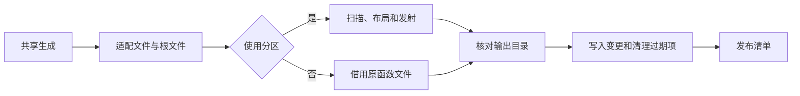
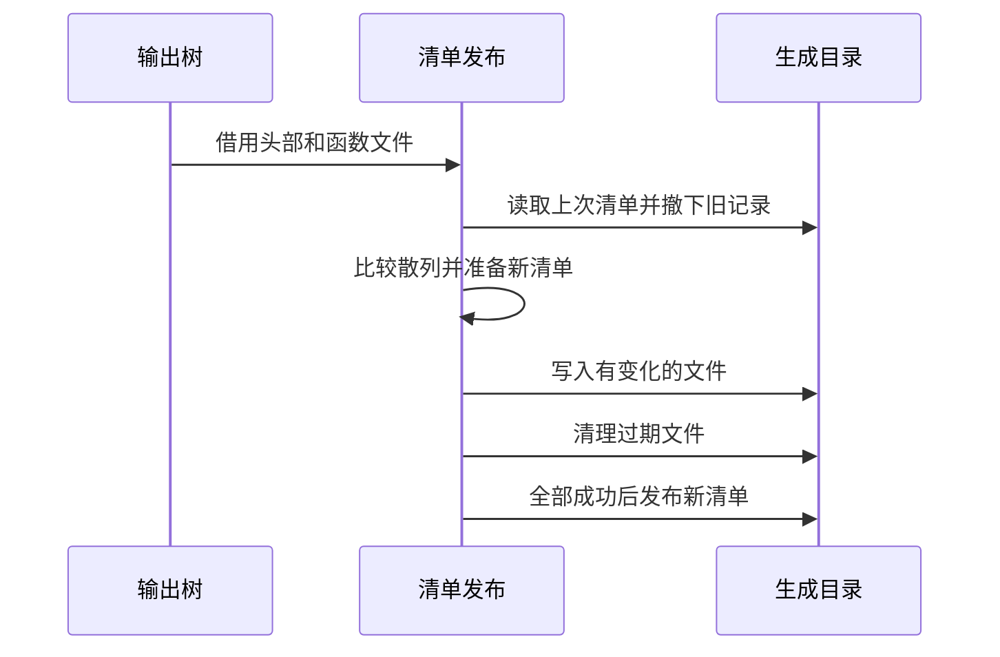

# 引导输出树和分区发布自举

## Intent

让正式引导器由 Source 调度公开适配文件、根文件、分区发射及输出目录发布。复用现有清单格式、文件清理规则和并行批次。

## Data

正式入口从引导共享生成到输出树。清单解析、差异选择、布局和文件内容由已有 Source 规则实现。手写 Zig 仍遍历公开适配文件，选择根文件和分区输出，推动分区扫描与发射，并负责更新目录的全部阶段。[共享生成](../../packages/compiler/build/shared_generation.zig)

## Edges

保留输入快照与文件清单各自的生命周期。沿用文件写入和删除次序，保留已有文件的时间戳。重用现有列与工作区，保持头部和函数文件两个区间。宿主继续执行实际文件操作、等待线程和释放资源。初始 seed 保留原来的生成逻辑。

## Answer

公开适配器的遍历退出 Zig，分区扫描、布局、位置发布和发射由 RX 推进。ZX 根据任务类型选择发射桩或按顺序发射分区的导出和根文件。清单发布由 RX 依次比较、写入并收尾，差异为空时跳过目录准备和写入线程。专用宿主接口借用输出位置、调用既有的 Source 规划或目标打印，再执行物理 I/O。原始根准备的 arena 在写入目录之前释放。[输出树](../../packages/compiler/src/backends/zig/output/tree/run.rx) · [分区编排](../../packages/compiler/src/backends/zig/partition/emission/run.rx) · [目录更新](../../packages/compiler/src/backends/zig/output/mirror/run.rx)

由 `5c9dcde7f` 的 Source 引导器构建候选，25 个步骤通过。另用仓库内初始 seed 生成四分区的引导解析器，30 个步骤通过。候选仍使用 Source 分析和发射。四份正式生成清单的 15,707 个文件逐字节一致，固定性能清单的 11,753 份文件一致。新编排及单任务分派的生成调用路径不分配堆内存或复制文件内容。

分区和非分区路径的输出及错误相同。核对了无编辑时的时间戳、按旧清单清理、无清单时恢复、切换分区模式后删除过期文件，以及输出位置为目录造成的 `IsDir`。修复输出位置后重建，文件内容恢复一致。

后端发布、模块生成和生成缓存运行三组回归通过，共 95 个构建步骤、41 项 Zig 测试及 3 项 CLI 集成检查，覆盖发布、运行、缓存损坏和缓存键不匹配。

同一 macOS arm64、Zig 0.17.0、ReleaseSmall、16 分区、冻结清单，三轮交错生成取中位数。范围为 zxc 分析和 Zig 文件写出。

| 场景 | 工具     | 墙钟（秒） | CPU（秒） | 进程树峰值（字节） | 单进程峰值（字节） |
| ---- | -------- | ---------: | --------: | -----------------: | -----------------: |
| 冷   | 固定基线 |       2.82 |     12.43 |        884,768,768 |        934,051,840 |
| 冷   | 上阶段   |       2.56 |     12.88 |        660,766,720 |        677,314,560 |
| 冷   | 本批     |       2.57 |     12.92 |        661,012,480 |        684,163,072 |
| 热   | 固定基线 |       2.16 |      8.40 |        892,633,088 |        933,937,152 |
| 热   | 上阶段   |       1.90 |      8.25 |        643,563,520 |        643,579,904 |
| 热   | 本批     |       1.91 |      8.24 |        644,251,648 |        644,268,032 |

冷生成较上阶段增加 0.01 秒墙钟和 0.04 秒 CPU，进程树峰值增加约 0.25 MB，单进程峰值增加约 6.8 MB。相对固定冷基线，墙钟减少 0.25 秒，CPU 增加 0.49 秒，进程树峰值下降约 223.8 MB。常驻编辑中位数从 0.424 降到 0.420 秒，进程峰值下降约 5.0 MB，所有编辑和恢复的产物哈希一致。完整 Zig 后端冷构建未单独计时。

级联的对象编译器继续使用同一个清单读写接口。下批沿其正式入口收口缓存键、覆盖旧状态、并行编译、错误报告和成功记录发布。对象进程和文件操作保留原 Zig 标准库边界。[对象编译入口](../../packages/compiler/build/partition/compile.zig)
