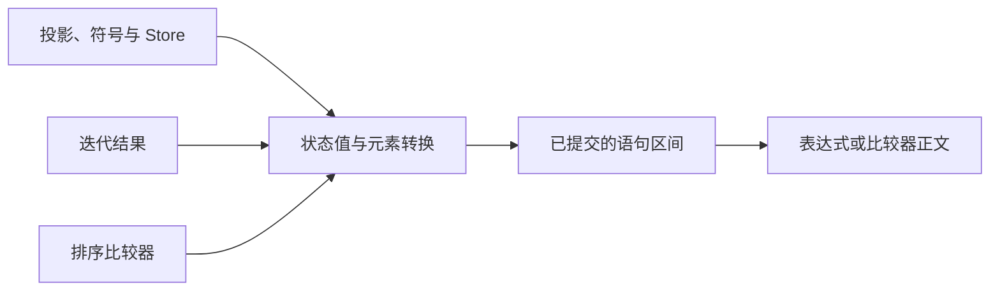
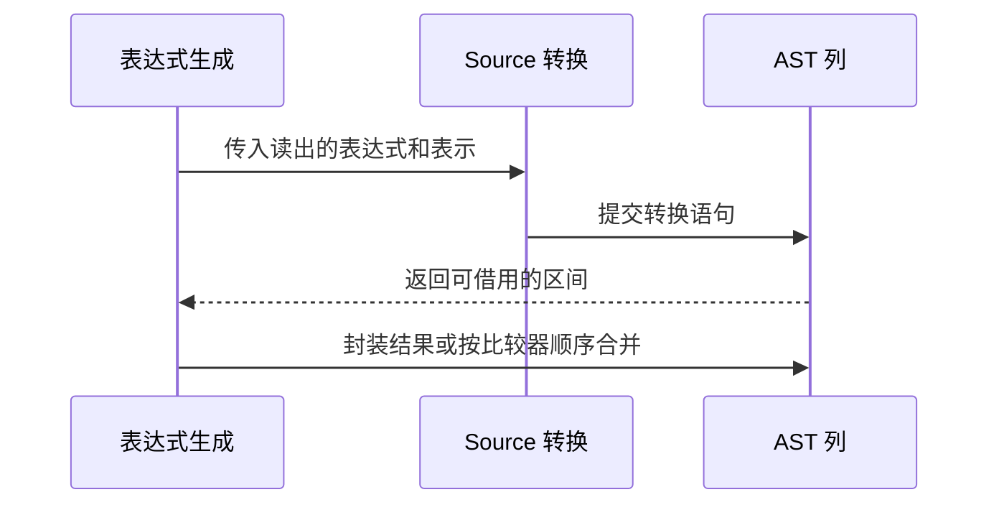

# 引用读取与排序正文区间自举

## Intent

贯通普通值 ABI、迭代与排序中的引用读出。让正式路径直接提交 AST 语句区间，由 Source 决定比较器正文顺序。

## Data

投影、普通符号及 Store 读取、迭代结果消费共用状态值和列表元素转换。排序比较器也通过同一入口转换两个实参，并穿插上下文解包和参数绑定。形式转换已由 Source 选择，但这些调用方仍先构造平坦语句，再交给 AST。

## Edges

保留直接读取和只读列表的短路。字段、下标和迭代结果在同一求值位置转换。比较器的上下文和借用储存先于左参数、右参数及返回语句。初始 seed 沿用原生表示。

## Answer

投影、Store 和迭代共用状态值读出。列表元素读出直接生成区间。普通引用在保留原有视图转换方式的同时也直接写入语句列。状态值发布只接收语句区间，删除从列重新物化平坦语句的分支。

排序比较器的两个元素转换分别交付语句区间。ZX 根据上下文、引用存储、参数转换、绑定和末尾返回的位置生成正文顺序与长度。宿主按顺序发布生成列，并用共用 AST 区间合并完成实际写入。

[值转换](../../packages/genz/src/zx/state_value/conversion.zig) · [元素读出](../../packages/genz/src/zx/state_value/elements.zig) · [语句列导入](../../packages/genz/src/node/import_statements.zig) · [比较器正文](../../packages/genz/src/analysis/sorting/worker/body_layout.zx)

### 引导一致性

上一代 Source 引导器 `c45b2fd05` 生成候选，25 个构建步骤通过。初始 seed 通过 19 个构建步骤。候选重新生成同一份主、增长、集合和执行清单，比较时排除工具身份戳，16,037 个文件逐字节一致。候选引导器 SHA-256 为 `abfbd470c3bee06fc9bf03b3a07c6437b550391efbe99c9b6ef52daa4b33963b`。

主清单中的自定义比较器包含标量及聚合元素。比较器的参数绑定、顺序和返回生成均包含在产物比较中。

### 运行回归

同一候选完成 494 个构建步骤，11,654 项 Zig 测试和 9 项 Node 集成检查全部通过。回归涵盖本地拥有的集合操作、迭代缓冲与跨调用和编译库结果、字段借用、缓存所有权、Store 内存连续性及旧视图存活。检查沿用既有用例。

### 性能

macOS arm64、Zig 0.17.0、ReleaseSmall。沿用 735 个入口、16 分区的冻结清单，关闭常驻，三轮交错取中位数。三套工具本体均由 Source 生成，测量时使用 Source 分析与生成。

| 场景   | 工具     | 墙钟（秒） | CPU（秒） | 进程树峰值（字节） | 单进程峰值（字节） |
| ------ | -------- | ---------: | --------: | -----------------: | -----------------: |
| 冷生成 | 固定基线 |       2.82 |     12.43 |        884,768,768 |        934,051,840 |
| 冷生成 | 上一阶段 |       2.57 |     12.99 |        673,660,928 |        688,291,840 |
| 冷生成 | 本批     |       2.55 |     12.90 |        660,979,712 |        687,570,944 |
| 热重建 | 上一阶段 |       1.91 |      8.26 |        644,546,560 |        644,579,328 |
| 热重建 | 本批     |       1.92 |      8.25 |        644,284,416 |        644,317,184 |

冷生成较同轮上一阶段墙钟下降 0.02 秒，CPU 下降 0.09 秒，进程树峰值下降 12.68 MB，单进程峰值下降 0.72 MB。物理内存峰值采样中位数下降 2.15 MB。较固定基线，墙钟下降 0.27 秒，CPU 累计增加 0.47 秒，进程树峰值下降 223.79 MB。无改动的墙钟、CPU 均为 0.03 秒。[固定基线](AST载荷导入与容量自举.md)

冻结清单的 11,753 个文件逐字节一致，各自的暖缓存重建与冷生成一致。所有权缓存正文 SHA-256 均为 `cdf9fa7e0f33002a95dc097b2837de781d67e6e519a452fb97f89f7c0bbf3a23`。

### 自我审查

转换、比较器顺序和语句列导入采用正式 Source 路径。投影节点求值、比较器作用域和函数组登记仍借用宿主接口。比较器生成后到命名空间发布前仍重复物化函数声明，下一批与入口和 Task 的声明发布一起核对。性能证据覆盖分析和 Zig 生成，完整冷构建及三阶段自编译仍待验收。
