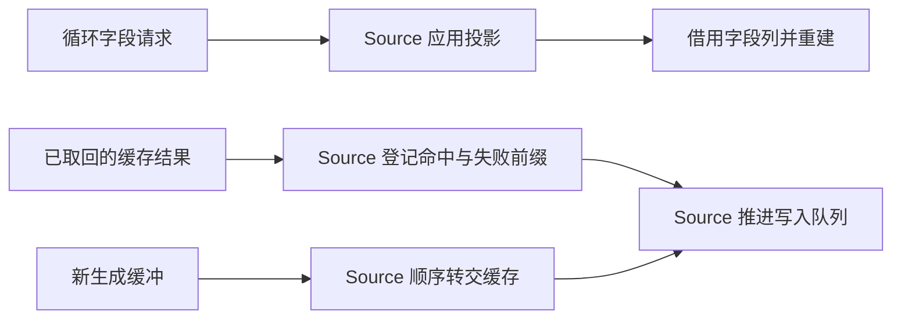
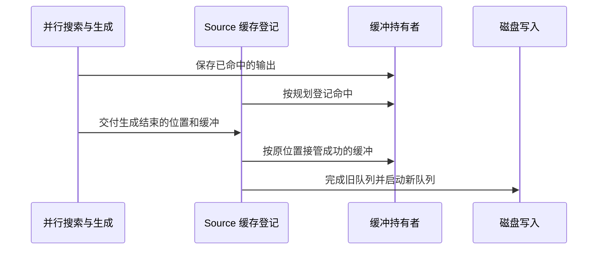

# 循环投影与生成缓存交接自举

## Intent

让循环字段投影消费已经计算的所有权请求，直接把字段列交回循环构造。将生成缓存的命中登记、失败前缀、新产物接管和写入队列推进迁入 Source，保持原有搜索、写入和借用成本。

## Data

循环字段原来把投影请求中的字段号逐行复制给重建器，再填充替换行号。生成缓存已有 Source 搜索规划、结果拷贝和写入决策。命中登记、生成缓冲的转交和写入执行分支仍由 Zig 推进。[字段投影](../../packages/genz/src/zx/iteration/fields/ownership.zig) · [生成缓存](../../packages/compiler/src/backends/zig/function_sources.zig) · [写入队列](../../packages/compiler/src/backends/zig/cache.zig)

## Edges

投影顺序与字段重建顺序沿用原计划。缓存先保存输出借用的数据，再允许命中写回替换原缓冲。存在写入线程和磁盘命中时保持原登记顺序。一次登记失败后只补记原输入位置之前的结果。新生成的缓冲仅在缓存接管成功后标记为已转移。

## Answer

字段请求现在直接保留按字段、类型和槽位组织的列。Source 按请求生成替换行，重建器复用原字段列，只分配替换行的一列。缓存命中登记、失败前缀和生成缓冲接管的循环退出 Zig。RX 依次完成旧队列、选择启动模式和交接新队列，线程启动失败时由 Source 选择同步写入。[字段应用](../../packages/genz/src/analysis/iteration/fields/ownership/apply.zx) · [缓存登记](../../packages/compiler/src/backends/zig/function_sources/updates/record.zx) · [队列流程](../../packages/compiler/src/backends/zig/cache/writes/workflow/run.rx)

宿主仍提供单行采用、缓冲接管、退休记录物理回收、工作线程和磁盘 I/O。执行清单已补上输出目录的源码依赖，改动这些 RX/ZX 文件后会重建执行模块。

以 `953988053` 的 Source 引导器构建本批工具，25 个步骤通过。两个工具用 Source 分析和生成处理相同源码，四份清单的 15,665 份文件逐字节一致。冻结清单的 11,753 份生成文件同上一阶段一致。

集中回归通过 292 个构建步骤和 359 项测试，覆盖循环投影、分区库、持久生成缓存、分配失败清理及原生 ABI。CLI 验证冷暖生成、源码修改后的选择性重建、损坏缓存重建、错误缓存键拒绝和禁用缓存。新队列及登记函数的生成 Zig 只使用调用方给定的工作区，布局流程本身未额外申请内存。

Zig 0.17.0、ReleaseSmall、16 分区和相同冻结清单下，三次配对生成的中位数如下。

| 场景 | 工具     | 墙钟（秒） | CPU（秒） | 进程树峰值（字节） | 单进程峰值（字节） |
| ---- | -------- | ---------: | --------: | -----------------: | -----------------: |
| 冷   | 固定基线 |       2.88 |     12.52 |        892,256,256 |        928,153,600 |
| 冷   | 上阶段   |       2.55 |     12.85 |        659,832,832 |        684,752,896 |
| 冷   | 本批     |       2.55 |     12.84 |        661,438,464 |        677,675,008 |
| 热   | 固定基线 |       2.19 |      8.44 |        892,878,848 |        935,165,952 |
| 热   | 上阶段   |       1.91 |      8.24 |        644,448,256 |        644,464,640 |
| 热   | 本批     |       1.90 |      8.22 |        644,284,416 |        644,300,800 |

冷生成墙钟持平，CPU 减少 0.01 秒，进程树峰值增加 1.6 MB，单进程峰值下降 7.1 MB。相对固定冷基线，墙钟减少 0.33 秒，CPU 增加 0.32 秒，进程树峰值下降 230.8 MB。常驻编辑耗时中位数均约 0.424 秒，峰值增加 1.2 MB，五次编辑与恢复的输出哈希一致。
