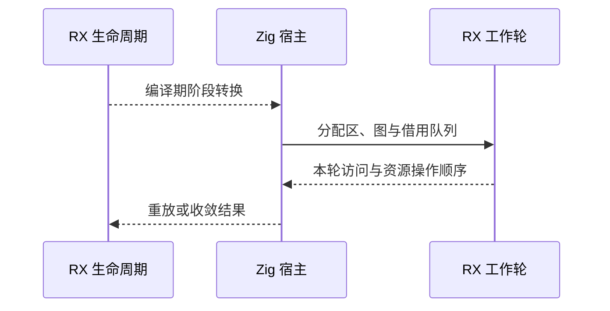

# 所有权主程序与工作区自举

## Intent

把常规分析与重放回退共用的程序阶段转换固化为 Source 规则，合并调用反向图和工作队列的初始化。将临时区重置及共享结算、需求结果的发布放回访问编排。

## Data

正式程序在 Zig 中保存阶段、重放接受状态和轮次结果。每次阶段变化都调用 Source 计算下一阶段。旁路接受与正常完成共用释放分支，由宿主额外保留接受标记。工作队列和反向图分别初始化，普通访问的短期区重置由外层循环选择。普通执行、预取和重放复查共用的结算与需求接线都要先把中间结果交回 Zig，再单独调用 Source 发布。

## Edges

保持常规、保守需求、快捷接受和回退的执行次序。复查失败保留旧轨迹，成功提交新轨迹时才移除旧记录。普通访问在前一项反馈已经消费且预取请求完成后重置短期区。初始词法 seed 继续使用独立的 Zig 分支。

## Answer

沿正式所有权入口核对退出的状态和运行时往返。用同输入生成产物、受影响回归、常驻缓存编辑和固定性能清单验收，记录外层循环仍调用的资源及计算接口。

RX 的阶段转换在构建引导器时求值。运行时只用当前阶段及其反馈索引转换表，移除 `Context.next` 及专门保留的重放接受标记。重放接受直接进入资源释放，正常完成由 Source 决定是否提交新轨迹。Seed 仍使用独立的手写转换规则。[阶段规则](../../packages/genz/src/analysis/uniqueness/program/run.rx) · [构建期转换表](../../packages/genz/src/zx/uniqueness/program/transition.zig)

同一个 RX 入口产生反向调用图并以实际正文数量为工作队列预留定长缓冲。图与队列保持各自的原分配器，错误时释放已预留的队列列。普通访问从 Source 确定短期区重置发生在读缓存之前，前一项反馈及预取的次序保持。[工作区准备](../../packages/genz/src/analysis/uniqueness/program/open.rx) · [访问顺序](../../packages/genz/src/analysis/uniqueness/program/visit/sequence.rx)

结算和需求各用一个 RX 入口完成分析与结果发布。临时事实保留在工作区，贡献、需求标记、可选读取记录和增长行写入结果拥有区。原来的两份独立发布入口从引导清单退出。常规与预取共享此路径，重放未命中重新算正文时也走同一路径。[结算访问](../../packages/genz/src/analysis/uniqueness/function/result/settle_visit.rx) · [需求访问](../../packages/genz/src/analysis/uniqueness/function/result/demand_visit.rx)

主程序与复查仍通过 Zig 循环派发实际操作。下一步从共享的正文分析调用切入，核对 `Bodies.Unit.analyze` 的正文工作区、memo 查找与登记、预取接管和回收。正式路径能够直接用 Source 描述这些操作后，再迁出外层循环。

### 验收

候选由上一代 Source 引导器构建，使用 Zig 0.17.0 ReleaseSmall 和 16 个生成分区。候选构建 25 步，初始词法 seed 构建 14 步通过。主清单、增长清单和集合清单分别比较 14,515、464、100 份同输入生成文件，共 15,079 份产物逐字节一致。候选引导器 SHA-256 为 `c34d0726ea30b1c9fee6e6c964bb9dd26affaddde53dcb1c5da89c816bb70488`。

既有常驻夹具的初次生成、修改常量、改变返回值的所有权来源及恢复四个步骤，生成文件指纹均与上一代一致。

九组回归覆盖函数分析与执行、函数效果与分配、所有权契约、缓存、循环初值、借用返回、上下文借用和对象集合追加。278 个构建步骤、560 项 Zig 测试及 36 项运行检查通过。

### 性能

三个工具均由 Source 引导构建，运行时使用 Source 分析和生成。macOS arm64、Zig 0.17.0 ReleaseSmall、固定 735 个入口、16 个生成分区，关闭常驻生成。三轮交错取中位数，范围为源码分析和 Zig 生成。

| 指标                           | 固定基线 | 上一批 |  本批 |
| ------------------------------ | -------: | -----: | ----: |
| 冷生成墙钟（秒）               |     2.85 |   2.61 |  2.60 |
| 冷生成 CPU（秒）               |    12.51 |  12.77 | 12.72 |
| 冷生成进程树采样峰值 RSS（MB） |    884.7 |  704.8 | 708.4 |
| 冷生成单进程峰值 RSS（MB）     |    925.5 |  733.4 | 727.7 |
| 热生成墙钟（秒）               |     2.25 |   1.98 |  1.95 |
| 热生成 CPU（秒）               |     8.45 |   8.27 |  8.22 |
| 无修改生成墙钟（秒）           |     0.04 |   0.03 |  0.03 |

相对上一批，冷生成墙钟减少 0.01 秒、CPU 减少 0.05 秒。进程树采样峰值增加 3.6 MB，三轮样本范围重叠。单进程峰值减少 5.7 MB。相对固定基线，冷生成墙钟减少 0.25 秒，CPU 累计增加 0.21 秒，进程树峰值下降 176.3 MB。

本批与上一批的 11,753 份固定清单产物逐字节一致，候选自身冷暖产物也一致。两批所有权缓存正文的 SHA-256 均为 `cdf9fa7e0f33002a95dc097b2837de781d67e6e519a452fb97f89f7c0bbf3a23`。
