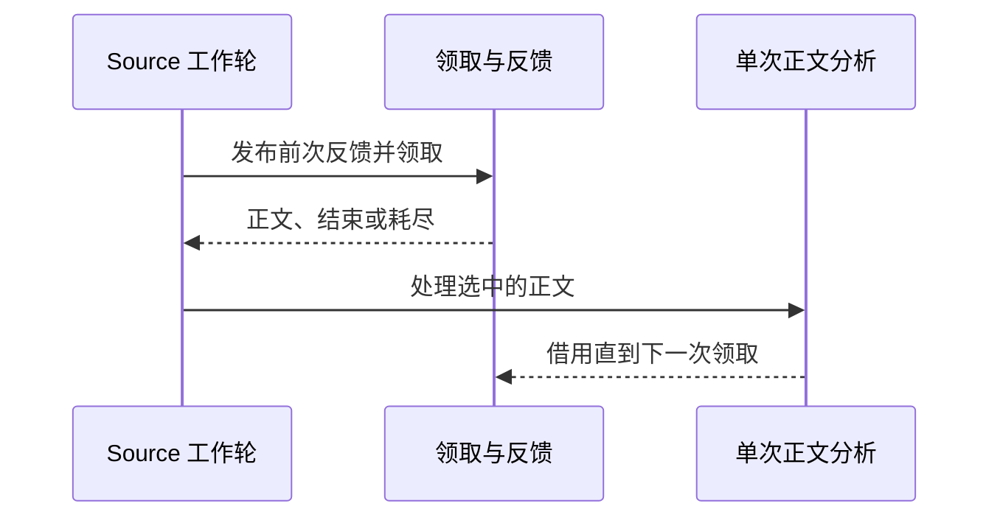

# 所有权外层调度自举

## Intent

将 `Context.run`、`Context.visitRound` 和缓存重放复查的控制流迁入 RX/ZX。普通工作轮共用上一批迁入的访问、写回和反馈，重放保留同一套结果比较及缺失复算。

## Data

阶段转换、队列状态、预取选择、正文处理和缓存扫描已经由 Source 提供。正式路径仍由 Zig 管理程序阶段、反复领取与反馈，以及缓存未命中后的恢复循环。

## Edges

沿用独立生成的所有权分组及其静态 Zig 调用边界。Source 决定调用顺序，原生叶操作保持旧列绑定、线程启动和资源清理顺序。在推进下一次领取前发布上次反馈，释放当轮临时区前排空 worker。缓存复算可能增长 memo，复算后重新绑定最新的列。

## Answer

从正式分析入口核对三个旧 Zig 循环退出。初始 seed 保留原执行路径。集中核对固定输入的产物和 memo、函数分析及缓存重放回归，并比较同配置的冷暖生成和常驻编辑。

### 正式路径

程序入口在 RX 中顺序安排旧轨迹复查、固定点迭代、计划生成及工作区释放。结算预算耗尽时进入保守需求轮，需求增长时继续结算。计划输出在最后一次反馈被领取方消费后才交付。旧轨迹复查通过时发布替换记录，拒绝时关闭复查临时区，再进入普通轮次。

工作轮和重放复算的循环改由 ZX 执行。调用边界传句柄、标量和枚举，借用已有列并持有原本的资源释放顺序。正式入口用空分配器执行这段编排，正文分析、memo、线程和输出仍使用各自原有分配器。Zig 仍负责绑定工作轮输入和反馈列、绑定重放游标对应的物理行以及分配和释放实际线程资源。启动 worker 后仍由宿主恢复当前预取窗口。

所有权生成组在既有正文借用视图的分组中增加程序入口。组内通过普通静态链接调用上述叶操作，避免额外的间接调用或跨分区参数装箱。手写阶段执行和工作轮仅保留在 seed，正式路径移除 `transition.zig` 和旧复查控制器。

### 性能对照

候选由已验收的 Source 引导器 `45ab611ce` 构建，运行使用本批 Source 控制流。冻结的 735 入口、`ReleaseSmall` 和 16 个分区保持一致，三组交替执行三轮，取中位数。

| 生成指标                   | 固定基线 | 上一批 |  候选 |
| -------------------------- | -------: | -----: | ----: |
| 冷墙钟（秒）               |     2.82 |   2.63 |  2.62 |
| 冷 CPU（秒）               |    12.42 |  12.87 | 12.85 |
| 冷进程树采样峰值 RSS（MB） |    889.6 |  704.7 | 705.8 |
| 冷单进程最大 RSS（MB）     |    921.3 |  734.4 | 734.6 |
| 热墙钟（秒）               |     2.19 |   1.96 |  1.97 |
| 热 CPU（秒）               |     8.46 |   8.28 |  8.28 |

相对上一批，冷生成墙钟减少 0.01 秒，CPU 减少 0.02 秒，进程树峰值增加 1.0 MB。相对固定基线，冷墙钟累计减少 0.20 秒，CPU 增加 0.43 秒，进程树峰值下降 183.8 MB。常驻编辑墙钟中位数从 0.422 秒到 0.424 秒，常驻最大采样 RSS 从 1,268.2 MB 到 1,273.9 MB。

冻结清单的 11,753 份生成文件和冷暖产物一致，memo 载荷 SHA-256 仍为 `cdf9fa7e0f33002a95dc097b2837de781d67e6e519a452fb97f89f7c0bbf3a23`。候选引导器 SHA-256 为 `19904b04affd4c8e8e0ad952a41e8a425c19c752b2e4f62d30fd2ad60f2e1dd4`。

### 阶段验收

Source 引导构建通过 25 个步骤，初始 seed 词法引导通过 14 个步骤。上一批和本批引导器在四份当前清单生成的 15,174 份文件逐字节一致。函数分析与执行、缓存所有权、函数效应、所有权契约、循环所有权和模块生成共通过 443 项回归。两套常驻编辑夹具的每次修改及恢复产物一致。
