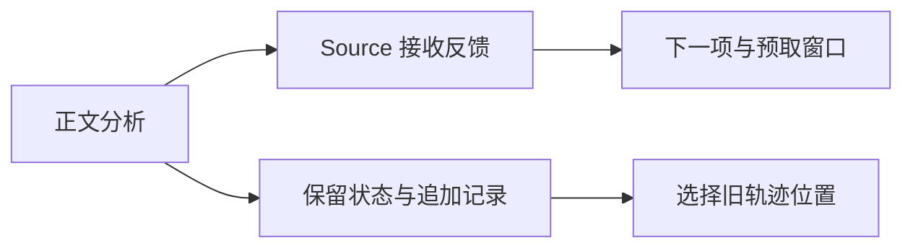
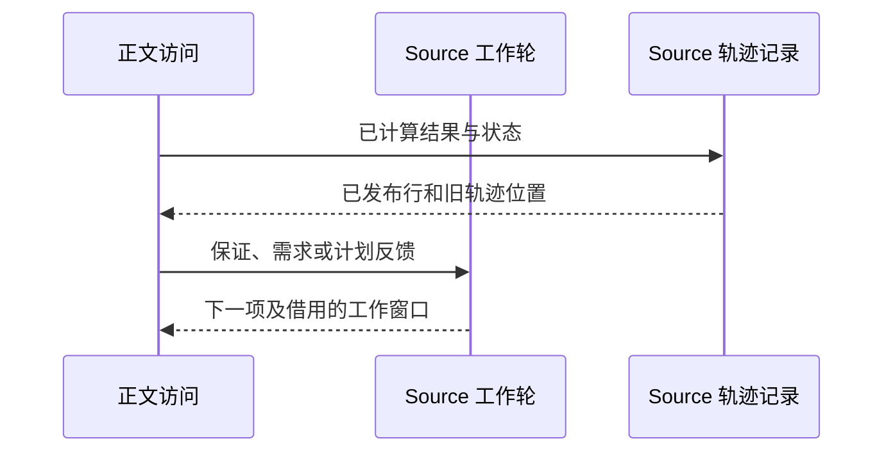

# 所有权工作轮与重放反馈自举

## Intent

让普通工作轮和重放的反馈在 Source 中提交。计划行和前一项的分析反馈共用一次工作轮推进，重放的记录追加与旧轨迹位置选择共用一次流程。

## Data

正式工作轮已由 Source 合并保证值、传播需求并选择下一正文。计划还从宿主逐项发布，环形窗口由宿主重新组装。重放会在每次普通访问后保留输入状态、写轨迹行，再查询旧轨迹位置。宿主分别调用这些 Source 原子函数。

## Edges

先发布上一项再取下一项，保持预取、临时区回收和轮次结束次序。记录失败时旧轨迹可用。异步任务调用和资源释放仍由已有宿主接口执行。

## Answer

沿正常工作轮、命中重放和重放回退核对原有语义。使用上一代公共引导器、同输入产物对照、既有所有权回归和固定性能基线，更新收敛计划。

普通工作轮在同一次推进里接收前一项结果。结算和需求保留原有写回逻辑，计划行也在取下一项前发布。函数计划和独立入口计划使用各自的目标视图，旧的逐项 Zig 发布入口退出正式路径。Source 直接借用环形工作队列的两个区间，宿主取得区间后沿用原有预取。[推进流程](../../packages/genz/src/analysis/uniqueness/work/round/advance.rx) · [工作窗口](../../packages/genz/src/analysis/uniqueness/work/round/take.zx)

重放记录在拥有区保留一份状态字节，用短期缓冲追加记录，再选择旧轨迹位置。三个阶段共用同一个 RX 发布入口，所有权状态的独立保留调用退出。快捷复查由 Source 在游标拒绝时清除旧需求，再回到普通工作轮。[轨迹记录](../../packages/genz/src/analysis/uniqueness/replay/record/publish.rx) · [拒绝处理](../../packages/genz/src/analysis/uniqueness/replay/shortcut/advance.rx)

### 验收

候选由上一代 Source 引导器构建，Zig 0.17.0 ReleaseSmall，16 个生成分区。候选构建 25 步，初始词法 seed 构建 14 步通过。主清单、增长清单和集合清单分别有 14,492、464、100 份生成文件，共 15,056 份逐字节一致。候选引导器 SHA-256 为 `5e5f90b11e983d2c68ee7b266b4e048d2c9504d78bc8f7089620d3156ff8f31b`。

使用既有常驻夹具比较初始生成、修改常量、由借用输入改为返回新值、恢复原版四个步骤。每一步的生成文件指纹与上一代一致，恢复原版命中已有输出。

八组回归涵盖函数分析与执行、缓存所有权、所有权契约、循环初值、借用返回、上下文借用和对象集合追加。269 个构建步骤、520 项 Zig 测试与 36 项运行脚本检查通过。

### 性能

三个工具均由 Source 引导构建，运行时使用 Source 分析和生成。macOS arm64、Zig 0.17.0 ReleaseSmall、固定 735 个入口、16 个生成分区，关闭常驻生成。三轮交错取中位数，计时涵盖源码分析与 Zig 生成。

| 指标                           | 固定基线 | 上一批 |  本批 |
| ------------------------------ | -------: | -----: | ----: |
| 冷生成墙钟（秒）               |     2.85 |   2.64 |  2.62 |
| 冷生成 CPU（秒）               |    12.45 |  12.69 | 12.75 |
| 冷生成进程树采样峰值 RSS（MB） |    885.7 |  713.3 | 708.7 |
| 冷生成单进程峰值 RSS（MB）     |    945.3 |  730.3 | 728.2 |
| 热生成墙钟（秒）               |     2.24 |   1.99 |  1.96 |
| 热生成 CPU（秒）               |     8.47 |   8.30 |  8.23 |
| 无修改生成墙钟（秒）           |     0.04 |   0.03 |  0.03 |

相比上一批，冷生成墙钟减少 0.02 秒，CPU 增加 0.06 秒。进程树采样峰值下降 4.6 MB，单进程系统峰值下降 2.1 MB。相对固定基线，冷生成墙钟减少 0.23 秒，CPU 累计增加 0.30 秒，进程树峰值下降 177.0 MB。

本批与上一批的 11,753 份固定清单产物一致，候选自身冷暖产物一致。两批所有权缓存正文 SHA-256 均为 `cdf9fa7e0f33002a95dc097b2837de781d67e6e519a452fb97f89f7c0bbf3a23`。

### 仍在执行的宿主职责

主程序、常规轮次和复查的外层执行循环还由 Zig 驱动。它们仍调用 worker、选择短期区何时重置、把实际计算结果交回 Source，并持有回退及释放所需的资源。已有反馈入口能直接接收计划、旧轨迹索引和借用队列。接续优先收口普通和复查共用的访问、恢复与退出，再进入 Lower 调度收尾。
