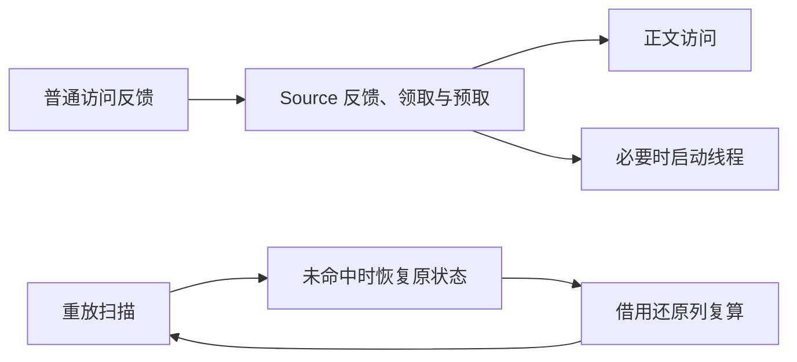
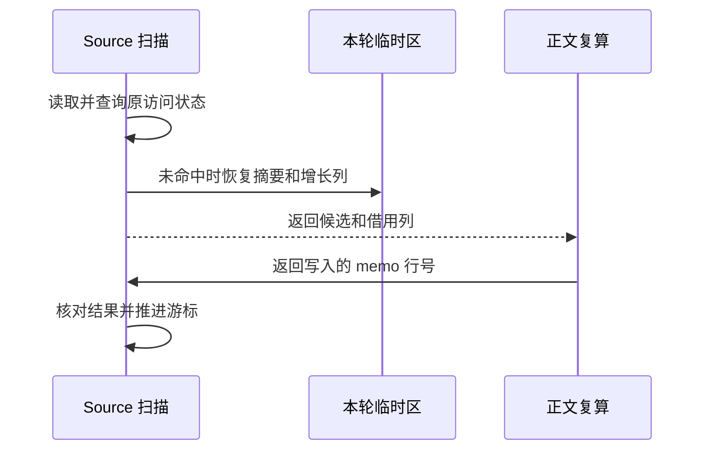

# 所有权工作轮调度与重放状态接续自举

## Intent

将工作轮的反馈、领取和预取合到一次 Source 调用。重放遇到未命中时，由同一次扫描恢复已记录的摘要和增长列，再请求正文复算。继续缩减普通工作轮及缓存重放依赖的宿主调度。

## Data

`Context.visitRound` 在 Source 发布反馈并领取正文后，单独调用预取。重放的 Source 扫描在找不到 memo 时暂停，宿主再次取出同一状态，再调用恢复入口。已有 Source 支持两处工作流需要的队列操作、缓存编码和状态写回。

## Edges

反馈发布先于下一次领取。需要启动线程时，先保留队列位置，宿主启动并发布后继续同一窗口。重放未命中时保持生成缓存键的顺序，对不完整数据继续拒绝重放。恢复列由本轮临时区持有，复算与记录写回前保持有效。

## Answer

集中核对已知回归、生成一致性、常驻编辑与固定基线。按正式入口复核退出的调用和剩余的宿主状态。

### 正式路径

普通工作轮通过同一 RX 入口先发布上一项反馈，再领取正文并将窗口交给 Source 预取。窗口在必要时随线程启动请求返回，启动后继续原窗口，避免重复发布反馈或领取下一项。原生成版 `Ahead.request` 和单独的工作队列领取入口已经退出。宿主继续负责实际线程启动和按访问结果调用正文分析。

重放查表同时返回原状态的借用视图。未命中时，Source 重置恢复临时区、检查记录边界、还原摘要和增长列。恢复失败直接走原有拒绝清理。成功时宿主借用恢复列计算并写入 memo，随后用返回行号继续 Source 扫描。正式路径退出原生状态取回、复算步骤分派和独立恢复适配。正文复算后写回及两条外层循环仍由宿主持有。

### 性能对照

候选由上一批已验收的 Source 生成器 `ae39fd0d4` 构建，运行使用本批 Source 分析与生成实现。冻结的 735 入口清单以 `ReleaseSmall` 和 16 个生成分区运行。固定基线、上一批和候选交替执行三轮，表中取中位数。

| 生成指标                   | 固定基线 | 上一批 |  候选 |
| -------------------------- | -------: | -----: | ----: |
| 冷墙钟（秒）               |     2.78 |   2.61 |  2.59 |
| 冷 CPU（秒）               |    12.35 |  12.71 | 12.74 |
| 冷进程树采样峰值 RSS（MB） |    887.9 |  704.3 | 704.0 |
| 冷单进程最大 RSS（MB）     |    926.1 |  721.2 | 731.5 |
| 热墙钟（秒）               |     2.17 |   1.94 |  1.92 |
| 热 CPU（秒）               |     8.39 |   8.21 |  8.16 |

相对上一批，冷墙钟减少 0.02 秒，冷 CPU 增加 0.03 秒，进程树峰值下降 0.3 MB，单进程最大 RSS 增加 10.3 MB。相对固定基线，冷墙钟累计减少 0.19 秒，冷 CPU 累计增加 0.39 秒，进程树峰值下降 183.9 MB。

冻结清单的 11,753 份生成产物及候选冷暖产物均逐字节一致。上一批和候选的 memo 载荷 SHA-256 均为 `cdf9fa7e0f33002a95dc097b2837de781d67e6e519a452fb97f89f7c0bbf3a23`。常驻编辑和恢复产物一致，编辑墙钟中位数从 0.427 秒到 0.426 秒，常驻最大采样 RSS 从 1,260.1 MB 到 1,261.2 MB。

### 阶段验收

Source 引导构建通过 26 个步骤。初始 seed 的词法引导通过 14 个步骤。函数分析与执行、缓存所有权、函数效应、所有权契约和循环所有权相关回归通过 171 个步骤和 420 项测试。

上一批 Source 与本批候选对五份当前清单生成的 15,142 份文件逐字节一致。两套已有常驻编辑夹具的产物和恢复结果一致。检查生成 Zig，两个入口及直接调用的编排代码没有额外装箱，增长列仍由恢复临时区按需分配。候选引导器 SHA-256 为 `c18267a77dfe7aba1ae74ef6536510473e9d7a3d8a5c277f5d7319dae948eea1`。
