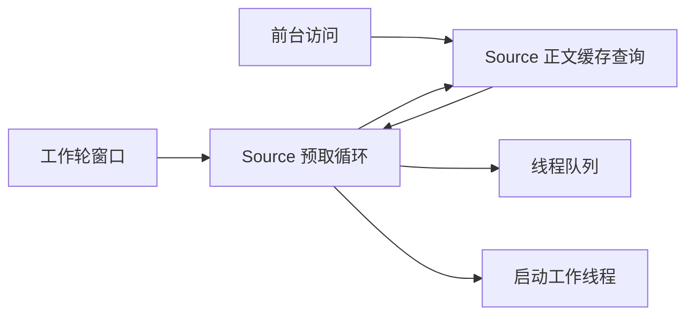
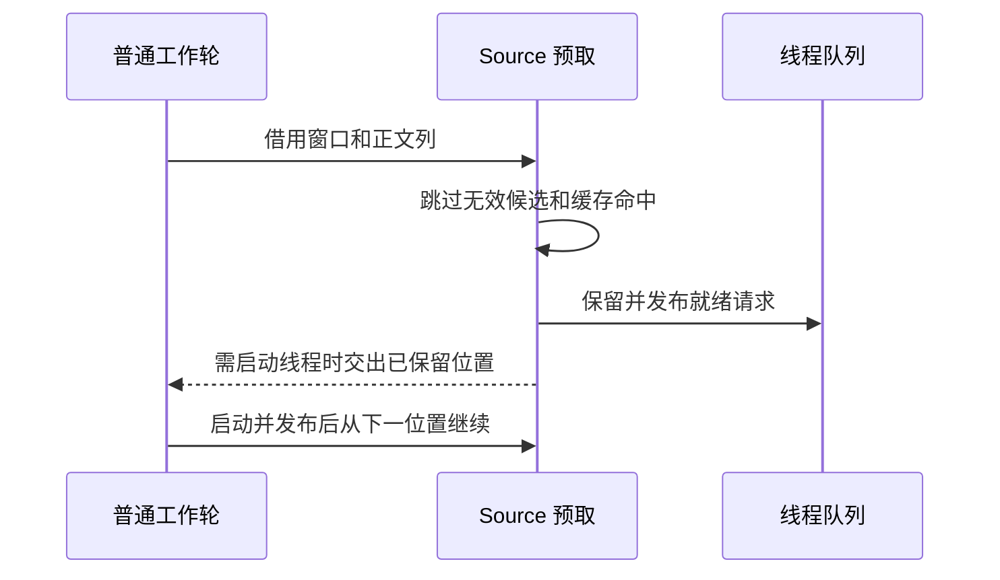

# 所有权工作轮预取与缓存访问自举

## Intent

迁移工作轮的预取请求循环，让 Source 连续筛选候选、访问 memo 并提交线程队列。前台查询与预取共用按正文选取数据的入口。

## Data

`Context.visitRound` 在领取正文后提供环形窗口。迁移前，`Ahead.offer` 用 Zig 循环连接候选筛选、memo 查询、状态转换和线程队列。前台查询也从正文提取同一组摘要、标识和增长列。

## Edges

保留请求窗口、缓存键字节和缓存使用标记。线程首次启动仍在队列保留之后、发布之前。保留失败时只在声明仍有效的情况下撤回。工作线程从既有状态取得正文，继续使用分立的临时区。

## Answer

### 正式路径

`Ahead.request` 进入 Source 候选循环。扫描直接返回正文编号和窗口偏移，命中时保持已缓存状态。需要分析时，以原顺序预留并发布队列条目。尚需启动工作线程时，宿主接手当前已保留条目，发布后从下一位置继续。原 Zig `Ahead.offer` 仅由初始 seed 执行。

前台和预取共用只读正文视图及缓存键生成。每次借用选中的标识、摘要和增长列，前台命中更新使用标记。物理列绑定和线程启动仍由宿主提供。普通访问的实际记录写回、工作轮反馈及重放未命中复算仍在 Zig 调度，列入下一批。

### 编码缓冲修正

首轮生成代码把循环中的编码列表标成共享。后续覆盖触发重复复制，旧副本留在 memo 的分配区。单次冷生成的最大 RSS 达到 1,203.7 MB。最终候选复用编译器内部的 `ByteWriter`。Source 决定键字段、编码和求值顺序，按需追加并借用当前缓冲，重置时保留已有容量。生成后的预取循环仅传递写入器引用，退出列表所有权降级和随后的写时复制。

常驻编辑检查还发现每次投影会为两组增长列分配四个临时对象。列描述符改为借用查询调用帧中的视图，Source 按正文更新投影，再读取实际行数。键编码仍由 Source 选择两组记录的宽度与顺序。重新检查生成函数，正文列投影已没有分配语句。

### 性能对照

候选生成器由上批已验收的 Source 工具 `f446ef354` 引导构建，运行时使用本批 Source 分析和生成实现。冻结的 735 入口清单以 `ReleaseSmall`、16 个生成分区运行。固定基线、上一批和候选交替执行三轮，表中取中位数。

| 生成指标                   | 固定基线 | 上一批 |  候选 |
| -------------------------- | -------: | -----: | ----: |
| 冷墙钟（秒）               |     2.84 |   2.61 |  2.61 |
| 冷 CPU（秒）               |    12.45 |  12.74 | 12.68 |
| 冷进程树采样峰值 RSS（MB） |    886.0 |  703.4 | 708.1 |
| 冷单进程最大 RSS（MB）     |    921.6 |  728.3 | 726.8 |
| 热墙钟（秒）               |     2.20 |   1.96 |  1.95 |
| 热 CPU（秒）               |     8.42 |   8.24 |  8.25 |

相对上一批，冷墙钟持平，冷 CPU 减少 0.06 秒，进程树峰值增加 4.6 MB，单进程最大 RSS 下降 1.5 MB。相对固定基线，冷墙钟累计减少 0.23 秒，冷 CPU 累计增加 0.23 秒，进程树峰值下降 177.9 MB。候选三次冷墙钟分别为 4.64、2.61 和 2.61 秒，冷 CPU 在 12.66 至 12.81 秒之间。

冻结清单的 11,753 份产物与上一批逐字节一致，候选冷暖生成产物也一致。上一批和候选的 memo 载荷 SHA-256 均为 `cdf9fa7e0f33002a95dc097b2837de781d67e6e519a452fb97f89f7c0bbf3a23`。完整构建和三阶段自编译按收敛计划的最后一批验收。

单独运行的常驻编辑夹具中，三次编辑及恢复后的生成结果均逐字节一致。编辑墙钟中位数从 0.428 秒到 0.426 秒，常驻最大采样 RSS 从 1,242.3 MB 到 1,260.3 MB，增加 18.1 MB。将该场景保留在后续工作轮阶段的对照中。

### 阶段验收

初始 seed 词法构建通过 14 个步骤。Source 引导构建通过 26 个步骤。九组现有所有权、函数分析与执行、集合回归通过 560 项测试。列视图修正后补跑函数分析、独立执行和缓存所有权三组，共 199 项测试通过。两套已有常驻编辑夹具均与上一版产物一致。

用上一批 Source 与本批候选生成五份当前清单，15,158 份文件逐字节一致。候选引导器 SHA-256 为 `3a5bbc7b1e453110137ec111be156887266fed2cf4f5ac2fafff85c36e3f5b03`。
