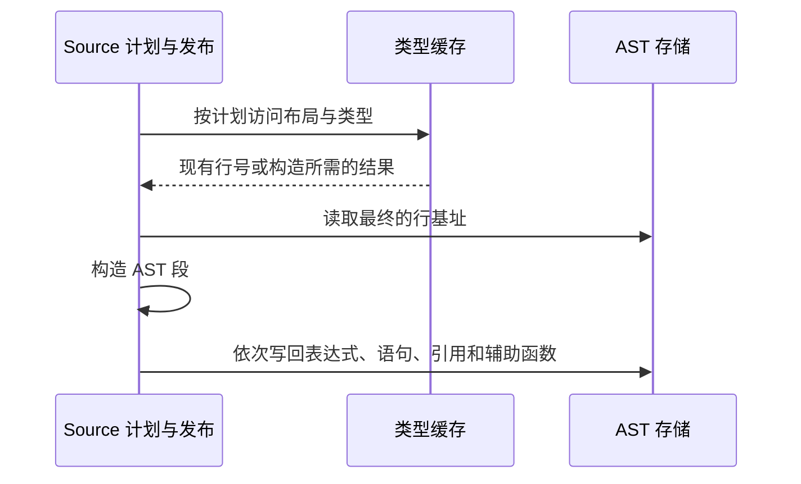

# 所有权布局与 AST 写回自举

## Intent

沿正式的所有权投影和状态转换入口，把布局准备及 AST 段的提交顺序交给 Source。保留惰性类型构造和现有 AST 表表示，移除清理计划的重复布局数组。

## Data

投影规划给出按清理顺序排列的引用类型。当前 Zig 为这些类型逐个查询布局，再交付一份临时结果数组。状态转换的操作与资源选择规则已有 ZX 实现。Zig 仍遍历计划节点并发起类型、布局和名称请求。投影的 Source 输出携带表达式段、语句、引用存储和可选辅助声明，宿主推进这些段的写回。

## Edges

按旧顺序构造尚未缓存的类型，完成后读取 AST 行基址。缓存命中直接读既有列。临时 AST 文字按原来的所有权策略借用或保留，错误仍经同一条分配失败通道传播。

## Answer

投影直接借用原来的类型布局列，只请求构造尚未缓存的类型。清理器通过计划中的类型索引读布局，原 Zig 遍历和临时布局数组退出。状态转换由 Source 选择资源，按原顺序处理缓存命中、类型构造、子布局和名称。状态视图的查询和遍历也由 Source 连续推进，移除 Zig 逐次接收和恢复遍历状态的循环。只读探测用生成函数的按值入口，保持零临时堆分配。[投影布局](../../packages/genz/src/analysis/state/ownership/projection/prepare_layouts.zx) · [状态资源](../../packages/genz/src/analysis/state/resources/resolve.zx) · [视图遍历](../../packages/genz/src/analysis/state/conversion/view/walk.zx)

投影、状态转换和复用同一转换结果的集合路径共用 Source 发布流程。物理列装配、分配、旧语句列表的兼容导入，以及辅助声明的本地存储仍由 Zig 适配。现有行导入继续沿用各列原来的文本借用和拥有策略。[AST 发布](../../packages/genz/src/analysis/state/publication/run.rx) · [列绑定](../../packages/genz/src/zx/state_value/publication.zig)

以 `0d2fc5f3b` 的 Source 引导器构建本批工具，25 个步骤通过。两个工具使用 Source 分析和生成处理相同源码，四份清单的 15,649 份文件逐字节一致。冻结性能清单的 11,753 份文件也与上一阶段逐字节一致。

借用寿命、字段事实、循环、集合增长、值返回、RX 调用、编译库和 Store 的集中回归通过 544 个构建步骤和 890 项测试。借用对照保留原有分配成本，两条数组路径分别比较读取长度和元素，两组均为有无视图各分配一次、80 字节。

Zig 0.17.0、ReleaseSmall、16 分区和同一冻结清单下，三次配对生成的中位数如下。

| 场景 | 工具     | 墙钟（秒） | CPU（秒） | 进程树峰值（字节） | 单进程峰值（字节） |
| ---- | -------- | ---------: | --------: | -----------------: | -----------------: |
| 冷   | 固定基线 |       2.81 |     12.42 |        885,178,368 |        944,046,080 |
| 冷   | 上阶段   |       2.51 |     12.72 |        661,667,840 |        686,735,360 |
| 冷   | 本批     |       2.57 |     12.83 |        661,667,840 |        686,997,504 |
| 热   | 固定基线 |       2.18 |      8.45 |        898,269,184 |        934,363,136 |
| 热   | 上阶段   |       1.90 |      8.23 |        644,022,272 |        644,038,656 |
| 热   | 本批     |       1.90 |      8.23 |        644,366,336 |        644,382,720 |

冷生成墙钟增加 0.06 秒，CPU 增加 0.11 秒，进程树峰值持平，单进程峰值增加 0.26 MB。相对固定冷基线，墙钟减少 0.24 秒，CPU 增加 0.41 秒，进程树峰值下降 223.5 MB。常驻编辑的中位数由 0.414 秒变为 0.422 秒，峰值下降 2.9 MB，五次编辑和恢复的输出哈希一致。

接下来收口循环字段投影的请求推进、生成缓存的命中发布和待写结果交接。
