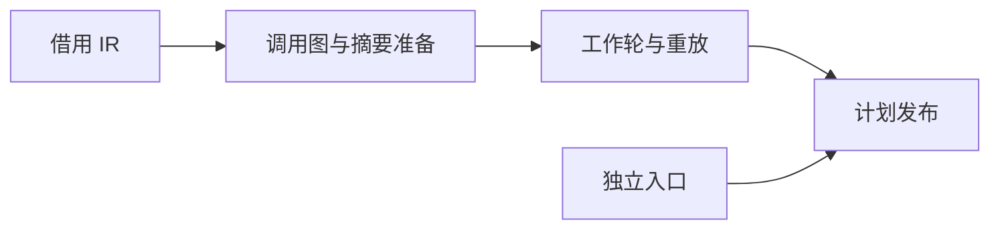
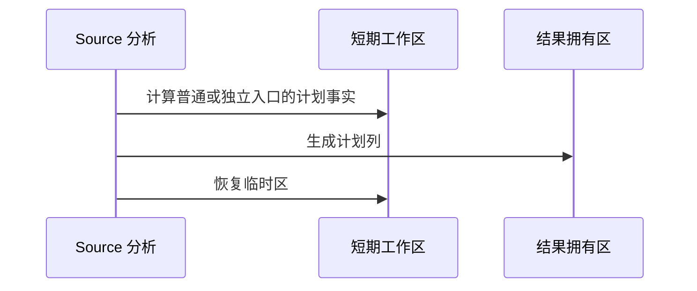

# 所有权摘要与计划发布自举

## Intent

把正式所有权分析的准备和结果发布迁进 RX/ZX。统一全程序与独立入口的计划输出，消除宿主重建摘要行和中间计划结果。

## Data

全程序入口先收集调用图，再创建摘要存储。旧宿主从两块字节区遍历构造四组行描述符。常规分析和独立入口都先把分析结果交回宿主，才在另一次生成调用里发布计划。重放也将计划写入同一最终表示。

## Edges

保留初始化、求解、重放和错误传播的原顺序。摘要行只借用字节区。缓存键、计划槽号、所有权结果的生命周期和并发访问继续遵守现有契约。

## Answer

沿 `analyzeWithConcurrency` 与 `analyzeEntry` 检查 Zig 退出的职责。集中验收常规与独立入口、缓存记录与重放、现有分配失败路径和固定清单性能，并更新收敛计划。

调用图与摘要存储共用一个 RX 入口。Source 在两块连续字节区上计算区间，按输入和输出分别一次写完保证与需求视图。四张行表按最终长度分配，无逐项扩容。底层字节区仍只分配两份，Zig 提供行描述符的物理缓冲及类型视图。通用的内存写入原语只写字节切片的描述符。[准备编排](../../packages/genz/src/analysis/uniqueness/program/prepare.rx) · [摘要行写入](../../packages/genz/src/analysis/uniqueness/summaries/rows.zx) · [内存原语](../../packages/core/src/memory/write_column.zig)

常规访问和独立入口各自保留原求解流程，在同一次 RX 调用中共用计划发布。计算继续使用临时区，发布切换到结果拥有区，直接生成标志、更新路径、转移和槽位。宿主只取最终切片，删除了独立入口的重复视图绑定和第二次计划生成调用。重放中重新分析的正文复用同一路径。[常规计划](../../packages/genz/src/analysis/uniqueness/function/plan/visit.rx) · [独立入口](../../packages/genz/src/analysis/uniqueness/function/entry/analyze.rx) · [计划发布](../../packages/genz/src/analysis/uniqueness/function/plan/publish.zx)

### 验收

Zig 0.17.0 ReleaseSmall，16 个生成分区，候选由上一代 Source 引导器构建。候选的 25 个构建步骤和初始词法 seed 的 14 步通过。主清单、增长清单、集合清单分别比较 14,490、464、100 份同输入生成文件，共 15,054 份逐字节一致。候选引导器 SHA-256 为 `0d54adb34542c5b869f216dcde0fcf75ee557d2ef61e06dd0bed4c14af94e112`。

八组现有回归覆盖函数分析与执行、所有权契约、缓存、循环初值、借用返回、上下文借用和对象集合追加。269 个构建步骤、520 项 Zig 测试及 36 项运行脚本检查全部通过。

常驻生成使用已有所有权夹具，依次生成新建数组的版本、改为借用输入的版本并恢复原版。三次的 41 份 Zig 文件各自与独立冷生成一致。

### 性能

三个工具均由 Source 引导构建，运行时使用 Source 分析和生成。macOS arm64、Zig 0.17.0 ReleaseSmall、固定 735 个入口和 16 个生成分区，关闭常驻生成。三轮交错取中位数，范围是源码分析与 Zig 生成。

| 指标                           | 固定基线 | 上一批 |  本批 |
| ------------------------------ | -------: | -----: | ----: |
| 冷生成墙钟（秒）               |     2.86 |   2.60 |  2.63 |
| 冷生成 CPU（秒）               |    12.47 |  12.64 | 12.72 |
| 冷生成进程树采样峰值 RSS（MB） |    886.4 |  708.0 | 713.7 |
| 冷生成单进程峰值 RSS（MB）     |    963.1 |  723.9 | 737.2 |
| 热生成墙钟（秒）               |     2.24 |   1.95 |  1.97 |
| 热生成 CPU（秒）               |     8.44 |   8.20 |  8.25 |
| 无修改生成墙钟（秒）           |     0.04 |   0.03 |  0.03 |

相比上一批，冷生成墙钟增加 0.03 秒，CPU 增加 0.08 秒。进程树采样峰值增加约 5.6 MB，三轮样本范围重叠。单进程系统峰值增加约 13.3 MB，三轮从 723.3～725.4 MB 变为 735.9～738.8 MB，同口径采样物理内存峰值中位数增加约 2.2 MB。单进程系统峰值仍在前一轮类型工作区验收的 719.7～740.1 MB 范围内，接续批次需继续跟踪。相对固定基线，冷生成墙钟减少 0.23 秒，CPU 累计增加 0.25 秒，进程树峰值下降 172.7 MB。

本批与上一批的 11,753 份固定清单产物一致，候选自身冷暖产物一致，两批所有权缓存正文保留相同的 SHA-256 `cdf9fa7e0f33002a95dc097b2837de781d67e6e519a452fb97f89f7c0bbf3a23`。

### 仍在执行的宿主职责

摘要的初次保证值填充仍由 Zig 选择现有 Source 生命周期入口。主流程仍持有重放资源、工作轮和退出状态，重放复查的游标循环也还在 Zig。接续以 `Context.visitRound` 和 `verify.run` 为入口，合并每轮取得工作、提交反馈及发布结果的状态，核对接受与回退共用的路径。

小范围生成发现按 `map` 构造摘要行会引入逐项扩容。最终实现利用输入数量已知的契约，按原来的分配规模一次预留行表。这个检查应继续用于从 Zig 的定长列迁入 Source 的路径，先核对生成的分配形态再运行全组回归。
