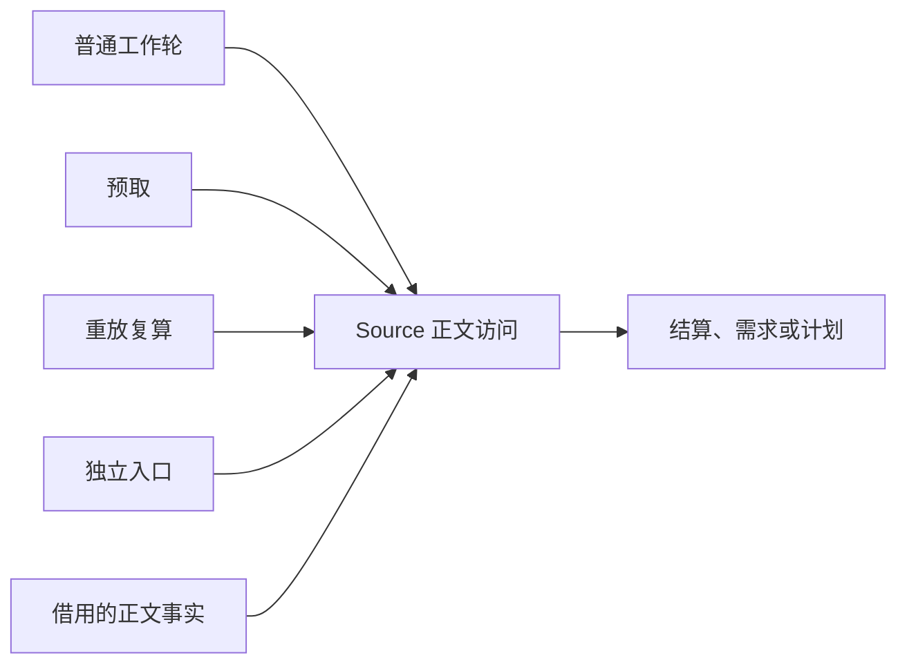
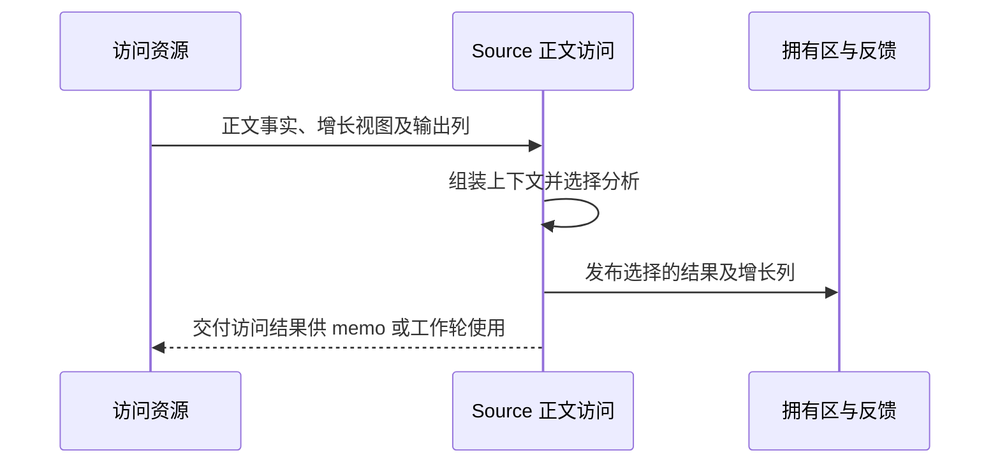

# 所有权正文分析访问共用自举

## Intent

让常规工作轮、预取、重放复算及独立入口共用 Source 正文分析和结果发布。收掉正式路径中以 Zig `Function` 组装分析上下文、选择每个访问调用的方法和单独安装增长列的逻辑。

## Data

`Visit.execute`、预取 worker 和 `verify.recover` 通过 `compute.run` 调用相同的准备步骤，随后分别绑定结算、需求和计划入口。独立入口另外绑定一次计划。正文事实已由 Source 创建，由当前访问线程或获得正文的 worker 延迟安装。

## Edges

保留正文事实延迟准备、worker 读集和 memo 生命周期。普通访问与重放未命中保留摘要更新时机，预取继续推迟效果。独立入口沿用本地需求收敛。初始 seed 继续使用原有分析。

## Answer

从各正式入口核对共用分析与类型化写回，确认退出的 Zig 上下文和调用。用同一候选集中核对生成文件、已有回归、常驻编辑和固定性能基线。

四种入口向 Source 借出正文事实、摘要、增长视图和输出列。Source 组装共享分析上下文并取得输入、输出摘要，随后通过同一正文访问入口选取分析阶段。结算和需求各自产生变化行和可选的预取读集。需求发布只在增长或临时恢复时安装新增长列。普通计划和独立计划根据调用场景选取闭包计算或本地收敛，再共用计划构造与发布。[正文访问](../../packages/genz/src/analysis/uniqueness/function/visit/run.rx) · [计划访问](../../packages/genz/src/analysis/uniqueness/function/plan/visit.rx) · [需求写回](../../packages/genz/src/analysis/uniqueness/function/result/publish_demand.zx)

Source 引导版本已退出 Zig `Function` 的访问组装和三个按阶段的原生绑定。Native 入口保留物理列绑定、正文事实第一次取得时的拥有区和结果互操作。工作轮仍负责领取、memo 读写与反馈推进，重放仍负责未命中后的恢复和重新进入扫描。[正文绑定](../../packages/genz/src/zx/uniqueness/program/visit/analysis.zig) · [轮次调度](../../packages/genz/src/zx/uniqueness/program/host.zig)

### 修正按值传递

初版同域生成正文视图和分析步骤。固定清单冷生成墙钟中位数从 2.59 秒升到 3.93 秒，CPU 从 12.60 秒升到 20.86 秒。推导时间相近，差异集中在 Zig 生成。检查生成代码发现，构造视图使元数据及其查询列布局变成按值记录，热路径反复展开这些字段。

尝试显式共享整个元数据时，布局推导同时改变了下游类型，固定清单出现无效读。最终将 Source 正文视图构造单独生成。构造产物放在当前访问的临时区，分析入口按原有只读引用接收，类型化列继续借出原始地址。跨生成模块的兼容检查验证了可空字段和同名的生成 ABI 句柄。修复后的单次同清单冷生成通过，生成阶段从初版的约 2.2 秒回到约 0.88 秒。[正文视图](../../packages/genz/src/analysis/uniqueness/function/visit/context.zx) · [布局校验](../../packages/core/src/columns.zig)

### 验收

初版九组既有回归覆盖函数分析和运行、函数效果、所有权契约、缓存、借用与集合增长。278 个构建步骤、560 项 Zig 测试和 36 项运行脚本检查通过。视图布局修复后，沿相同环境重新构建候选，集中补验经过正文访问的入口。

最终候选使用 Zig 0.17.0 ReleaseSmall 和 16 个生成分区，由上一代 Source 引导器构建，26 步通过。初始词法 seed 的 14 步通过。主清单、增长、集合、比较及正文视图清单分别有 14,540、464、100、31、7 份生成文件，共 15,142 份，与构建候选时使用的生成结果逐字节一致。引导器 SHA-256 为 `0e184f6fe55189c9cd8157a17a443563e9ba5fca85bbe594c98d52ed7312418e`。

最终候选在首次生成、常量编辑、返回值所有权变化及恢复原版的四步常驻夹具中，产物指纹与上一代一致。

修复后补验整批正文访问受影响的五组现有回归。函数分析与执行、缓存所有权、所有权契约和循环初始归属共 162 个构建步骤、380 项测试通过。

### 性能

三个工具均由 Source 引导构建，运行时使用 Source 分析与生成。macOS arm64、Zig 0.17.0 ReleaseSmall、735 个固定入口、16 个生成分区。关闭常驻生成时做三轮交错对照，取中位数。计时涵盖源码分析和 Zig 生成。

| 指标                           | 固定基线 | 上一批 |  本批 |
| ------------------------------ | -------: | -----: | ----: |
| 冷生成墙钟（秒）               |     2.84 |   2.61 |  2.61 |
| 冷生成 CPU（秒）               |    12.49 |  12.80 | 12.78 |
| 冷生成进程树采样峰值 RSS（MB） |    895.8 |  703.4 | 706.0 |
| 冷生成单进程峰值 RSS（MB）     |    942.1 |  726.6 | 738.6 |
| 热生成墙钟（秒）               |     2.21 |   1.96 |  1.95 |
| 热生成 CPU（秒）               |     8.48 |   8.27 |  8.23 |
| 无修改生成墙钟（秒）           |     0.04 |   0.03 |  0.03 |

较上一批，冷生成墙钟持平，CPU 减少 0.02 秒。进程树采样峰值增加 2.7 MB，单进程峰值增加 12.0 MB，两项前后样本范围重叠。相对固定基线，冷生成墙钟缩短 0.23 秒，CPU 累计增加 0.29 秒，进程树峰值下降 189.8 MB。固定清单 11,753 份产物在上一批、本批及本批热生成之间逐字节一致。两批所有权缓存正文 SHA-256 均为 `cdf9fa7e0f33002a95dc097b2837de781d67e6e519a452fb97f89f7c0bbf3a23`。

同一固定清单启用常驻生成后，连续改动 lint 的字符串常量三次再恢复。各次产物指纹一致，每次只重新生成一份文件。三次编辑墙钟中位数为 0.423 秒和 0.428 秒，前后请求结束时最高 RSS 为 1,238.9 MB 和 1,245.0 MB。
