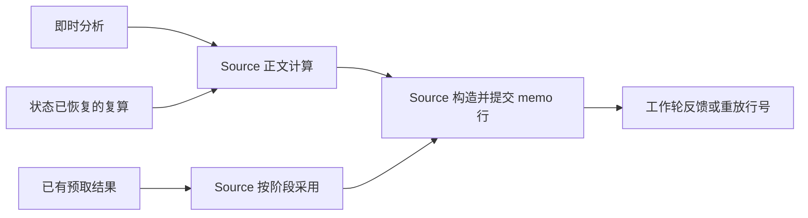
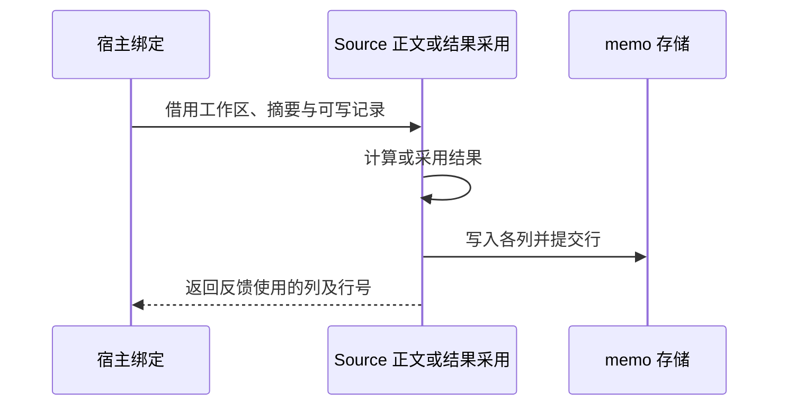

# 所有权正文结果采用与直接写回自举

## Intent

让即时分析与重放复算在正文 Source 调用内完成 memo 写回。将前台缓存和预取结果的采用接入同一套写回规则，缩小 `Visit.execute` 的宿主分派。

## Data

当前四类路径共用 Source 正文计算及 memo 存储，宿主仍组装结果记录并在两者之间调用写入。预取结算先持久保留结果再合并贡献，预取需求先安装增长列再应用并记录需求。缓存命中只更新摘要和反馈。

## Edges

缓存中已有的列继续借用。需跨 worker 或临时区存活的列按原所有权规则保留。预取结算维持先写回再合并贡献。若写回后的后续步骤失败，宿主仍须释放旧索引并保留已提交的前缀。

## Answer

按冻结清单及常驻编辑做产物对照，并跑受影响的既有回归。核对正式路径退出的宿主调用和剩余的轨迹、线程及工作区边界。

### 正式路径

即时分析和重放复算进入同一条 Source 正文流水。结果字段直接装入已绑定的记录，Source 负责提交，并返回重放需要的行号。需求记录借用已安装增长列的切片描述符。缓存命中、预取结算、需求和计划各走自己的 Source 采用路径，只有需要跨原拥有区保存的结果才执行原有保留步骤。

预取结算完成持久写回后才合并贡献。若合并失败，宿主按 Source 记录的已发布容量同步索引与可见前缀。普通和重放退出原 `Memo.putVisit` 往返。宿主仍选择缓存命中、预取接管或即时分析，并负责轨迹比较和原生存储绑定。

把同一批贡献同时传入结算保留和更新时，生成 ABI 曾要求对象指针表。两条路径现在共用跨步列视图，按原顺序直接读函数编号和等级列，避免为读取生成指针数组。

### 性能对照

候选由上一批已验收的 Source 生成器 `dcdb58d2e` 构建，运行使用本批 Source 分析与生成实现。冻结的 735 入口清单以 `ReleaseSmall` 和 16 个生成分区运行。固定基线、上一批和候选交替执行三轮，表中取中位数。

| 生成指标                   | 固定基线 | 上一批 |  候选 |
| -------------------------- | -------: | -----: | ----: |
| 冷墙钟（秒）               |     2.83 |   2.60 |  2.63 |
| 冷 CPU（秒）               |    12.52 |  12.67 | 12.73 |
| 冷进程树采样峰值 RSS（MB） |    894.3 |  704.5 | 707.7 |
| 冷单进程最大 RSS（MB）     |    960.2 |  728.2 | 732.4 |
| 热墙钟（秒）               |     2.20 |   1.96 |  1.97 |
| 热 CPU（秒）               |     8.46 |   8.27 |  8.30 |

相对上一批，冷墙钟增加 0.03 秒，冷 CPU 增加 0.06 秒，进程树峰值增加 3.2 MB，单进程峰值增加 4.2 MB。相对固定基线，冷墙钟累计减少 0.20 秒，冷 CPU 累计增加 0.21 秒，进程树峰值下降 186.6 MB。

冻结清单的 11,753 份生成文件和候选冷暖产物均一致。上一批和候选的 memo 载荷 SHA-256 均为 `cdf9fa7e0f33002a95dc097b2837de781d67e6e519a452fb97f89f7c0bbf3a23`。常驻编辑与恢复产物一致，编辑墙钟中位数从 0.429 秒到 0.426 秒，常驻最大采样 RSS 从 1,252.0 MB 到 1,259.1 MB。

### 阶段验收

Source 引导构建通过 26 个步骤，初始 seed 词法引导通过 14 个步骤。函数分析与执行、缓存所有权、函数效应、所有权契约和循环所有权共通过 171 个步骤、420 项测试。

上一批 Source 与本批候选对五份当前清单生成的 15,180 份文件逐字节一致，两套已有常驻编辑夹具都得到相同产物。生成的正文执行、结算采用、需求采用和计划保留入口没有额外装箱分配。候选引导器 SHA-256 为 `6b25b047ba53f778d42723149f4c680af96de96168a7f746e98109b7bcd22bc2`。
