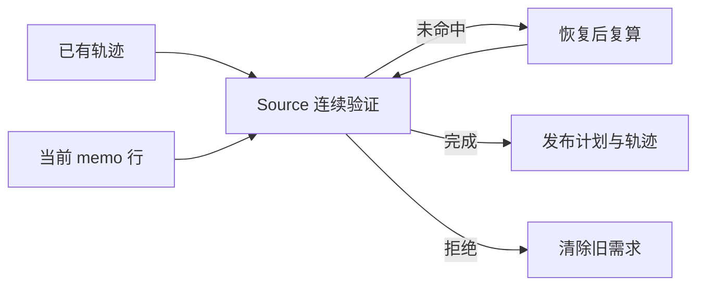
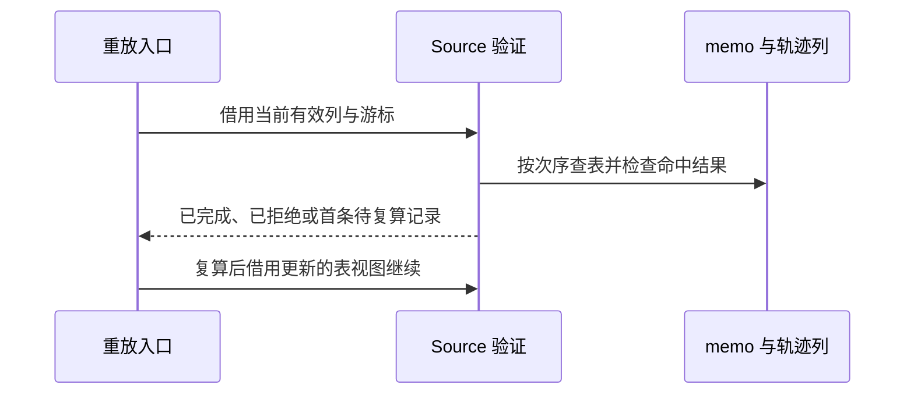

# 所有权缓存重放访问循环自举

## Intent

让 Source 连续访问所有权轨迹，核对缓存命中并暂存计划。以缓存未命中和资源分配为边界，收掉原有逐条 Zig 重放调度。

## Data

正式入口从 `Context.run` 进入 `verify.run`。每条访问由 Zig 请求下一游标，再读取 memo、核对摘要或暂存计划。轨迹和 memo 都已有可借用的行存储。复算可能扩容 memo，之前绑定的表列到此结束借用。

## Edges

序列保持原结算、需求和计划次序。只标记实际使用的 memo 行，计划发布前保留替换位置。复算沿用已验收的分析入口，允许扩容后重新绑定。seed 沿用现有路径。

## Answer

确认连续命中的查表、比较、计划暂存和终止由 Source 持有。从同一候选核对轨迹和生成产物，记录仍执行的复算边界和工作轮剩余依赖。

扫描从当前游标开始，重用已有轨迹推进和摘要撤销规则。每条访问按原结算、需求、计划顺序查表。命中当场核对，计划写入暂存区。未命中时退出扫描，当前缓存键已写入 memo，复算沿用该键。复算可能扩容，下一次扫描在宿主重新绑定表列之后开始。[重放循环](../../packages/genz/src/analysis/uniqueness/replay/shortcut/scan/run.zx) · [复算入口](../../packages/genz/src/zx/uniqueness/replay/shortcut/verify.zig)

最初尝试直接借用嵌套对象数组。生成 ABI 将其表示为指针表，并改变了其他调用使用的贡献记录布局。最终方案使用已有跨步列视图。结算、需求和增长比较由新的扫描与常规轨迹跟随共用。增长列逐项比较不一致时，在临时区排序后再核对。替换计划继续按完整行描述符写入，底层集合保留原有借用。[比较入口](../../packages/genz/src/analysis/uniqueness/replay/shortcut/scan/compare.rx) · [列绑定](../../packages/genz/src/zx/uniqueness/replay/ordered/columns.zig)

旧的逐条 Zig 游标调用和独立重放查表适配退出正式路径。仍在执行的宿主职责包括缓存未命中后的复算、重试和物理表视图绑定。普通工作的外层循环继续由 `Context.visitRound` 执行。

### 验收

Zig 0.17.0 ReleaseSmall，16 个生成分区。上一代 Source 引导器构建候选，25 步通过。初始词法 seed 的 14 步通过。候选生成的主清单、增长清单、集合清单和比较清单分别有 14,546、464、100 和 31 份产物，共 15,141 份，与构建候选时使用的生成结果逐字节一致。候选引导器 SHA-256 为 `e74f0ddd813d40437ae631d99f827adab162278473db9a157d5dc516ac62c369`。

既有常驻夹具依次执行首次生成、编辑常量、改变返回值所有权和恢复原版，四步产物指纹同上一代一致。

函数分析及运行、函数效果、所有权契约、缓存、借用与集合增长的九组回归通过，共 278 个构建步骤、560 项 Zig 测试和 36 项运行脚本检查。

### 性能

三个工具均由 Source 引导构建，运行时使用 Source 分析和生成。macOS arm64、Zig 0.17.0 ReleaseSmall、735 个固定入口、16 个生成分区。关闭常驻生成时以三轮交错测量取中位数，计时涵盖源码分析与 Zig 生成。

| 指标                           | 固定基线 | 上一批 |  本批 |
| ------------------------------ | -------: | -----: | ----: |
| 冷生成墙钟（秒）               |     2.84 |   2.68 |  2.63 |
| 冷生成 CPU（秒）               |    12.43 |  12.77 | 12.72 |
| 冷生成进程树采样峰值 RSS（MB） |    887.9 |  704.9 | 707.8 |
| 冷生成单进程峰值 RSS（MB）     |    926.2 |  717.4 | 730.1 |
| 热生成墙钟（秒）               |     2.23 |   1.96 |  1.96 |
| 热生成 CPU（秒）               |     8.42 |   8.27 |  8.29 |
| 无修改生成墙钟（秒）           |     0.04 |   0.03 |  0.03 |

相对上一批，冷生成墙钟和 CPU 均减少 0.05 秒。进程树采样峰值增加 2.9 MB，单进程峰值增加 12.7 MB，前后样本范围重叠。相对固定基线，冷生成墙钟缩短 0.21 秒，CPU 累计增加 0.29 秒，进程树峰值下降 180.0 MB。固定清单的 11,753 份生成文件在上一批、本批和本批热生成间一致，两批所有权缓存正文 SHA-256 均为 `cdf9fa7e0f33002a95dc097b2837de781d67e6e519a452fb97f89f7c0bbf3a23`。

同一固定清单启用常驻生成后，连续修改 lint 模块的字符串常量三次，再恢复原值。每次编辑实际重新分析 3 个模块并生成 1 份文件。五次产物指纹在两个工具间一致，恢复后的指纹与首次生成一致。三次编辑墙钟中位数为 0.424 秒和 0.423 秒。请求结束时采到的常驻进程最高 RSS 为 1,243.4 MB 和 1,246.3 MB。连续编辑的内存增长在迁移前后均存在。
