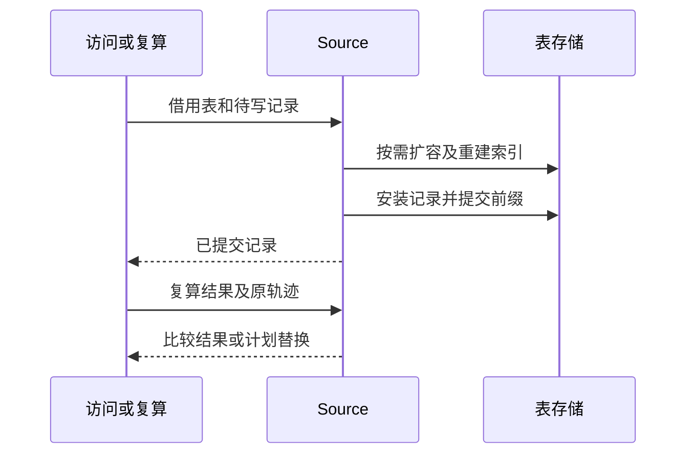

# 所有权记录写回与重放恢复自举

## Intent

让 Source 接管普通访问和重放复算共用的 memo 写回。容量检查、扩容后的索引选择、记录与可见前缀提交在同一条调用内完成。再把复算结果接回已有的 Source 重放扫描。

## Data

普通工作轮经 `Visit.save`、重放未命中经 `recover`，两条路径最终都调用 `Memo.putVisit`。旧 `Table.put` 在 Zig 检查空间并更换索引，再经独立入口发布记录。重放在扫描暂停后取回旧状态并复算，然后由 Zig 选择比较或暂存计划。

## Edges

磁盘加载继续使用同一摘要登记规则。扩容失败时保留旧索引和可见前缀，部分完成的物理容量仍归原表。状态恢复后的复算先写 memo，再比较结算或需求结果。计划复算只追加替换项，直到重放通过才发布。

## Answer

集中验收既有所有权与缓存回归、冷热生成产物和常驻编辑。以相同的清单与引导阶段对照墙钟、CPU 及峰值 RSS。

### 正式路径

四类记录共用 Source 写回。Source 检查可用容量，按需重建后选择新索引，沿同一摘要登记规则安装记录、发布长度并标记表已变更。磁盘加载继续使用该登记规则。Zig 保留有类型的存储绑定、旧分配释放和失败时的容量同步。

缓存未命中后的复算返回已写入的 memo 行号。Source 用该行继续原有扫描，复用结算和需求比较、计划暂存及拒绝清理。复算通过已绑定的新表视图重入，无需再次生成摘要或查询该行。旧的 Zig 复算结果分派与独立计划追加入口已退出。恢复状态、实际正文复算与普通工作轮的外层推进仍经宿主。

### 性能对照

候选由上一批已验收的 Source 生成器 `a0bfccf59` 构建，运行使用本批 Source 分析和生成实现。冻结的 735 入口清单在 `ReleaseSmall` 下使用 16 个分区。固定基线、上一批和候选交替执行三轮，表中取中位数。

| 生成指标                   | 固定基线 | 上一批 |  候选 |
| -------------------------- | -------: | -----: | ----: |
| 冷墙钟（秒）               |     2.86 |   2.64 |  2.66 |
| 冷 CPU（秒）               |    12.50 |  12.78 | 12.83 |
| 冷进程树采样峰值 RSS（MB） |    896.3 |  703.5 | 707.6 |
| 冷单进程最大 RSS（MB）     |    927.4 |  734.7 | 727.3 |
| 热墙钟（秒）               |     2.23 |   1.97 |  1.99 |
| 热 CPU（秒）               |     8.50 |   8.33 |  8.33 |

相对上一批，冷墙钟增加 0.02 秒，冷 CPU 增加 0.05 秒，进程树峰值增加 4.2 MB，单进程最大 RSS 下降 7.4 MB。相对固定基线，冷墙钟累计减少 0.20 秒，冷 CPU 累计增加 0.33 秒，进程树峰值下降 188.6 MB。

冻结清单的 11,753 份产物与上一批逐字节一致，候选冷暖产物也一致。上一批与候选的 memo 载荷 SHA-256 均为 `cdf9fa7e0f33002a95dc097b2837de781d67e6e519a452fb97f89f7c0bbf3a23`。常驻编辑及恢复产物一致，编辑墙钟中位数从 0.424 秒到 0.428 秒，常驻最大采样 RSS 从 1,259.6 MB 到 1,261.1 MB。

### 阶段验收

Source 引导构建通过 26 个步骤，初始 seed 的词法引导通过 14 个步骤。九组已有回归共通过 560 项 Zig 测试与 36 项运行检查。用上一批 Source 和本批候选生成五份当前清单，15,160 份文件逐字节一致。小型集合夹具及冻结清单的常驻编辑和恢复结果均一致。

检查生成 Zig，表发布路径没有额外装箱分配，增长仍使用原有行存储和桶分配原语。候选引导器 SHA-256 为 `46c7d139cedda908f1d38cca827343edc578f72987b156680ee5decb19870f01`。
