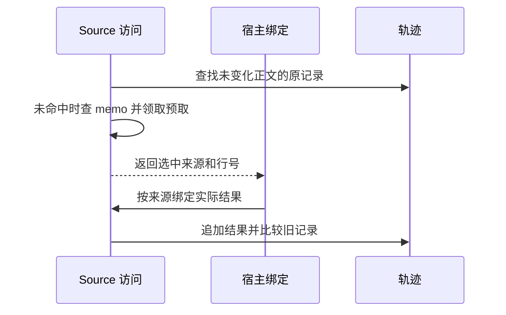

# 所有权访问来源与轨迹提交自举

## Intent

让 Source 接管普通访问的来源判断及轨迹提交。沿工作轮迁入旧轨迹读取、memo 查询、预取领取和校验，再将实际结果的追加及一致性比较接成一次 Source 调用。

## Data

原 `Visit.execute` 分别请求旧轨迹、memo 和预取，并把命中的结果交给 Source 采用。轨迹追加由 Source 执行，宿主再取出对应旧记录并调用另一条比较入口。已有 Source 支持摘要查表、原子领取、记录选择和各相位的结果比较。

## Edges

旧轨迹优先于 memo，其次采用预取，最后即时分析。即使命中缓存，也要完成预取领取和错误传播。预取读列在原子领取成功后访问。记录追加仍发生在比较之前，比较失败时保留已追加的前缀。各阶段只在原时点重置临时区。

## Answer

用固定清单、现有回归及常驻编辑核对生成结果、缓存字节和资源成本。记录保留的线程、原生列绑定和外层阶段边界。

### 正式路径

普通访问借用 memo、旧轨迹及预取结果的列描述，Source 决定采用的来源、命中标记及临时区重置时点。无 worker 时跳过结果槽绑定。有 worker 时，读列表按原顺序在原子领取后直接校验，选中预取时才读取结果值。

轨迹提交在同一次 Source 调用里追加两列、确认可见前缀并检查旧轨迹。追加成功后，比较失败也保留前缀。结算、需求和所有权计划继续复用原有比较规则，旧记录按偏移读取。

正式构建移除了独立的来源选择、memo 查询、预取领取和读集校验入口，以及轨迹游标和三类结果的独立比较入口。Zig 仍负责借用现有列、绑定具体结果类型、处理线程资源以及推进外层工作轮和复查。初始 seed 继续使用其自身实现。

### 性能对照

候选由上一批通过验收的 Source 引导器 `4873d8505` 构建，运行使用本批 Source 实现。冻结的 735 入口清单以 `ReleaseSmall`、16 个生成分区运行，固定基线、上一批与候选交替执行三轮。表中为各指标中位数。

| 生成指标                   | 固定基线 | 上一批 |  候选 |
| -------------------------- | -------: | -----: | ----: |
| 冷墙钟（秒）               |     2.83 |   2.59 |  2.61 |
| 冷 CPU（秒）               |    12.44 |  12.70 | 12.83 |
| 冷进程树采样峰值 RSS（MB） |    897.7 |  701.8 | 704.2 |
| 冷单进程最大 RSS（MB）     |    943.7 |  730.7 | 732.1 |
| 热墙钟（秒）               |     2.19 |   1.95 |  1.95 |
| 热 CPU（秒）               |     8.44 |   8.24 |  8.26 |

冷墙钟和 CPU 较上一批分别增加 0.02 秒和 0.13 秒，进程树峰值增加 2.4 MB。相对固定基线，冷墙钟累计减少 0.22 秒，CPU 累计增加 0.39 秒，进程树峰值下降 193.5 MB。常驻编辑中位墙钟保持约 0.423 秒，常驻最大采样 RSS 从 1,256.2 MB 增至 1,266.2 MB，继续沿用同一夹具跟踪。

冻结清单的 11,753 份生成文件及候选冷暖产物一致。上一批与候选的 memo 载荷 SHA-256 均为 `cdf9fa7e0f33002a95dc097b2837de781d67e6e519a452fb97f89f7c0bbf3a23`。两套常驻编辑夹具在每次编辑及恢复后均得到相同产物。

### 阶段验收

Source 引导构建通过 25 个步骤，初始 seed 词法引导通过 14 个步骤。函数分析与执行、缓存所有权、函数效应、所有权契约和循环所有权共通过 420 项测试。上一批 Source 与本批候选对当前四份清单生成的 15,159 份文件逐字节一致。

复核发现无 worker 时结果槽数组为空，因此将槽绑定移入既有 worker 分支。最终候选补验 199 项函数分析与缓存所有权回归，冻结清单产物和 memo 载荷一致。一次冷生成取样为墙钟 3.05 秒、CPU 12.86 秒，进程树采样峰值 703.9 MB。最终候选引导器 SHA-256 为 `89645d5b3c873eb44c544ae153bcee0b2c89402e9b66438a07d65b0165a78513`。
