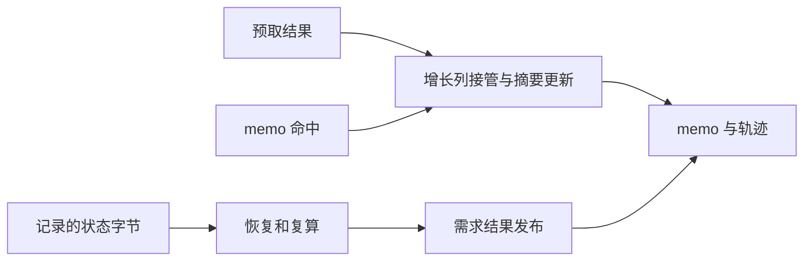
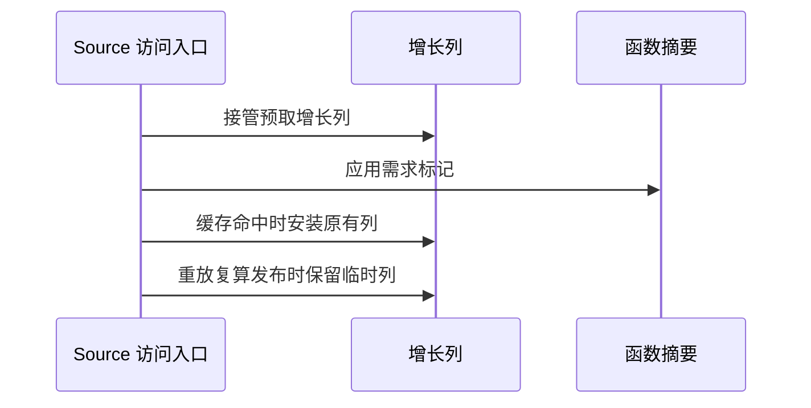

# 所有权访问状态交接自举

## Intent

让 Source 在同一条访问链决定如何采用预取结果、恢复缓存增长列并写入摘要。让重放复算在交付需求结果时保留临时恢复的增长列。

## Data

普通命中直接借用 memo 的增长列，预取新增的列暂时属于 worker。重放从缓存字节恢复的列属于复算工作区。三类来源的记录最终都能存入 memo，引用的存储必须覆盖后续访问。

## Edges

预取接管先安装增长列再应用摘要标记，普通命中保持相反顺序。重放复算保持原摘要与需求顺序。已经归 memo 所有的列继续借用。线程、分配器和 native 行视图沿用现有边界。

## Answer

核对需求结果采用与复算的正式入口，消除独立的 Zig 保留步骤。集中核对生成文件、缓存正文、现有回归和固定性能基线。

预取需求接管在 `visit/demand.rx` 中保留 worker 新增的两组增长列，完成后写入正文状态，再把需求标记应用到摘要。两列都分配成功后才改写正文的切片描述符。预取未增长和普通缓存命中直接安装已有切片。保留使用 memo 分配器，需求标记产生的变化行继续用工作轮临时分配器。[访问编排](../../packages/genz/src/analysis/uniqueness/program/visit/demand.rx) · [增长列接管](../../packages/genz/src/analysis/uniqueness/program/visit/growth.zx)

重放从缓存字节恢复增长列后同普通访问一样执行需求发布。暂存在复算分配区的列即使没有增长也会在发布时写入 memo 拥有区。该路径退出复算之后的 Zig 保留步骤和独立的增长列保留入口。增长标记仍根据实际变化产生。[需求发布](../../packages/genz/src/analysis/uniqueness/function/result/publish_demand.zx) · [重放复查](../../packages/genz/src/zx/uniqueness/replay/shortcut/verify.zig)

### 验收

Zig 0.17.0 ReleaseSmall，16 个生成分区。上一代 Source 引导器构建候选，25 步通过。初始词法 seed 的 14 步通过。候选生成的主清单、增长清单和集合清单分别与构建候选时使用的产物比较，14,523、464 和 100 份逐字节一致，共 15,087 份。候选引导器 SHA-256 为 `e0dd20b4833c16b7d2897e73644394a86d6a69dfb9430fc6214bc5d5f5aa3450`。

同一份常驻生成夹具依次执行首次生成、编辑常量、改变返回值所有权和恢复原版，四步产物指纹同上一代一致。

九组现有回归覆盖独立函数执行、归属检查、缓存与借用、函数效果和集合增长。278 个构建步骤、560 项 Zig 测试及 36 项运行脚本检查通过。

### 性能

三个工具均由 Source 引导构建，运行时使用 Source 分析和生成。macOS arm64、Zig 0.17.0 ReleaseSmall、735 个固定入口、16 个生成分区，关闭常驻生成。三轮交错取中位数，计时涵盖源码分析与 Zig 生成。

| 指标                           | 固定基线 | 上一批 |  本批 |
| ------------------------------ | -------: | -----: | ----: |
| 冷生成墙钟（秒）               |     2.86 |   2.58 |  2.63 |
| 冷生成 CPU（秒）               |    12.54 |  12.65 | 12.81 |
| 冷生成进程树采样峰值 RSS（MB） |    886.3 |  708.6 | 705.0 |
| 冷生成单进程峰值 RSS（MB）     |    921.8 |  725.4 | 729.0 |
| 热生成墙钟（秒）               |     2.20 |   1.96 |  1.96 |
| 热生成 CPU（秒）               |     8.49 |   8.26 |  8.24 |
| 无修改生成墙钟（秒）           |     0.04 |   0.03 |  0.03 |

相对上一批，冷墙钟增加 0.05 秒，CPU 增加 0.16 秒。冷生成进程树峰值下降 3.7 MB，单进程峰值增加 3.6 MB，前后样本范围重叠。相对固定基线，冷生成墙钟缩短 0.23 秒，CPU 累计增加 0.27 秒，进程树峰值下降 181.4 MB。

固定清单共 11,753 份生成文件，候选与上一批逐字节一致，候选冷暖产物也一致。两批所有权缓存正文 SHA-256 均为 `cdf9fa7e0f33002a95dc097b2837de781d67e6e519a452fb97f89f7c0bbf3a23`。
