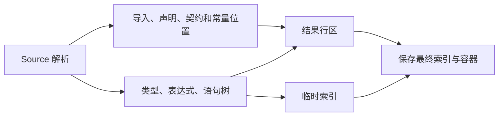
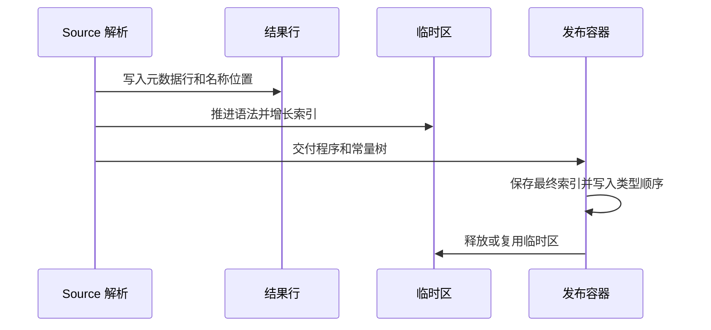

# 模块解析结果发布收口

## Intent

让导入、别名、声明、枚举成员、契约、函数名和常量位置直接进入结果区。普通模块、常量和独立表达式在同一发布链保存语法索引，移除 Zig 对解析结果的通用递归复制。

## Data

词法、类型、表达式和语句行已在 Source 中构造。模块元数据及常量容器仍走递归复制。导入别名会替换已有名称，常量同时持有类型树、表达式树、语句树及类型顺序，发布时需要提交这些容器中的最终索引。[旧发布路径](../../packages/compiler/src/zx/frontend/compact_output.zig) · [导入替换](../../packages/compiler/src/zx/frontend/parser/imports/alias.zx) · [常量记录](../../packages/compiler/src/zx/frontend/parser/constants/model.zx)

## Edges

别名替换与原始导出名称共享既有的索引语义。名称位置与契约跨度越过临时区时持有自己的记录。保留常量中三种语法树的精确长度，以及类型顺序直接写入的发布约定。诊断与分配失败释放本次结果。已解析兼容接口沿用其输入输出形状。

## Answer

核对正式发布路径只写入最终索引与容器。复用导入别名、名称来源、契约和缓存回归，固定清单验证产物一致性和性能。然后沿正式入口核对遗留的兼容 AST 接口，再接续共享 IR 与类型存储。

### 验收

导入别名、声明、契约、函数名和常量位置接入共用结果区。宿主按固定布局保存索引和常量树容器。正式的模块、独立表达式和 RX 属性入口退出通用递归复制。兼容 AST 接口仍保留，继续在正式闭包审计中按调用方核对。

以 `b153f92dd` 生成的 Source 引导器构建候选，25 个步骤通过。候选使用 Source 分析和生成后端重生成四份清单，15,593 份产物逐字节一致。种子构建 32 个步骤通过。集中回归 150 个构建步骤、327 项 Zig 测试和 103 项 CLI 与 RX 集成检查通过，覆盖缓存、表达式、原生声明、名义类型、路径、导入顺序、契约和库入口。

Zig 0.17.0、ReleaseSmall、固定冻结清单和相同缓存配置下，比较上阶段与候选生成的 Source 引导器。上阶段与候选的 11,753 份冷暖输出逐字节一致。固定对照自身的冷暖输出一致，作为下表的累计性能基线。下表为三次配对结果的中位数。

| 场景 | 工具     | 墙钟（秒） | CPU（秒） | 进程树峰值（字节） | 单进程峰值（字节） |
| ---- | -------- | ---------: | --------: | -----------------: | -----------------: |
| 冷   | 固定基线 |       2.85 |     12.44 |        885,358,592 |        928,743,424 |
| 冷   | 上阶段   |       2.60 |     12.88 |        659,881,984 |        685,277,184 |
| 冷   | 候选     |       2.60 |     12.87 |        655,392,768 |        681,639,936 |
| 热   | 固定基线 |       2.22 |      8.49 |        893,419,520 |        934,379,520 |
| 热   | 上阶段   |       1.97 |      8.26 |        644,726,784 |        644,743,168 |
| 热   | 候选     |       2.01 |      8.35 |        642,269,184 |        642,285,568 |

候选冷生成较上一阶段墙钟持平、CPU 减少 0.01 秒、进程树峰值减少 4.5 MB。相对固定基线，冷墙钟减少 0.25 秒、CPU 增加 0.43 秒、进程树峰值减少 230.0 MB。常驻编辑中位数由 0.426 秒降至 0.425 秒，峰值减少 2.4 MB，输出哈希一致。

共享 IR 与类型表进入实现。混合项目并行分析仍为每个正文复制共享类型基表，随后在联结中只登记增量。优先把这两步接到同一份增量，保留原类型 ID，以及批次间表增长后的联结语义。
