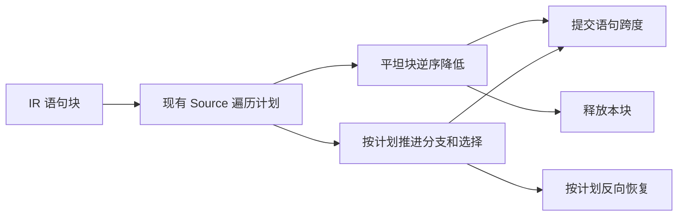

# 正式闭包与语句遍历执行自举

## Intent

沿正式 genz 降低路径迁出语句计划执行。让普通语句逆序、分支和选择的阶段，以及失败时的作用域恢复由 Source 控制。

## Data

正式打印已经从原生入口借用 AST 列，并由 Source 按范围或索引遍历。普通、值和迭代函数的语句入口仍执行 Zig 的计划循环、逆序写入、条件保存、分支合并以及选择与作用域回滚。[打印入口](../../packages/genz/src/printer/host.zig) · [语句入口](../../packages/genz/src/zx/statements.zig)

## Edges

保留计划顺序、临时字节区、原来的失败与作用域恢复顺序。仅在动作成功后推进。Zig 保留正在写入的原生 AST、分配容器和列访问。沿用初始 seed 的独立实现。

## Answer

正式降低入口将原语句计划借给执行模块。RX 按平坦块和嵌套块分流，并在嵌套动作失败时显式调用回滚。ZX 推进逆序游标、决定选择项的比较与字面量发射顺序，并沿原计划记录回收已开启的作用域。Zig 执行单条语句降低和 AST 写入，继续管理原生作用域与分配器。[执行入口](../../packages/genz/src/analysis/statements/traversal/execute/run.rx) · [原生存储](../../packages/genz/src/zx/statements/traversal/host.zig)

以 `a1704c3c3` 的 Source 引导器构建候选，共 25 步通过。候选使用 Source 分析和生成处理同样的四份清单，15,934 份产物逐字节一致，排除工具身份戳。执行模块借用计划列推进，由宿主提供空分配器，生成代码未对计划列分配或复制数据。

候选的六组回归通过 1,112 个构建步骤和 1,033 项测试，覆盖模块化循环、匹配、布尔分支、顺序 RX、资源失败与借用寿命。有无视图的长度查询和元素读取两组对照，每条路径均分配一次、80 字节。

### 性能

复用固定的 735 入口、16 分区清单。Zig 0.17.0、ReleaseSmall，两套引导器均由 Source 生成并使用 Source 分析和发射。上一阶段与候选交错三轮取中位数。两代冷生成和各自热重建的 11,753 份文件一致，排除工具身份戳。

| 状态   | 工具     | 墙钟（秒） | CPU（秒） | 进程树峰值（字节） | 单进程峰值（字节） |
| ------ | -------- | ---------: | --------: | -----------------: | -----------------: |
| 冷生成 | 固定基线 |       2.82 |     12.43 |        884,768,768 |        934,051,840 |
| 冷生成 | 上一阶段 |       2.58 |     12.97 |        659,095,552 |        686,850,048 |
| 冷生成 | 候选     |       2.57 |     12.92 |        661,471,232 |        683,999,232 |
| 热重建 | 上一阶段 |       1.92 |      8.26 |        644,513,792 |        644,530,176 |
| 热重建 | 候选     |       1.91 |      8.26 |        643,366,912 |        643,383,296 |

冷生成相对上一阶段墙钟减少 0.01 秒，CPU 减少 0.05 秒，进程树峰值增加 2.38 MB，单进程峰值减少 2.85 MB。相对固定冷基线，墙钟减少 0.25 秒，CPU 累计增加 0.49 秒，进程树峰值减少 223.3 MB。无改动时墙钟与 CPU 均为 0.03 秒。本批性能测量覆盖引导生成，完整 Zig 冷构建沿用历史记录。[固定基线](引导输出树和分区发布自举.md)

继续核对单条语句发射，包括调用前的 Store 处理、局部绑定和结果段合并，以及 AST 列的写入和存储。
