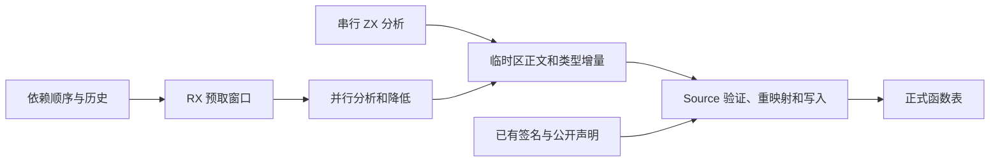
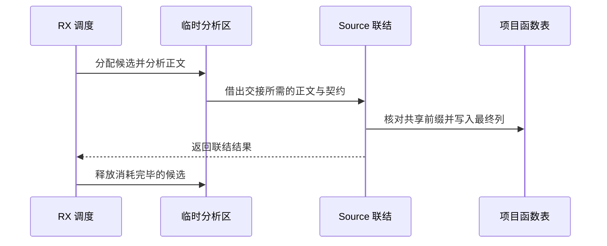

# 正文 IR 交接与预取自举

## Intent

让混合项目联结直接读取分析完成的正文列，由最终函数表发布步骤完成必要的编号重映射和数据保留。把同行依赖层的候选推进与窗口准备交给 RX/ZX。

## Data

此前 ZX 分析先在临时区构造正文，再复制正文、契约和公开声明去等待混合联结。最终函数表写入时会重新拥有全部正文列，混合联结本来就使用签名阶段登记的公开声明。预取已有 Source 候选查询和并行窗口规则，Zig 在两者之间遍历候选，遇到预备失败就查找下一项。[分析发布](../../packages/compiler/src/zx/analysis/publication/module/publish.rx) · [联结写入](../../packages/compiler/src/zx/modules/artifact/materializing/publication/link.rx) · [预取](../../packages/compiler/src/rx/analysis/project/mixed/ahead.zig)

## Edges

临时正文借用只在正式的 Release 混合 ZX 路径启用。公开分析结果、独立 ZX 与 Debug 全量验证按各自原有的持有契约得到完整结果。并行结果以准备时的共享前缀作基准，联结前再次检查版本。资源释放要覆盖写入成功、失败和被历史复用跳过的三种结果。

## Answer

逐条核对串行、并行、递归与 Store 正文的借用期，在完整调用路径验证链接、恢复、回退和失败。完整 Source 产物逐字节比较，集中验收生成与常驻编辑的墙钟、CPU 和进程内存。

正文借用与预取编排已接到正式入口。Source 选择直接借用还是保留完整分析结果。混合联结使用签名阶段已有的公开声明，只在最终写入时重映射和保留正文列。串行复用事务的临时区，并行在消耗候选后结束正文借用，随后按窗口复用线程的分配区。整窗清理覆盖回退、错误和跳过。

预取由 RX 串起开始、收集和分派计算，ZX 查找合格候选并在准备失败时补位。Zig 连接解析、线程和实际容量，在 seed 路径保留原准备循环。常驻历史前缀能跳过解析和正文分析，接续迁移它的对齐、列写入与范围提交。

以 `aec781f1f` 的 Source 引导器生成候选，25 个构建步骤通过。用候选与上一 Source 工具重生成同一份候选源码，四份清单的 15,605 份生成产物逐字节一致。集中回归 137 个构建步骤、412 项 Zig 测试和 17 项 RX 磁盘项目及 Store 运行检查通过。调整分配区后补验并行推导和语义缓存，112 项通过。

最初每个并行候选独立向全局分配器取得临时区，冷生成进程树峰值较上阶段增加 24.6 MB。进程区域采样把增长定位到匿名内存。改为从线程已有的区分配候选空间，联结结束后回收候选，窗口切换再重置线程区。复测撤掉了这部分增长，同时保留了正文借用。

Zig 0.17.0、ReleaseSmall、16 分区和同一冻结清单下，配对的候选与上一阶段冷暖输出各有 11,753 份文件逐字节一致。固定工具的性能数据沿用验收时的同配置结果。三次配对中位数据如下。

| 场景 | 工具     | 墙钟（秒） | CPU（秒） | 进程树峰值（字节） | 单进程峰值（字节） |
| ---- | -------- | ---------: | --------: | -----------------: | -----------------: |
| 冷   | 固定基线 |       2.82 |     12.45 |        890,372,096 |        921,223,168 |
| 冷   | 上阶段   |       2.57 |     12.84 |        664,322,048 |        687,652,864 |
| 冷   | 候选     |       2.53 |     12.79 |        660,668,416 |        688,865,280 |
| 热   | 固定基线 |       2.20 |      8.45 |        894,156,800 |        934,199,296 |
| 热   | 上阶段   |       1.92 |      8.29 |        644,808,704 |        644,825,088 |
| 热   | 候选     |       1.90 |      8.27 |        643,465,216 |        643,481,600 |

冷生成比上一阶段快 0.04 秒，CPU 减少 0.05 秒，进程树峰值减少 3.7 MB，单进程峰值增加 1.2 MB。相对固定冷基线，墙钟减少 0.29 秒，CPU 增加 0.34 秒，进程树峰值减少 229.7 MB。常驻编辑耗时中位数从 0.428 降到 0.423 秒，峰值减少 1.5 MB，逐次输出哈希一致。
