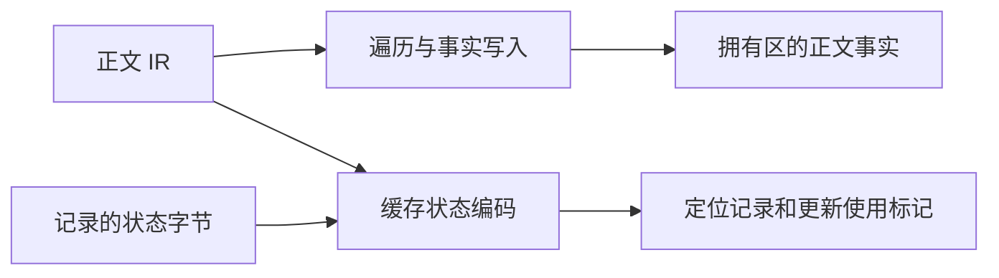
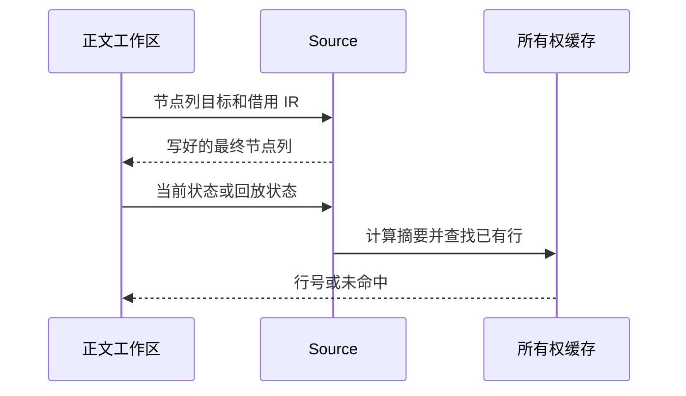

# 正文事实与所有权缓存自举

## Intent

让常规访问、预取和重放复算共用 Source 管理的正文事实。节点列直接写最终位置，缓存编码、命中查询与使用标记在同一条 Source 路径完成。

## Data

正文遍历在临时区建立计时和区域列，返回后由 Zig 调第二个生成入口，把这些列同其他最终事实一起复制。缓存查询先由 Source 编码，随后由 Zig 哈希并进入独立的表查找。重放的摘要按相同协议构造，使用另一条 Zig 路径查表。

## Edges

保持遍历时钟、列编号、缓存键字节和失败传播。问询预取只检查命中，实际采用才更新使用标记。最终列、临时图和缓存缓冲保持各自的原分配器。

## Answer

沿三类正文访问核对退出的 Zig 调用。集中验收同输入产物、缓存正文、常驻编辑、所有权回归和固定性能基线。

Source 按表达式数量在拥有区创建计时、结束时刻、区域和重复作用域四列。遍历直接写这些列，发布时借用原切片。只需要可达性与定义的流向分析沿用简化遍历，不分配这些列。其余短期图和使用事实仍遵守原来的保留规则，在同一个 RX 入口交付最终正文。原先的独立正文发布调用退出。[正文准备](../../packages/genz/src/analysis/uniqueness/function/prepare/build.rx) · [遍历](../../packages/genz/src/analysis/uniqueness/order/walk.zx)

普通访问从状态编码直接走到哈希和表索引，重放从已记录字节进入同一个命中检查。摘要写到 memo 已有的 32 字节区域，底层继续使用原来的 SHA-256 实现，重放按三段输入增量哈希。预取探测只返回行号，常规与重放采用时才设置记录的使用位。宿主继续借出行视图并读取类型化记录，记录插入沿用原有的 Source 发布规则。[普通查询](../../packages/genz/src/analysis/uniqueness/memo/encoding/lookup.rx) · [重放查询](../../packages/genz/src/analysis/uniqueness/memo/encoding/replay_key.zx) · [使用标记](../../packages/genz/src/analysis/uniqueness/memo/table/touch.zx)

### 验收

Zig 0.17.0 ReleaseSmall，16 个生成分区，候选由上一代 Source 引导器构建。候选构建 25 步及初始词法 seed 的 14 步通过。主清单、增长清单和集合清单分别比较 14,528、464 和 100 份同输入生成文件，共 15,092 份逐字节一致。最终候选引导器 SHA-256 为 `c0b54e35009549f84cafe3562af0e445fbbb7d8da515924ec9bd05d330993504`。

既有常驻夹具在首次生成、编辑常量、改变返回值的所有权和恢复原版四个步骤的产物指纹与上一代一致。

初测覆盖九组所有权、函数分析与执行、分配及集合回归，278 个构建步骤、560 项 Zig 测试和 36 项运行检查通过。修正编码缓冲后，补跑函数分析、独立执行和缓存所有权三组回归，100 个步骤和 199 项测试通过。重新核对三份生成清单与常驻夹具。

### 编码缓冲修正

首次完整对照中，进程树峰值中位数从 705.9 MB 升至 1,184.4 MB。生成代码显示，中间查表函数接收并返回整个编码状态时把缓冲标为共享。下一次编码更新共享缓冲时生成新副本，旧副本留在 memo 的分配区。

查表函数改为只读取字节和有效长度，只返回命中行号。查表调用可以弱化自己的临时视图，外层 RX 将原来的编码状态交回缓存。小范围生成确认返回的状态保留原缓冲的所有权标记，随后重建候选并复测。

### 性能

三个工具均由 Source 引导构建，运行时使用 Source 分析和生成。macOS arm64、Zig 0.17.0 ReleaseSmall、735 个固定入口、16 个生成分区，关闭常驻生成。三轮交错取中位数，计时涵盖源码分析与 Zig 生成。

| 指标                           | 固定基线 | 上一批 |  本批 |
| ------------------------------ | -------: | -----: | ----: |
| 冷生成墙钟（秒）               |     2.86 |   2.59 |  2.59 |
| 冷生成 CPU（秒）               |    12.56 |  12.70 | 12.71 |
| 冷生成进程树采样峰值 RSS（MB） |    885.5 |  707.7 | 704.5 |
| 冷生成单进程峰值 RSS（MB）     |    928.5 |  729.9 | 735.9 |
| 热生成墙钟（秒）               |     2.22 |   1.96 |  1.96 |
| 热生成 CPU（秒）               |     8.49 |   8.27 |  8.23 |
| 无修改生成墙钟（秒）           |     0.04 |   0.03 |  0.03 |

修正后冷生成进程树峰值回到 704.5 MB，较上一批下降 3.2 MB。冷暖墙钟持平，冷 CPU 增加 0.01 秒，热 CPU 减少 0.04 秒。单进程峰值中位数增加 6.0 MB，三轮样本范围与上一批重叠。相对固定基线，冷生成墙钟减少 0.27 秒，CPU 累计增加 0.15 秒，进程树峰值下降 180.9 MB。

固定清单的 11,753 份产物与上一批一致，候选冷暖产物一致。两批所有权缓存正文 SHA-256 均为 `cdf9fa7e0f33002a95dc097b2837de781d67e6e519a452fb97f89f7c0bbf3a23`。
