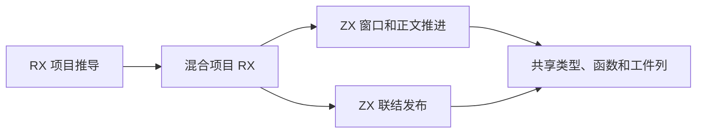
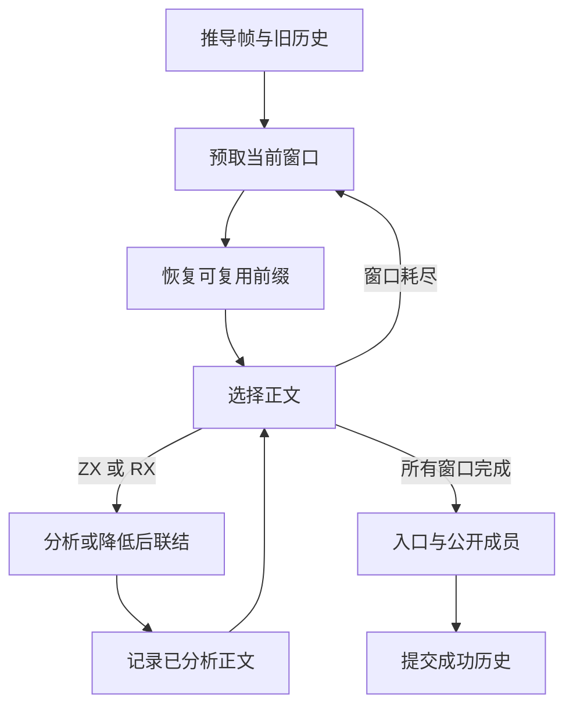

# 混合项目正文与联结发布自举

## Intent

让正式混合项目由 RX/ZX 驱动正文预取窗口、历史前缀恢复、正文派发和联结发布。冷路径与历史复用共用调度，保持原有验证、错误顺序和表存储的生命周期。

## Data

`mixed.compile` 从推导结果初始化共享类型与函数表。原 `Transaction.execute` 在 Zig 中推进窗口，先预取再恢复前缀，按顺序选出正文并联结，然后物化入口、发布公开成员、提交历史。已验收的 Source 实现提供窗口算术、正文选择和入口发布判断。[混合项目入口](../../packages/compiler/src/rx/analysis/project/mixed.zig) · [语义分析与推导发布](语义分析结果与RX推导发布自举.md)

## Edges

Source 控制游标、派发和发布顺序。宿主借出预取工作区和表存储，暂时保留线程启动、前缀的物理恢复与单个正文的分析、联结操作。成功发布后才更新历史。Source 的调用层使用零容量临时分配器，真实分析继续使用原有分配区。初始 seed 保留独立调度。

## Answer

验收覆盖冷路径、历史复用、模块派发与诊断、公开成员和分配失败。沿同一入口确认原 Zig 步骤表和外层执行循环已退出，再比较引导清单产物及固定基线性能。

### 已迁移的职责

- RX 先运行正文窗口，再发布联结结果。ZX 每次推进窗口时先预取，再恢复可复用前缀，按分派结果执行 ZX 分析或 RX 降低。窗口耗尽后继续取下一段。历史记录启用时，正文成功后才登记边界。冷路径直接使用正文完成位置推进。
- ZX 按入口、公开导出和成功历史的顺序发布。公开成员加载失败时保留原来的诊断和清理路径。联结结果在调用方的原有存储中写入，编排通过不透明句柄借用上下文。
- 删除正式路径上的 Zig 阶段表、正文外层循环和独立窗口算术入口。初始 seed 保留自己的正文循环。补齐生成步骤对 RX 工作流和混合项目源码的增量依赖，编辑这些源码时重新生成宿主接口。

宿主继续持有预取工作区、借用视图、前缀列恢复和正文及导出表的物理写入。预取候选提交和 Store 签名复核的剩余调用随共用存储批次收口。移除条件是 Source 能直接借用目标列并发布有效长度，线程边界只交接工作项和结果。[RX 正文入口](../../packages/compiler/src/rx/analysis/project/mixed/run.rx) · [窗口推进](../../packages/compiler/src/rx/analysis/project/mixed/windows.zx) · [输出发布](../../packages/compiler/src/rx/analysis/project/mixed/publish.zx)

### 引导验收

正式候选由 `917932aaa` 的 Source 引导器生成，26 个步骤通过。初始 seed 的解析和词法生成通过 33 个步骤。用正式候选重生成四份清单，共 15,562 份产物逐字节一致。候选的 SHA-256 为 `c481aad2d6324b6a66c3ab6e0373968311aba33c71c235ec4aae13d9cb788d9a`。

### 集中回归

合约、库联结、模块工件、语义缓存、RX 推导、项目 CLI 和 watch 七组通过。共 150 个构建步骤、302 项 Zig 测试和 10 项 CLI 检查。回归程序在最终源码上构建，使用 `917932aaa` 的 Source 引导器生成模块。最终候选使用同一份清单复验了生成的一致性。

### 性能对照

固定基线、上一批和候选均为 Source 引导器，分别使用各自生成的分析与生成实现。对同一份 735 入口冻结清单各运行三轮，配置为 `ReleaseSmall` 和 16 个分区。表中为中位数。

| 指标                       | 固定基线 | 上一批 |  候选 |
| -------------------------- | -------: | -----: | ----: |
| 冷生成墙钟（秒）           |     2.84 |   2.64 |  2.64 |
| 冷生成 CPU（秒）           |    12.48 |  12.89 | 12.85 |
| 冷进程树采样峰值 RSS（MB） |    898.6 |  713.2 | 708.1 |
| 冷单进程最大 RSS（MB）     |    921.7 |  736.8 | 729.8 |
| 热生成墙钟（秒）           |     2.21 |   1.97 |  1.99 |
| 热生成 CPU（秒）           |     8.48 |   8.31 |  8.31 |

冷生成较上一批墙钟持平，CPU 减少 0.04 秒，进程树峰值减少 5.1 MB。相对固定基线，冷墙钟累计减少 0.20 秒，CPU 累计增加 0.37 秒，进程树峰值减少 190.6 MB。无源文件改动时，候选中位数为 0.03 秒。

候选与上一批的 11,753 份冻结产物一致，候选的冷暖产物一致，memo 载荷哈希保持 `cdf9fa7e0f33002a95dc097b2837de781d67e6e519a452fb97f89f7c0bbf3a23`。常驻编辑的输出及恢复序列一致，编辑中位数为 0.423 → 0.424 秒，常驻 RSS 峰值为 1,276.1 → 1,275.0 MB。

### 下一批

从 `analyzeInputIn` 继续收口独立与已解析 ZX 的递归正文登记、本地原生视图交接、IR 前缀验证和 Store 初始化器诊断。两种入口继续共用上一批的语义结果发布。[ZX 分析入口](../../packages/compiler/src/zx/analysis/analyze.zig)
