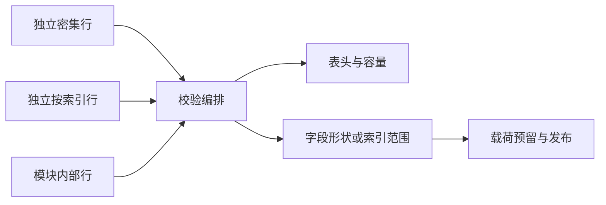
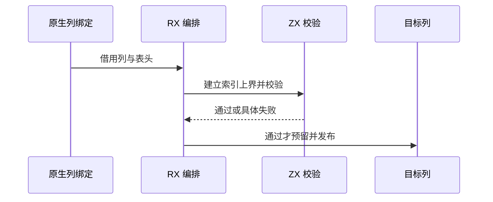

# 独立 AST 载荷校验与提交自举

## Intent

让独立密集、按索引和模块内的 AST 行导入共用 Source 校验与提交。Zig 只绑定原生列和临时描述符，初始引导器保留旧实现。

## Data

普通表达式、语句片段和声明仍从 `import_rows` 进入 Zig 逐列检查。复用语句及值调用从 `import_selected` 进入 Zig 计算各组安全下标。两条路径分别校验后再绑定写入列。模块导入已能用 Source 检查密集列。

## Edges

密集导入按标签计数检查每列长度，按索引导入以上界最小的字段为准。缺少必需字段时该组无法接受索引，全空值组无需有效字段。错误校验保持原有优先顺序。密集发布保持整批提交，按索引发布保留已经成功的前缀。输入借用原列，运行检查使用栈上计数和边界。

## Answer

正式密集导入、按索引导入和模块内导入共用 `validate.rx` 与 `validated.rx`。RX 在校验通过后调用已有的载荷事务。按索引导入由 ZX 处理缺列规则，使用通用列操作读取最短列，结果写入栈上的上界数组。密集导入继续逐组检查实际长度。独立校验也通过同一入口供扁平语句使用。

[校验编排](../../packages/genz/src/analysis/node_headers/payload/validate.rx) · [索引上界](../../packages/genz/src/analysis/node_headers/payload/limits.zx) · [校验与提交](../../packages/genz/src/analysis/node_headers/payload/validated.rx)

Zig 保留字段布局绑定及通用原生列读写。旧密集和按索引校验只由初始引导器使用。扁平语句中的目标容量检查、允许标签和联合体组装仍由 Zig 执行，需要沿正式 State 和循环消费者继续收口。

### 引导一致性

Source 引导器通过 25 个构建步骤，初始引导入口通过 19 个构建步骤。上一代 Source 引导器 `24ce77a19` 生成候选。候选用相同输入重新生成主、增长、集合和执行四份清单，16,035 个文件逐字节一致，比较时排除工具身份戳。

候选引导器 SHA-256 为 `07283997a029845ce24c6f9179dd9a3e0a6b8ced5d52c9854fad505d593ad9c2`。

### 运行回归

选定循环列、模块集合循环、统一库、RX 复合值转移、原生借用和 Store I/O 共通过 249 个构建步骤和 294 项 Zig 测试。

### 性能

三轮交错取中位数。平台为 macOS arm64、Zig 0.17.0、ReleaseSmall。沿用 735 个入口、16 分区的冻结清单，关闭常驻。各工具均由 Source 生成并使用 Source 分析和生成。固定冷基线沿用前批记录。

| 场景   | 工具     | 墙钟（秒） | CPU（秒） | 进程树峰值（字节） | 单进程峰值（字节） |
| ------ | -------- | ---------: | --------: | -----------------: | -----------------: |
| 冷生成 | 固定基线 |       2.82 |     12.43 |        884,768,768 |        934,051,840 |
| 冷生成 | 上一阶段 |       2.59 |     12.88 |        659,898,368 |        684,670,976 |
| 冷生成 | 本批     |       2.62 |     12.94 |        679,821,312 |        692,830,208 |
| 热重建 | 上一阶段 |       1.94 |      8.32 |        644,382,720 |        644,382,720 |
| 热重建 | 本批     |       1.94 |      8.30 |        644,562,944 |        644,595,712 |

冷生成较上一阶段墙钟增加 0.03 秒，CPU 增加 0.06 秒。进程树峰值增加 19.92 MB，单进程峰值增加 8.16 MB。同轮进程物理内存采样峰值中位数由 656.82 MB 增至 656.85 MB。相对固定基线，墙钟减少 0.20 秒，CPU 累计增加 0.51 秒，进程树峰值下降 204.95 MB。无改动场景的墙钟与 CPU 均为 0.03 秒。[固定基线](AST载荷导入与容量自举.md)

冻结清单的 11,753 个输出文件逐字节一致，暖缓存结果与各自冷生成一致。所有权缓存正文 SHA-256 均为 `cdf9fa7e0f33002a95dc097b2837de781d67e6e519a452fb97f89f7c0bbf3a23`。

### 自我审查

适配器仍按编译期字段布局绑定原生列，Source 在栈上检查长度和索引范围。现有测试覆盖按索引提交、复合值、借用和 Store 路径。进程树 RSS 和物理占用按各自口径保留，下一阶段继续跟踪累计内存。性能证据覆盖生成器，正式闭包审计之后仍需完整冷构建和三阶段自编译。
