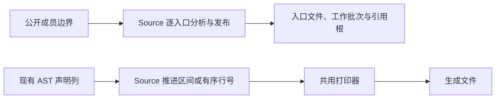
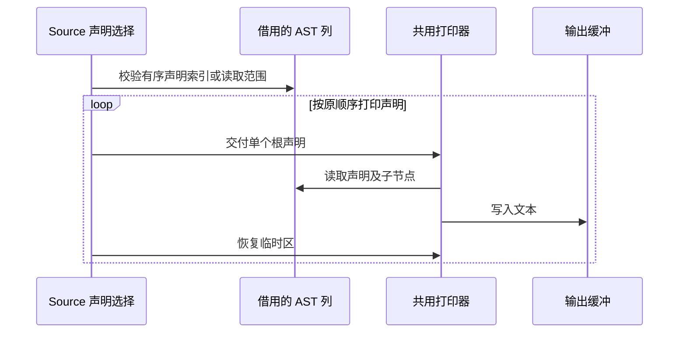

# 目标声明发布与打印自举

## Intent

让 Source 推进公开库入口的分析和发布，按指定顺序打印 AST 声明。复用声明列和原有打印器，避免为选取部分声明复制行头。

## Data

公开库成员边界已由 Source 产出。入口分析和输出身份也调用现有 Source 规则。原来由 Zig 遍历公开入口，按成员边界分别调用分析和发布，再走一遍建立入口根列表。限定区间的打印也在 Zig 中逐声明推进。Gateway 先把选定声明的行头复制到表尾，再走连续打印入口。

## Edges

库发布按原顺序逐入口完成分析和写入，复用已有成员切片。宿主继续预留输出数组、绑定编译程序视图和提交列。打印借用现有声明范围或行号，按原顺序输出。每条声明打印完恢复打印器工作区，输出缓冲单独生存。连续声明的快速入口仍直接使用同一打印器。

## Answer

正式库入口在一次遍历中写入公开模块、批次与引用根。同层声明区间和 Gateway 选定根使用同一 Source 打印入口。Gateway 通过声明行号直接打印，移除复制选定声明行头的步骤。[公开库入口](../../packages/compiler/src/backends/zig/library_entries.zig) · [声明选择](../../packages/genz/src/printer/selection/render.rx)

以 `e288e1614` 的 Source 引导器构建本批工具，25 个步骤通过。上阶段和本批工具以 Source 分析与生成处理相同源码，四份清单的 15,621 份文件逐字节一致。冻结性能清单的 11,753 份输出与上一阶段逐字节一致。库打包、入口发布、原生模块、后端发布及 Gateway 集中回归共 126 个步骤、125 项测试通过。Gateway 脚本的 86 项检查全部通过。

Zig 0.17.0、ReleaseSmall、16 分区和同一冻结清单下，三次配对生成的中位数如下。

| 场景 | 工具     | 墙钟（秒） | CPU（秒） | 进程树峰值（字节） | 单进程峰值（字节） |
| ---- | -------- | ---------: | --------: | -----------------: | -----------------: |
| 冷   | 固定基线 |       2.77 |     12.31 |        886,079,488 |        963,985,408 |
| 冷   | 上阶段   |       2.52 |     12.78 |        662,175,744 |        676,741,120 |
| 冷   | 本批     |       2.53 |     12.70 |        660,635,648 |        680,804,352 |
| 热   | 固定基线 |       2.15 |      8.35 |        893,632,512 |        934,313,984 |
| 热   | 上阶段   |       1.88 |      8.16 |        644,300,800 |        644,317,184 |
| 热   | 本批     |       1.85 |      8.09 |        644,612,096 |        644,628,480 |

冷生成较上一阶段墙钟增加 0.01 秒，CPU 减少 0.08 秒，进程树峰值下降 1.5 MB，单进程峰值增加 4.1 MB。相对固定冷基线，墙钟减少 0.24 秒，CPU 增加 0.39 秒，进程树峰值下降 225.4 MB。常驻编辑的中位数均约 0.425 秒，峰值下降 0.9 MB，每次编辑的输出哈希一致。

本批移除了入口遍历和选定根打印的 Zig 调度。所有权清理与投影的布局查询、AST 写回，以及库条目和分区的剩余专用输出逻辑继续核对。
