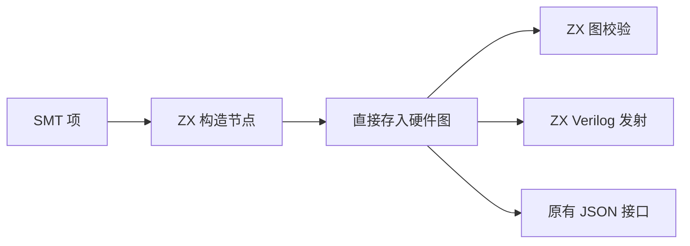
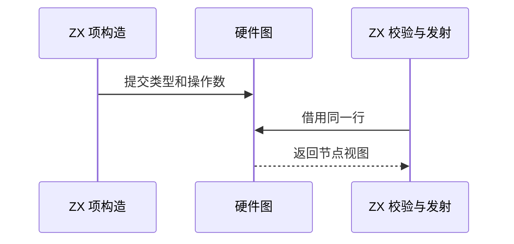

# 硬件节点表示与读写自举

## Intent

让 `fpga` 的项构造、图校验和 Verilog 发射共用一份由 ZX 定义的节点。移除正式路径的 Zig 标签转换和逐属性回调。

## Data

SMT 项读取已接入 Source，构造和扫描仍穿过 Zig 联合节点。公开 Zig API 和硬件 JSON 使用带标签的旧节点形状，首次引导也使用该表示。

## Edges

保持节点编号、来源位置、位宽和运算规则。正式编译器只存一份节点，读取时借用其地址。旧 Zig API 在其入口直接生成或读取原有行。产物 JSON 逐节点编码旧格式，保留输出字节。

## Answer

一次核对引导、现有资源与坏图回归、Yosys 行为、Verilog 与 JSON 逐字节对照，并测量固定输入的 `fpga` 运行开销。

### 实现

ZX 决定输入节点和 SMT 项的标签、位宽、操作数和符号位。原生写入接收这些字段并写入最终节点数组。图校验和 Verilog 发射直接借用节点并读取字段。二元算子的查表沿用已有静态表，节点不再经原生函数逐项拆开。

公开 Zig API 继续直接生成原有的节点数组，通过逐节点视图调用相同的 Source 校验和发射。JSON 用标准库逐行写出原有带标签结构，保留端口、来源和字段顺序。正式 CLI 无需为这个格式再分配完整的旧图。

`std:integer` 新增与 `narrow` 和 `narrowByte` 同样受检的 `narrowShort`，使 Source 可以保留 `u16` 位宽和扩展量。上一代工具嵌入的标准库签名尚无此项，先由 seed 更新签名，再用得到的 Source 引导器生成候选。

[节点契约](../../packages/compiler/src/backends/hardware/graph/view.d.zx) · [SMT 项生成](../../packages/compiler/src/backends/hardware/terms/parse/intern.zx) · [图读取](../../packages/compiler/src/backends/hardware/graph/view.zig) · [原有 JSON 格式](../../packages/compiler/src/backends/hardware/graph/circuit.zig)

### 当前验证

节点读取生成直接返回 `*const Node` 的调用。旧节点句柄换成有类型的原生对象后，循环状态与捕获值一度从栈上降级为 `allocator.create`。无分配的图校验使用空的固定缓冲分配器，首次回归中的图校验与资源释放检查由此失败。

生成器在循环结束值引用该作用域最后一个绑定时，沿该绑定判断状态是否新建。已有的边界检查仍限制状态借出。对可空标量的直接投影也可在状态存活期间读取。校验循环用可空的输入节点计数记录校验结果，只携带原有图和节点的借用。发射循环从单个输入引用读取图和写入器，避免单独生成捕获元组。定点生成的校验 Zig 已核对，循环入口、循环体和计数返回均不调用 `allocator.create`。

写入路径也做了定点生成检查。原生参数中的复合对象会使生成器在节点写入前先创建一个堆对象。写入端沿用原生标量调用约定，匹配和字段含义保留在 ZX，宿主按已计算的字段写入节点，去掉每次项登记的临时分配。

[循环状态分析](../../packages/genz/src/analysis/iteration/fresh.zx) · [可空标量投影](../../packages/genz/src/analysis/consumer/scalar.zx) · [图校验的无分配入口](../../packages/compiler/src/backends/hardware/graph/view.zig)

### 验收

硬件、验证、合约、原生边界及三组集合循环回归共 **289/289 构建步骤、398/398 测试**通过。写入改为标量后，硬件专项补验 **77/77 构建步骤、5/5 测试**通过。Yosys 核对了两组组合电路各 72 项输入与故障检查，以及时钟电路的 14 个周期和 56 条信号记录。组合、时钟、宽输入和多分支等六组配对运行共 12 份 Verilog 与图 JSON 产物逐字节一致。

Zig 0.17.0、ReleaseSmall、16 分区的最终 Source 引导构建 **25/25** 步骤通过。第一次用旧规则生成工具时，修改过的循环降低使部分生成文件变化。用修正后的 Source 工具再生成，最终工具摘要为 `b0bc4b0aa26bbe2730192d04f0c06027e9a7bf1fca89a80a52fc2c71c9a07af4`，两代工具摘要相同。主清单、增长、集合和执行四套生成树共 **16,040 份文件**逐字节一致，比较排除记录工具身份的 `.zxc-inputs`。

固定的 735 入口冷生成用 Source 自编译的最终同摘要工具和上一阶段工具交替测三轮，运行均使用各自的 Source 分析与生成。下表沿用固定基线。RSS 为字节。

| 工具     | 墙钟（秒） | CPU（秒） | 进程树峰值 RSS | 单进程峰值 RSS |
| -------- | ---------: | --------: | -------------: | -------------: |
| 固定基线 |       2.82 |     12.43 |    884,768,768 |    934,051,840 |
| 上一阶段 |       2.58 |     12.94 |    660,717,568 |    688,324,608 |
| 本阶段   |       2.61 |     12.98 |    663,896,064 |    681,181,184 |

相对固定基线，墙钟减少 0.21 秒，CPU 累计增加 0.55 秒，进程树峰值减少 220.87 MB。相对上一阶段，墙钟增加 0.03 秒，CPU 增加 0.04 秒，进程树峰值增加 3.18 MB，单进程峰值减少 7.14 MB，采样的物理内存峰值中位数增加 3.05 MB。热生成墙钟均为 1.93 秒，CPU 由 8.28 秒变为 8.31 秒。候选冷暖生成逐字节一致，上一阶段的冻结产物在循环降低处有预期变化。

实际 `fpga` 六组对照各运行八轮，舍弃首轮。墙钟中位数变化为 −1.78 至 +0.09 毫秒，CPU 为 −1.81 至 +0.06 毫秒。隔离宽输入场景的单进程峰值增加 240 KiB，其余场景变化为 −16 至 +16 KiB。最终生成代码中的校验、发射循环、输入写入和项登记均通过临时节点零堆分配检查。原始记录位于 `.zig-cache/verification-tmp/hardware-node-rows/`。

原生宿主仍提供物理行存储、旧 Zig 节点与 JSON 的逐行转换，以及静态算子查表。下批优先核对项目入口的状态交付和导入推进，继续减少正式闭包内的项目状态操作。
