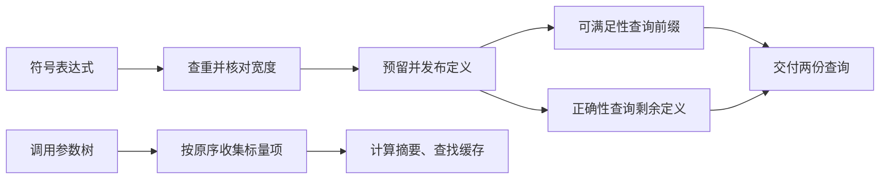

# 符号图登记与查询组装自举

## Intent

让符号图登记、求解器查询组装和调用缓存键遍历通过 Source 执行，收口验证与硬件共用的符号结果交付。

## Data

目前图登记使用 Source 判断准入和探测槽位，但扩容、登记与提交由 Zig 直接推进。查询各段由 Source 生成，随后由 Zig 组装两个可交付缓冲。调用缓存的摘要及等值检查属于 Source，参数树遍历及命中后回收仍在 Zig。[图入口](../../packages/compiler/src/verification/graph.zig) · [查询入口](../../packages/compiler/src/verification/query/output.zig) · [调用缓存](../../packages/compiler/src/verification/call_cache.zig)

## Edges

保留容量预留、复用、摘要序列、诊断和失败释放顺序。扩容后重新借用定义列。查询仍交付独立的连续字节缓冲。缓存键以偏移量保存，嵌套调用扩大列容量后仍然可用。Zig 持有物理分配器、写入缓冲和散列表。

## Answer

图登记以 RX 串联候选选择和提交。ZX 决定返回原子项、复用旧符号、拒绝或登记新定义，决定何时分配和换入索引。预留行容量后重新借用定义列。新索引只有在定义发布后进入图，途中失败由宿主释放暂存容量。[图编排](../../packages/compiler/src/verification/graph/workflow/run.rx) · [定义提交](../../packages/compiler/src/verification/graph/workflow/bind.zx) · [图存储](../../packages/compiler/src/verification/graph/registration.zig)

查询由 RX 依次写入前缀、其余定义及正确性断言，再交付正确性和可满足性缓冲。复用按两个区间渲染定义的现有接口。容量估算和 `std.Io.Writer` 的实际操作仍在 Zig，两份查询继续使用独立的连续缓冲。[查询编排](../../packages/compiler/src/verification/query/assembly/run.rx) · [字节写入](../../packages/compiler/src/verification/query/assembly.zig)

ZX 按原序递归收集调用实参的标量项、计算摘要、探测和处理命中。缓存表的物理操作留在 Zig，发生错误时恢复追加前的偏移。已核对三个新入口生成的函数文件，未增加分派及遍历所需的堆对象或底层字段复制。[调用键展开](../../packages/compiler/src/verification/call_cache/traverse.zx) · [缓存查找](../../packages/compiler/src/verification/call_cache/lookup.zx)

### 验收

候选引导器通过 25 步构建，二进制与上一阶段逐字节一致。四组同输入清单的 15,885 份文件一致，排除工具身份戳。初始 seed 能生成三个新增入口，入口包装及 ABI 类型与 Source 一致。

契约、验证、验证资源、硬件资源和 HDL 仿真通过 91 个构建步骤、14 项 Zig 测试、20 个 CLI 验证场景、8 个公开入口场景及 74 个枚举用例。Yosys 通过两组各 72 条组合逻辑检查及 56 条时序信号记录。

多分支、4,096 字段对象、空返回、契约、并行、九成员嵌套枚举、硬件端口及不安全的 `match` 共对照 52 份实际产物，逐字节一致。反例诊断和退出码一致。宽对象在隔离求解配置下另核对 7 份产物。

### 性能

macOS arm64、Zig 0.17.0、ReleaseSmall，关闭缓存和常驻生成。两套 CLI 均由 Source 生成并执行 Source 分析及发射，候选的登记、组装和缓存遍历使用本批 RX/ZX。两代交错运行，预热一轮后取七轮中位数，真实求解使用相同 Z3，隔离求解使用同一探针。RSS 为 CLI 进程系统峰值。

| 输入                     | 墙钟旧 → 新（毫秒） | CPU 旧 → 新（毫秒） |  峰值 RSS 旧 → 新（字节） |
| ------------------------ | ------------------: | ------------------: | ------------------------: |
| 512 分支                 |     366.85 → 368.43 |     365.80 → 367.38 | 200,048,640 → 200,097,792 |
| 4,096 字段对象，真实 Z3  |       26.54 → 26.61 |       25.63 → 25.62 |   26,492,928 → 26,509,312 |
| 4,096 字段对象，隔离求解 |       21.57 → 21.55 |       20.40 → 20.36 |   16,187,392 → 16,220,160 |
| 空返回                   |         8.20 → 8.26 |         7.38 → 7.42 |   24,985,600 → 24,985,600 |
| 前后置条件               |     158.86 → 159.15 |     157.87 → 158.15 |   31,932,416 → 31,932,416 |
| RX 并行                  |       10.55 → 10.48 |         9.75 → 9.71 |   25,018,368 → 25,018,368 |
| 九成员嵌套枚举           |       10.68 → 10.64 |         9.72 → 9.71 |   34,422,784 → 34,422,784 |
| 硬件复合端口             |         9.97 → 9.97 |         9.11 → 9.13 |   24,985,600 → 24,985,600 |

受影响入口最大墙钟和 CPU 增量均为 1.58 毫秒，峰值 RSS 增加最多 48 KiB，出现在 512 分支用例。固定清单沿用哈希相同的引导器。相对固定冷生成基线，墙钟少 0.25 秒，CPU 多 0.49 秒，进程树峰值低约 223.8 MB。完整 Zig 冷构建本批未单独计时。[固定清单证据](引导输出树和分区发布自举.md)

### 下一批

从硬件后端的 `build` 和 `flatten` 接续，迁移输入端口写入、定义执行与来源跟踪、复合输出展开和安全节点确认。物理写入、图索引及调用散列表仍留在 Zig 宿主，并随正式闭包审查逐项核对。[硬件图构造](../../packages/compiler/src/backends/hardware/root.zig)
