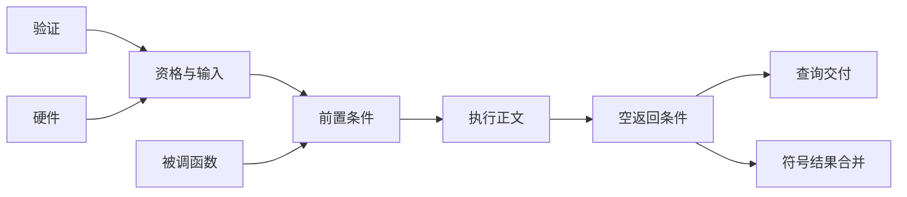

# 符号执行入口与端口自举

## Intent

让 `verify`、硬件模型和被调函数共用的端口准备、契约与正文调度、查询或结果的交付由 Source 推进。

## Data

`Conditions.generate`、`model` 和 `call` 共享图、输入和返回值。此前正文及契约各阶段已迁移，入口仍在 Zig 直接串联。校验入口的图在入口资格检查前准备，硬件模型在输入就绪后才进入普通调用流程。[正式入口](../../packages/compiler/src/verification/conditions.zig)

## Edges

保留三条入口的 graph 初始化、诊断、分配和错误优先级。对象与元组逐字段写入已有符号表示。端口文本及公开输入列使用结果分配器，符号值和图使用原分配器，正文工作区按原时机回收。

## Answer

三个正式入口由 RX 执行。验证先确保图存在，再检查资格并准备输入。硬件先检查资格、准备输入，再走被调函数共用的执行入口。两条正文路径保留前后置条件和空返回处理顺序。查询以正文开始前的图定义数量标记可满足性前缀，函数返回在现有合并入口处理。[验证编排](../../packages/compiler/src/verification/execution/program/verify.rx) · [硬件编排](../../packages/compiler/src/verification/execution/program/hardware.rx) · [调用编排](../../packages/compiler/src/verification/execution/program/call.rx)

端口遍历借用六列类型表视图。ZX 按对象字段顺序或元组索引生成路径、判断支撑的标量类型，选择只发布端口或同时发布 SMT 声明与枚举范围。聚合字段直接写入最终值槽，声明及公开端口保持原来的分配器。生成闭包未新增端口遍历所需的堆对象或底层数据复制。Zig 仍负责分配器与临时区检查点、符号图及列的物理写入、查询字节组装及硬件模型 ABI。[端口遍历](../../packages/compiler/src/verification/execution/parameter/walk.zx) · [标量端口](../../packages/compiler/src/verification/execution/parameter/leaf.zx) · [宿主边界](../../packages/compiler/src/verification/execution/program.zig)

### 验收

候选引导器通过 25 步构建，二进制与上阶段逐字节一致。四组清单生成 15,849 份相同文件，排除工具身份戳。初始 seed 可生成三个新增入口，入口包装和 ABI 类型与 Source 一致。

契约、验证、验证资源、硬件资源和 HDL 仿真通过 91 个构建步骤、14 项 Zig 测试、20 个 CLI 验证场景、8 个公开入口场景及 74 个枚举用例。Yosys 通过两组各 72 条组合逻辑检查及 56 条时序信号记录。

多分支、4,096 字段对象、空返回、契约、并行、九成员嵌套枚举、硬件端口及不安全的 `match` 共对照 52 份实际产物，逐字节一致。反例诊断和退出码也一致。宽对象在隔离求解配置下另核对 7 份产物。

### 性能

macOS arm64、Zig 0.17.0、ReleaseSmall，关闭缓存和常驻生成，使用相同 Z3。两套 CLI 由 Source 生成并执行 Source 分析及发射。上阶段的符号执行入口和输入构造走手写 Zig，候选使用 RX/ZX。两代交错运行，预热一轮后取七轮中位数。RSS 为 CLI 进程的系统峰值。隔离求解使用同一个求解器探针。

| 输入                     | 墙钟旧 → 新（毫秒） | CPU 旧 → 新（毫秒） |  峰值 RSS 旧 → 新（字节） |
| ------------------------ | ------------------: | ------------------: | ------------------------: |
| 512 分支                 |     370.84 → 370.57 |     369.76 → 369.49 | 200,032,256 → 200,048,640 |
| 4,096 字段对象，真实 Z3  |       26.53 → 26.47 |       25.62 → 25.56 |   26,509,312 → 26,509,312 |
| 4,096 字段对象，隔离求解 |       21.64 → 21.90 |       20.46 → 20.63 |   16,187,392 → 16,203,776 |
| 空返回                   |         8.31 → 8.22 |         7.43 → 7.38 |   24,985,600 → 24,985,600 |
| 前后置条件               |     159.88 → 160.36 |     158.85 → 159.27 |   31,932,416 → 31,932,416 |
| RX 并行                  |       10.58 → 10.47 |         9.82 → 9.66 |   25,034,752 → 25,018,368 |
| 九成员嵌套枚举           |       10.72 → 10.61 |         9.76 → 9.69 |   34,422,784 → 34,422,784 |
| 硬件复合端口             |       10.18 → 10.16 |         9.33 → 9.27 |   24,985,600 → 24,985,600 |

受影响入口的最大墙钟增量为 0.48 毫秒，CPU 为 0.41 毫秒，峰值 RSS 为 16 KiB。固定清单沿用哈希相同的引导器。相对固定冷生成基线，墙钟少 0.25 秒，CPU 多 0.49 秒，进程树峰值低约 223.8 MB。完整 Zig 冷构建本批未单独计时。[固定清单证据](引导输出树和分区发布自举.md)

### 下一批

接续查询组装、图结果写入和调用缓存键的符号树遍历，核对验证及硬件共用路径中的 Zig 状态。随后进入硬件图构造和 Verilog 的正式入口。[查询组装](../../packages/compiler/src/verification/query/output.zig) · [调用缓存](../../packages/compiler/src/verification/call_cache.zig) · [硬件入口](../../packages/compiler/src/backends/hardware/root.zig)
