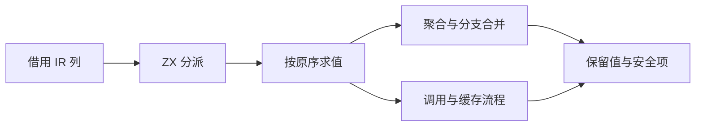

# 符号表达式求值自举

## Intent

把正式符号表达式的分派、子表达式求值、复合值构造及函数调用流程迁入 Source，连同上一批的语句推进覆盖验证与硬件共用的符号正文。

## Data

`Expressions.evaluate` 在缓存未命中时登记符号图步数，然后执行表达式。表达式表已有只读列，原 Zig 分派将其解码为行。复合值和调用缓存共享符号图存储。[旧表达式入口](../../packages/compiler/src/verification/expressions.zig) · [调用与缓存](../../packages/compiler/src/verification/calls.zig)

## Edges

先登记图步数，再检查表达式深度。缓存查找及图登记继续使用已有队列和分配器。复合值只分配最终字段列，递归操作数在栈上借用已有符号值。调用先校验资格，再求值参数和探测缓存，成功后发布；保留错误和图节点顺序。

## Answer

正式入口从表达式表直接读取类型和来源位置，命中缓存直接返回。未命中时把同一个只读列视图交给 ZX。ZX 决定表达式类型、操作数求值顺序、聚合字段写入及条件分支的归并。每个递归调用只保存本层操作数和结果。`match` 先求值主体与默认项，再倒序合并各个条件，每轮立即保留值及安全项。对象继续先执行显式记录的求值顺序，再登记字段。[表达式分派](../../packages/compiler/src/verification/execution/expression/walk.zx) · [分支合并](../../packages/compiler/src/verification/execution/expression/match_value.zx) · [复合值](../../packages/compiler/src/verification/execution/expression/aggregate.zx)

RX 将调用资格及参数准备、缓存探测和结果处理连在同一入口。工具按原顺序检查 Store、外部函数、递归和调用深度，在缓存未命中时执行被调函数并登记结果。缓存保存被调函数的安全项，单次调用另与实参安全项合并。Zig 继续持有表达式缓存表、调用缓存键、符号值物理写入及新被调函数的工作区。已核对生成的函数文件，操作数槽和列描述符未引入新的堆分配或底层载荷复制。[调用编排](../../packages/compiler/src/verification/execution/call/run.rx) · [表达式适配](../../packages/compiler/src/verification/execution/expression.zig) · [调用适配](../../packages/compiler/src/verification/execution/call.zig)

### 验收

候选引导器通过 25 步构建，二进制与上一代引导器逐字节一致。四组相同清单生成 15,808 份相同文件，排除工具身份戳。初始 seed 同样生成了两个新增入口，入口包装和 ABI 类型一致。

契约、验证、验证资源、硬件资源和 HDL 仿真通过 91 个构建步骤、14 项 Zig 测试、20 个 CLI 验证场景、8 个公开入口场景和 74 个枚举用例。Yosys 通过两组各 72 条组合逻辑检查及 56 条时序信号记录。

真实 Z3 和硬件对照共 38 份输出逐字节一致，覆盖多分支、宽对象转发、`match` 短路、RX 并行及硬件复合结果。不安全的 `match` 继续给出相同反例和退出码。隔离求解的查询生成另比对了 7 份输出。

### 性能

macOS arm64、Zig 0.17.0、ReleaseSmall，关闭缓存和常驻生成。两套 CLI 均由 Source 生成并执行 Source 分析及发射。上阶段的符号表达式及调用推进在 Zig，候选使用 RX/ZX。两代交错运行，预热一轮后七轮取中位数。RSS 为 CLI 进程系统峰值。宽对象的隔离测量使用同一个求解器探针以观察查询生成成本。

| 输入                         | 墙钟旧 → 新（毫秒） | CPU 旧 → 新（毫秒） |  峰值 RSS 旧 → 新（字节） |
| ---------------------------- | ------------------: | ------------------: | ------------------------: |
| 验证 512 分支                |     367.18 → 367.70 |     366.15 → 366.65 | 200,081,408 → 200,032,256 |
| 4,096 字段对象转发，真实 Z3  |       26.46 → 26.44 |       25.57 → 25.55 |   26,492,928 → 26,509,312 |
| 4,096 字段对象转发，隔离求解 |       21.61 → 21.53 |       20.45 → 20.38 |   16,203,776 → 16,187,392 |
| `match` 短路                 |         8.90 → 8.83 |         8.05 → 8.00 |   25,034,752 → 25,034,752 |
| RX 并行计算验证              |       10.43 → 10.37 |         9.61 → 9.61 |   25,018,368 → 25,018,368 |
| 硬件复合结果                 |        9.90 → 10.07 |         9.04 → 9.21 |   24,985,600 → 25,001,984 |

受影响入口的最大墙钟增量为 0.52 毫秒，CPU 为 0.50 毫秒，峰值 RSS 为 16 KiB。固定清单继续使用哈希相同的引导器。相对固定冷生成基线，墙钟少 0.25 秒、CPU 多 0.49 秒、进程树峰值低约 223.8 MB。完整 Zig 冷构建本批未单独计时。[固定清单证据](引导输出树和分区发布自举.md)

### 下一批

从 `Conditions.generate`、`Conditions.model` 和 `Conditions.call` 接续，共用端口类型遍历、参数发布、正文前后的阶段推进和查询交接。表达式缓存、符号图和调用缓存底层存储仍由宿主管理，调用键的递归展开仍在 Zig。核对这些依赖后接续硬件图和 Verilog。[符号执行入口](../../packages/compiler/src/verification/conditions.zig) · [调用缓存](../../packages/compiler/src/verification/call_cache.zig)
