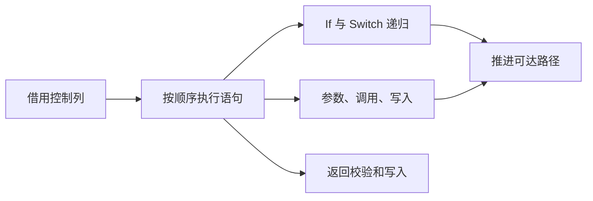

# 符号语句与路径推进自举

## Intent

让验证、硬件和被调函数共用的语句遍历、分支路径和并行阶段由 RX/ZX 执行。

## Data

三个入口经 `Conditions.block` 读取共用 IR 列。每个块有独立的表达式缓存，并与子块共用环境和符号图。返回与契约的 Source 入口已经通过上一批验收。[旧语句入口](../../packages/compiler/src/verification/conditions.zig)

## Edges

保持符号操作数的求值顺序、分支入口构造、失败传递和图定义登记顺序。并行先求值各参数，再按同一个起始路径检查调用，最后向环境写入结果。块借用原始控制列，原生侧继续持有表达式缓存、环境、符号值槽和分配器生命周期。

## Answer

Source 借用原始控制列，逐条选择读取、绑定、解构、分支、并行或返回。`If` 保留两臂都完整落下时对输入路径的复用。`Switch` 按原顺序执行有标签分支，最后处理默认分支。返回先用现有契约入口检查，再提交符号值。初始 seed 保留等价的 Zig 执行入口。[语句遍历](../../packages/compiler/src/verification/execution/block/walk.zx) · [语句分派](../../packages/compiler/src/verification/execution/block/step.zx)

并行编排先检查参数，再以同一启动路径检查调用，最后写符号环境。保持原有结果缓冲的分配和释放点。每个子块复用同一个控制列描述符，单独保存表达式缓存的临时区检查点。已检查两个入口及生成函数闭包，新增语句推进未引入堆分配或底层列复制。[并行编排](../../packages/compiler/src/verification/execution/parallel/run.rx) · [宿主边界](../../packages/compiler/src/verification/execution/block.zig)

### 验收

候选 Source 引导器通过 25 个构建步骤，二进制与上阶段逐字节一致。两代工具对当前源码的四组清单生成 15,765 份相同文件，排除工具身份戳。初始 seed 能生成两个新入口，入口包装和类型 ABI 与 Source 一致。

契约、验证、验证资源、硬件资源及 HDL 仿真通过 91 个构建步骤、14 项 Zig 测试，以及 20 个 CLI 验证场景、8 个公开入口场景和 74 个枚举用例。Yosys 通过两组各 72 条组合逻辑检查及 56 条时序信号记录。

复用仓库的并行纯计算示例，在核验目录内更新为当前 RX 调用和结果引用写法。两个 CLI 都证明通过，查询和输出文件一致。128 分支、512 分支、并行、含复合返回的硬件示例，以及整型 `Switch` 的反例，共比对 31 份产物，全部逐字节一致。`Switch` 两代工具的反例诊断和退出码也一致。

### 性能

macOS arm64、Zig 0.17.0、ReleaseSmall，使用相同 Z3，关闭缓存和常驻生成。两套 CLI 均由 Source 生成并执行 Source 分析和发射。上阶段执行手写 Zig 的语句遍历和并行流程，候选执行 RX/ZX 入口。两代交错运行，预热一轮，随后七轮取中位数。RSS 为 CLI 进程的系统峰值。

| 输入            | 墙钟旧 → 新（毫秒） | CPU 旧 → 新（毫秒） |  峰值 RSS 旧 → 新（字节） |
| --------------- | ------------------: | ------------------: | ------------------------: |
| 验证 128 分支   |       75.43 → 75.25 |       74.52 → 74.33 |   25,690,112 → 25,690,112 |
| 验证 512 分支   |     365.96 → 365.19 |     364.85 → 364.12 | 200,065,024 → 200,081,408 |
| RX 并行计算验证 |       10.49 → 10.47 |         9.67 → 9.63 |   25,018,368 → 25,018,368 |
| 硬件复合值选择  |         9.87 → 9.81 |         9.03 → 8.97 |   24,985,600 → 24,985,600 |

四组墙钟及 CPU 中位数均小幅下降，512 分支的峰值 RSS 增加 16 KiB，其余持平。固定清单继续使用哈希相同的引导器。相对固定冷生成基线，墙钟少 0.25 秒、CPU 多 0.49 秒、进程树峰值少约 223.8 MB。完整 Zig 冷构建本批未单独计时。[固定清单证据](引导输出树和分区发布自举.md)

### 下一批

从 `Expressions.evaluate` 接续，把表达式求值、聚合与 `match` 的遍历，以及其关联函数调用从正式 Zig 路径迁出。保持图定义及诊断顺序，复用本批的块作用域和原有的表达式缓存边界。图、环境以及各列的物理写入仍是过渡依赖。[表达式入口](../../packages/compiler/src/verification/expressions.zig) · [调用入口](../../packages/compiler/src/verification/calls.zig)
