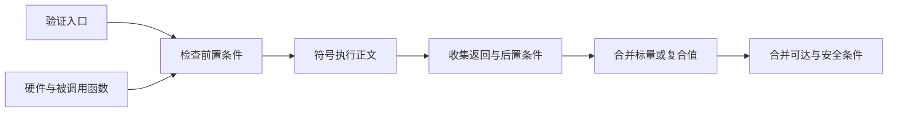

# 符号返回与契约条件自举

## Intent

让验证与硬件的共用符号执行由 Source 选择分支值、检查契约，并按原顺序合并函数返回与安全条件。

## Data

两条入口共享符号值和定义图。已有 Source 能构造布尔项并登记图定义。复合值的递归选择、三种契约模式与多路径返回的折叠仍在 Zig。[符号执行入口](../../packages/compiler/src/verification/conditions.zig) · [符号图](../../packages/compiler/src/verification/graph.zig)

## Edges

验证入口只把前置条件本身的求值安全性作为验证义务。被调用函数同时检查前置条件的值。后置条件按原顺序收紧返回路径。表达式的错误位置、图定义的登记顺序以及复用同一字段存储的规则保持一致。宿主保留符号值存储和单次递归求值入口。

## Answer

契约遍历按入口、被调函数和返回三种模式执行。ZX 按原合同顺序推进路径，保留每条验证义务与符号定义的登记顺序。跨步骤路径保存在一个栈上槽位，复用原有合同类别列。RX 依次合并各条返回、累积安全条件并发布最终条件。复合值选择由 ZX 按类型表递归完成，相同字段存储直接复用。[契约求值](../../packages/compiler/src/verification/contracts/apply.zx) · [返回合并](../../packages/compiler/src/verification/execution/merge/run.rx) · [复合值选择](../../packages/compiler/src/verification/graph/selection/select.zx)

正式 `verify` 和硬件共同使用新的分支值选择与返回合并。Zig 继续提供物理字段存储、表达式单次求值、图定义绑定和结果列的实际写入。新增的过渡接口引用原记录或直接写目标槽位。核对生成的 Zig 时，契约遍历的跨轮路径落在栈槽，未为每次条件更新分配状态对象。[契约和返回适配](../../packages/compiler/src/verification/execution/context.zig) · [符号值适配](../../packages/compiler/src/verification/graph/selection.zig)

### 验收

- 由上阶段 Source 工具产生的候选引导器通过 25 个构建步骤，与上一代引导器的 SHA-256 均为 `7fce570df79ac26433d4ac472cc64ce12d8a575273770898fd0cbd58fae69fd0`。候选与上阶段对同一份当前源码的四个清单生成 15,737 份相同文件，排除工具身份戳。
- 契约、验证、验证资源、硬件资源和 HDL 仿真共通过 91 个构建步骤和 14 项 Zig 测试。CLI 另外通过 20 个验证场景、8 个公开入口场景和 74 个枚举用例。Yosys 跑通两组各 72 条组合逻辑检查，以及 14 个周期、56 条信号记录的时序检查。
- 三个验证输入的查询、前置条件可满足性查询、来源映射和结果共 21 份产物逐字节一致。含嵌套对象和元组的硬件用例生成相同的 Verilog 和接口文件。另一个硬件输入在两代工具上均以同一反例拒绝，退出码为 1，诊断文本逐字节一致。
- 初始 seed 能生成包含三个新入口的执行清单，入口文件、类型和 ABI 与 Source 一致。全清单仍有 54 份函数文件及清单索引存在差异，其中已核对的函数差异包括局部临时绑定编号。正式回归和性能均使用 Source 生成的 CLI。

### 性能

macOS arm64，Zig 0.17.0，ReleaseSmall。禁用 zxc 缓存和常驻生成，使用同一个 Z3。两个 CLI 均由 Source 工具生成并执行 Source 分析及发射。上阶段符号契约遍历、复合值选择和返回折叠执行 Zig 实现，候选执行 Source 实现。两代交错预热一轮，再测七轮取中位数。RSS 是 CLI 进程的系统峰值。

| 输入                      | 墙钟旧 → 新（毫秒） | CPU 旧 → 新（毫秒） | 峰值 RSS 旧 → 新（字节） |
| ------------------------- | ------------------: | ------------------: | -----------------------: |
| 验证前置及后置条件        |     159.73 → 161.21 |     158.72 → 160.23 |  31,916,032 → 31,932,416 |
| 验证嵌套调用              |     159.67 → 161.12 |     158.64 → 160.11 |  31,932,416 → 31,932,416 |
| 验证 4,096 次复合参数转发 |       26.38 → 26.34 |       25.47 → 25.44 |  26,492,928 → 26,492,928 |
| 硬件复合值选择            |        10.04 → 9.93 |         9.16 → 9.09 |  24,985,600 → 25,001,984 |

实际受影响路径的最大增量为 1.48 毫秒墙钟、1.51 毫秒 CPU 和 16 KiB 峰值 RSS。固定清单使用的引导器逐字节相同，复用原有性能记录。冷生成相对固定基线仍快 0.25 秒，CPU 多 0.49 秒，进程树峰值低约 223.8 MB。完整 Zig 冷构建本批未单独计时。[固定清单证据](引导输出树和分区发布自举.md)

### 下一批

沿 `Conditions.block` 迁移语句推进以及 `If`、`Switch`、并行的路径计算，随后迁移表达式分派和调用。审核各分支在递归前后对共享环境、结果及错误的写入顺序，接续现有的条件与返回折叠。图和环境的物理存储及表达式缓存仍在 Zig，列入 4.3b 的后续批次。[语句入口](../../packages/compiler/src/verification/conditions.zig) · [表达式入口](../../packages/compiler/src/verification/expressions.zig)
