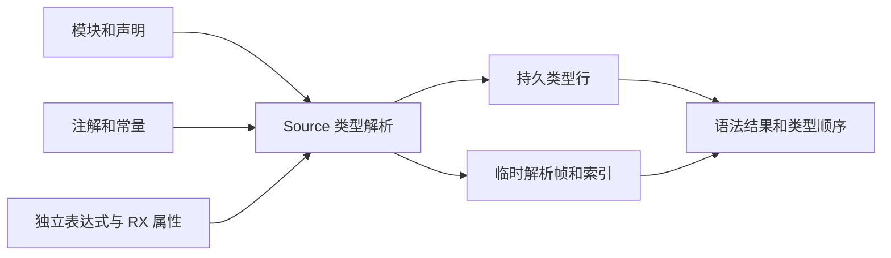
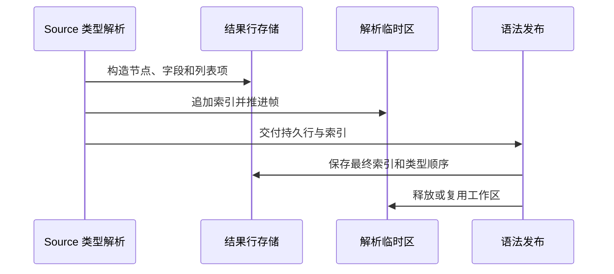

# 类型语法行持久化

## Intent

让模块、常量和独立表达式通过同一条 Source 路径直接构造持久类型行，移除发布时对类型节点、字段、元组项及其名称位置的递归复制。

## Data

声明、常量注解、函数体和表达式内的类型应用共同使用类型解析状态。类型顺序已在最终区域生成。类型行及名称位置仍从临时区逐项复制，剩余表达式与语句列也经过这一流程。[类型状态](../../packages/compiler/src/zx/frontend/parser/types/model.zx) · [结果保留](../../packages/compiler/src/zx/frontend/compact_output.zig)

## Edges

最终行使用已有解析结果区，类型帧与增长中的索引使用临时区。直接构造持久行时只读取名称位置的标量，避免保留指向临时区的引用。状态中的分配位置不进入最终语法树。保留原生和种子入口的解析契约及失败释放顺序。

## Answer

核对类型行确实在结果区构造，沿模块、常量和表达式的同一发布链确认递归复制退出。集中运行类型、解析缓存、表达式和外部签名回归，比较引导产物、性能与内存。表达式和语句行接续使用同一驻留模型。

### 当前候选

模块声明、常量注解、函数体和独立表达式复用同一行分配区。生成 Zig 中，节点与字段的名称位置和行数据均在切换到结果区后构造，列表项也直接在该区构造。三个入口各自恢复临时分配区再增长索引。发布阶段只保存这三类索引，并沿用已有的类型顺序直接写入。旧 Zig 递归存储继续处理表达式、语句和容器。

候选由 `cf0a4511c` 的 Source 引导器构建，25 个步骤通过。自身重生成四份正式清单，15,591 份产物逐字节一致。候选 SHA-256 为 `477846c1ef3d20e3a4c44712a2e97cf39b22712eebc6111590c3dff660f74c53`。

### 配对测量

继续沿用 735 个冻结入口、`ReleaseSmall` 和 16 个分区。三套引导器分别运行各自的 Source 分析与生成实现，按交替次序各运行三轮。候选与上一批的 11,753 份冻结产物和候选自身冷暖产物逐字节一致。

| 指标                       | 固定基线 | 上一批 |  候选 |
| -------------------------- | -------: | -----: | ----: |
| 冷生成墙钟（秒）           |     2.84 |   2.62 |  2.64 |
| 冷生成 CPU（秒）           |    12.46 |  12.85 | 12.91 |
| 冷进程树采样峰值 RSS（MB） |    886.1 |  657.0 | 659.5 |
| 冷单进程最大 RSS（MB）     |    921.8 |  681.2 | 677.9 |
| 热生成墙钟（秒）           |     2.21 |   1.96 |  1.98 |
| 热生成 CPU（秒）           |     8.48 |   8.30 |  8.35 |

较上一批，冷墙钟增加 0.02 秒，CPU 增加 0.06 秒。冷进程树采样峰值增加 2.5 MB，单进程最大 RSS 下降 3.4 MB。相对固定基线，冷墙钟下降 0.20 秒，CPU 累计增加 0.45 秒，进程树峰值下降 226.6 MB。

常驻编辑的产物与恢复序列一致，编辑中位数为 0.425 → 0.429 秒，RSS 峰值为 1,244.5 → 1,249.1 MB。解析缓存的当期容量为 86.64 → 86.75 MB，增量约 0.12 MB。初始 seed 的词法和语法生成通过 32 个步骤，

### 集中回归

164 个构建步骤、346 项 Zig 测试、55 项 RX 属性执行和 6 项拒绝检查通过。回归覆盖解析缓存的重复读取及分配失败、类型语法、独立表达式、模板准备与名义类型来源。接续表达式、语句、块及其附属行，再收口模块元数据。
