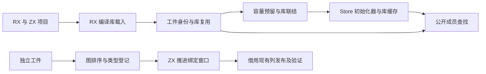
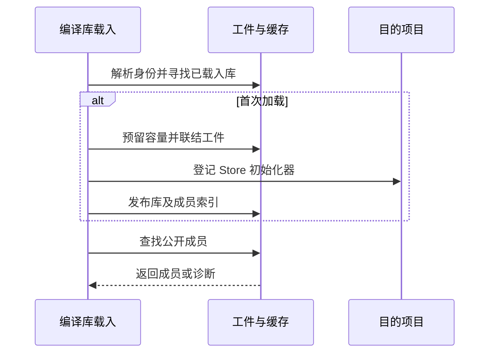

# 编译库导入与独立联结收尾

## Intent

完成 RX 与 ZX 共用的编译库载入和独立工件联结的剩余推进。公开成员查找、工件替换、Store 初始化器登记和错误次序沿用现有项目契约。

## Data

`compiled.imports.load` 原先在 Zig 连接工件解析、库复用、联结、初始化器登记和查找。具体工件解析、内容联结和公开名称索引已由 Source 实现。独立工件联结也已有 Source 的图排序、类型登记、窗口内绑定和结果验证。其外层仍由 Zig 推进窗口和控制最终发布。

## Edges

首次加载先检查工件身份，联结成功才登记初始化器和库状态。即使请求的公开成员不存在，成功发布的库和初始化器仍可供下一次请求复用。初始化器与名称表使用原有分配器及发布顺序。预留资源在失败前缀内释放。独立联结沿用同一窗口容量、排序、模块行布局和临时区回收点。固定基线性能对照沿用前一批配置。

## Answer

沿两个项目入口和独立联结核实旧阶段顺序已退出，检查库身份冲突、缺失公开成员、Store 初始化器、跨进程库消费、资源分配失败及多窗口联结。最后比较同一引导清单的产物和性能。本批结束后，从前端的解析产物保留与诊断发布推进下一阶段。

### 迁移状态

- RX 决定何时联结、发布和查找公开成员。查找复用现有 Source 名称索引。首次加载通过哈希表已有的插入操作取得稳定槽位，复用时不重新绑定库成员或初始化器。
- 独立工件的注册顺序与窗口游标由 Source 执行。绑定结束后直接调用已有的 RX 结果发布与验证入口。Zig 持有物理行视图、列存储和三个分配区，结果发布直接借用列视图。
- 初始 seed 保留兼容路径。过渡句柄可以在项目哈希表、工件视图和结果表可直接由 Source 持有后移除。

### 引导验收

候选由 `8a907f6b6` 的 Source 引导器构建，正式执行本批的库载入与独立联结编排。引导构建通过 26 个步骤，初始 seed 词法引导通过 14 个步骤。最终候选重生成四份清单，15,456 份产物逐字节一致，候选 SHA-256 为 `4e6e72477dff15030bd1c3217593f48e95251d5b4a13b1ed194e4063fdba1df0`。

### 回归验收

初次联结回归出现返回 IR 无效与分配泄漏。窗口改为借用静态空表，联结对象直接持有分配区。绑定结束后调用原有 RX 发布与验证入口，由其直接返回 IR，去掉宿主回调与外层返回之间的结果暂存。

库联结、库初始化器、库编解码和库发布四组回归通过。修复后补跑工件联结边界、联结执行和原生联结，38 个步骤和 28 项测试通过。把窗口缩到单行后复用现有资源测试，4 项通过，覆盖跨窗口推进与逐次分配失败。

### 性能对照

用相同工具链和 16 个分区，固定基线、上一批和最终候选各运行三轮 735 入口冻结清单。表格记录生成阶段中位数。

| 指标                           | 固定基线 | 上一批 |  候选 |
| ------------------------------ | -------: | -----: | ----: |
| 冷生成墙钟（秒）               |     2.84 |   2.63 |  2.62 |
| 冷生成 CPU（秒）               |    12.58 |  12.95 | 12.91 |
| 冷生成进程树采样峰值 RSS（MB） |    885.4 |  717.6 | 712.3 |
| 冷生成单进程最大 RSS（MB）     |    926.5 |  723.8 | 739.0 |
| 热生成墙钟（秒）               |     2.23 |   1.94 |  1.97 |
| 热生成 CPU（秒）               |     8.49 |   8.20 |  8.27 |

较上一批，冷生成墙钟减少 0.01 秒，CPU 减少 0.04 秒，进程树采样峰值下降 5.2 MB，单进程最大 RSS 上升 15.1 MB。较固定基线，冷生成墙钟累计减少 0.22 秒，CPU 增加 0.33 秒，进程树峰值下降 173.1 MB，单进程最大 RSS 下降 187.6 MB。

与上一批相比，11,753 份冻结产物一致，候选自身的冷暖产物一致。固定基线的历史差异一致，memo 载荷哈希保持 `cdf9fa7e0f33002a95dc097b2837de781d67e6e519a452fb97f89f7c0bbf3a23`。

常驻编辑耗时中位数由 0.425 秒降至 0.422 秒，采样峰值由 1,268.3 MB 增至 1,278.2 MB。编辑期间与恢复后的产物一致。内存增量纳入下一批的同夹具对照。

直接运行受影响的独立联结资源测试与编译库导入测试，使用相同 `ReleaseSmall` 配置，每组交错运行三轮，每轮重复 12 次。对照来自已验收的 `f25c2cd7c` 测试产物。独立联结的 CPU 中位数为 0.1191 → 0.1192 秒，编译库导入为 0.0418 → 0.0416 秒。短夹具的计时包含进程启动和测试框架开销。
