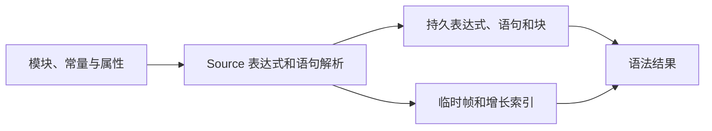
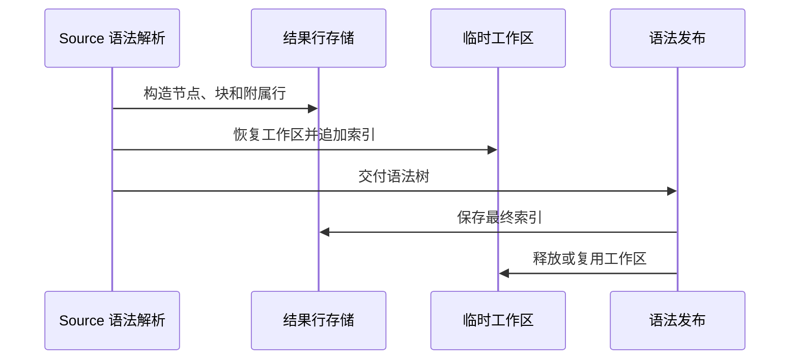

# 表达式与语句行持久化

## Intent

让表达式、语句、块及其附属行在现有结果区内构造。模块、常量、独立表达式和 RX 属性共用同一发布路径，移除三类语法树的逐行递归复制。

## Data

类型节点、字段和列表项已在 Source 中选择写入区域。表达式树仍保存节点、调用项、对象字段、参数、模板片段和匹配分支。语句树仍保存语句、块、列表项、绑定模式和分支。两类树此前都由 Zig 逐项复制到结果区。[表达式树](../../packages/compiler/src/zx/frontend/parser/expressions/state/model.zx) · [语句树](../../packages/compiler/src/zx/frontend/parser/body/model.zx) · [结果发布](../../packages/compiler/src/zx/frontend/compact_output.zig)

## Edges

分支、类型应用、模板插值和解除嵌套按原顺序推进。跨越临时区的名称与位置必须由结果行持有。增长中的索引与帧在临时区，发布只写最终索引。原生接口和初始 seed 沿用各自的存储。

## Answer

核对两类语法树的所有写入入口及跨工作区的读取，比较固定清单中的冷暖产物与常驻编辑。集中运行缓存、表达式、模板、语句、原生声明和运行回归。验收后接续模块元数据和兼容 AST 接口。

### 当前核验

首轮候选可构建，重生成时在表达式顺序索引读取处失败。发布前的地址核对定位到条件列表闭合时用 `splice` 替换根节点的路径。它绕过新增行时的分配区域，留下临时区节点。该路径已改为在结果区构造替换行及新位置，再在临时区更新索引。加上行和嵌套位置地址检查后，914 个主清单入口的重生成通过。临时检查已移除，正式候选继续做产物对照。[条件闭合](../../packages/compiler/src/zx/frontend/parser/expressions/grammar/condition/resume.zx)

首个完成重生成的候选在单轮探测中增加 26.3 MB 进程树峰值。常驻解析缓存容量只增加约 3.35 MB，峰值增量主要出现在分配层。结果行分配区改为在已有小块耗尽时优先尝试原地扩展，保留已发布的指针。单轮复测的进程树峰值为 657.4 → 657.0 MB，随后进行三轮配对验收。[分配区](../../packages/core/src/memory/arena.zig)

### 配对测量

正式候选由 `80c32aad9` 的 Source 引导器构建，25 个步骤通过。四份正式清单的 15,593 份产物逐字节一致，候选 SHA-256 为 `d6ea877eafe56cdcc2dc35d75ee087e68ee5d86092d73d6c7ae881c4f43577c9`。三套工具执行各自的 Source 分析与生成，沿用 735 个冻结入口、`ReleaseSmall` 与 16 个分区，交替运行三轮。候选与上一批的 11,753 份冻结产物及候选自身冷暖产物一致。

| 指标                       | 固定基线 | 上一批 |  候选 |
| -------------------------- | -------: | -----: | ----: |
| 冷生成墙钟（秒）           |     2.81 |   2.62 |  2.64 |
| 冷生成 CPU（秒）           |    12.48 |  12.91 | 12.99 |
| 冷进程树采样峰值 RSS（MB） |    887.6 |  659.3 | 662.6 |
| 冷单进程最大 RSS（MB）     |    921.4 |  680.3 | 683.1 |
| 热生成墙钟（秒）           |     2.20 |   1.97 |  1.98 |
| 热生成 CPU（秒）           |     8.46 |   8.33 |  8.38 |

冷墙钟和 CPU 分别较上一批增加 0.02 秒与 0.08 秒，冷进程树采样峰值增加 3.3 MB。相对固定基线，冷墙钟下降 0.17 秒，CPU 累计增加 0.51 秒，进程树峰值下降 225.0 MB。常驻编辑产物及恢复序列一致，编辑中位数约 0.425 → 0.426 秒，RSS 峰值为 1,244.4 → 1,241.7 MB。初始 seed 通过 32 个步骤。

### 集中回归

首轮集中回归通过 8,108 项 Zig 测试和 61 项 RX 属性检查。数组范围用例中的双参数 \`slice\` 预期为未知方法，上一版和本版均在同一位置返回参数数量错误。仓库既有接口为无参 \`slice()\`，据此校准该用例的诊断预期，单独复验通过。回归覆盖解析缓存、表达式、模板、类型、原生声明、前端语义、求值顺序和返回语句。[既有切片契约](../2026-11-14/工件正文列物化.md)

后续的递归复制集中在模块元数据。导入名称绑定带有 `with` 替换路径，声明、契约和函数名有位置引用，常量包含三类树和类型顺序的容器。下一批沿这些入口保证引用有效，再将宿主保留收束为显式的索引和容器写入。[发布入口](../../packages/compiler/src/zx/frontend/compact_output.zig)
