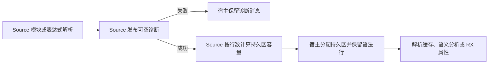
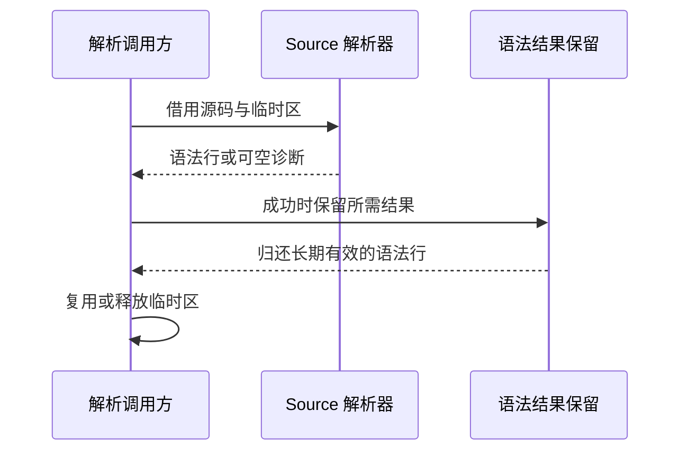

# 解析结果保留与诊断发布自举

## Intent

贯通 ZX 模块、独立表达式和 RX 借用属性表达式。把成功或诊断的发布判定，以及语法存储的大小计算迁到 Source，保留解析缓存和调用方的源码所有权。

## Data

两个正式解析入口都以源码运行 Source 解析器。生成结果用数组记录词法和语法行，用跨度引用源码。原实现由 Zig 根据诊断消息是否为空分派，再递归遍历整个结果计算持久区的容量，随后遍历第二次复制行。多数行的分配成本只取决于 ABI 和行数，常量声明还会携带独立的语法树。

## Edges

保持源码和文件名的拥有或借用方式，保持模块解析临时区复用及现有 ABI 的失败映射。静态行成本以实际生成 Zig ABI 的尺寸和对齐计算。常量声明的动态行数仍由 Source 遍历。目标区继续用单个预留的 Arena 承载，不引入额外的数组或临时堆分配。

## Answer

一次验收解析诊断、缓存生命周期、RX 属性政策和分配失败，并复用固定生成清单对照耗时、内存和产物。源程序可以直接接收长期语法列时，再清除实际复制与原生 AST 适配。

### 已迁移的职责

- ZX 模块和独立表达式都由 Source 发布可空诊断。外部声明分析直接使用该结果判断是否继续，原生 AST 兼容入口也用同一表示。宿主按原顺序保留诊断消息并转换原生错误和位置。
- 语法持久区用列长度乘以真实 ABI 的行成本计算，跳过逐个词法、表达式和语句记录的大小遍历。常量行内部的可变长度列由 Source 逐项累加。固定成本与对齐由 Zig 编译期计算。
- 生成容量计算通过空分配器实跑，两条调用链的生成 Zig 都未出现分配。现有语法行仍从可复用临时区复制到持久区。待解析器直接产生持久语法列、临时帧独立分配后，才能移除复制和布局桥。

### 引导验收

正式候选由 `54ae7770d` 的 Source 引导器构建，通过 26 个步骤。初始 Zig seed 生成词法和语法入口通过 33 个步骤。候选重新生成四份清单，15,480 份产物逐字节一致。候选 SHA-256 为 `fe9404286195a337cd86026fd2dceb272ffdf733190a1cd89fc9a430cbe16c8c`。

### 回归验收

解析缓存、表达式绑定、表达式运行、RX 属性、XML 表达式、名义类型来源和模块记录七组回归通过。合计 119 个步骤、262 项测试，覆盖语法错误、源码与缓存的生命周期、跨模块的原生类型和分配失败。

### 性能对照

固定基线、上一批和候选分别运行同一份 735 入口冻结清单各三轮。配置为 `ReleaseSmall`、16 个分区。下面记录生成阶段中位数。

| 指标                       | 固定基线 | 上一批 |  候选 |
| -------------------------- | -------: | -----: | ----: |
| 冷生成墙钟（秒）           |     2.83 |   2.63 |  2.63 |
| 冷生成 CPU（秒）           |    12.50 |  12.88 | 12.92 |
| 冷进程树采样峰值 RSS（MB） |    885.1 |  709.1 | 710.1 |
| 冷单进程最大 RSS（MB）     |    969.9 |  726.4 | 728.6 |
| 热生成墙钟（秒）           |     2.21 |   1.99 |  1.96 |
| 热生成 CPU（秒）           |     8.47 |   8.29 |  8.30 |

与上一批相比，冷生成墙钟持平，CPU 增加 0.04 秒，进程树峰值增加约 1 MB。较固定基线，冷生成墙钟累计减少 0.20 秒，CPU 增加 0.42 秒，进程树峰值下降 175 MB。无改动时的候选生成命令中位数为 0.03 秒。

与上一批相比，11,753 份冻结产物一致。候选自身冷暖产物一致，memo 载荷哈希保持 `cdf9fa7e0f33002a95dc097b2837de781d67e6e519a452fb97f89f7c0bbf3a23`。

常驻编辑中位数从 0.424 秒降至 0.423 秒，采样峰值由 1,279.0 MB 降至 1,260.2 MB。编辑和恢复的产物逐项一致。

### 下一批

从 `analyzeInputIn` 与 `analyzer/host/publish.zig` 接续，贯通独立分析、已解析导入和项目的入口校验、类型表与名义来源写入，以及 IR 正文和错误发布。同步核对 RX 项目 `workflow/derive` 与 `workflow/solve` 的状态发布。同一类型表继续由原有拥有者管理。[ZX 分析](../../packages/compiler/src/zx/analysis/analyze.zig) · [ZX 发布](../../packages/compiler/src/zx/analysis/analyzer/host/publish.zig) · [RX 推导](../../packages/compiler/src/rx/analysis/project/workflow/derive/host.zig)
