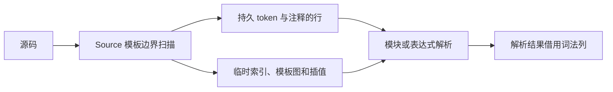
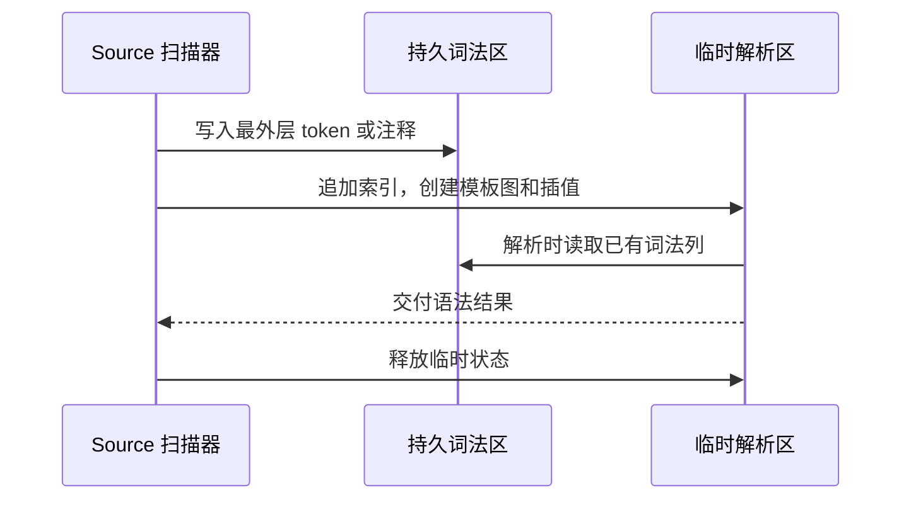

# 词法列独立持久化自举

## Intent

按解析结果的消费需求保留最外层词法行。扫描阶段在临时区增长索引，发布时只保存需要跨越解析生命周期的行和最终指针序列。模板图、插值扫描及语法工作区继续按原生命周期释放或复用。

## Data

模板边界扫描已经是 Source。它的 token 和注释参与后续解析，并由解析缓存长期持有。旧路径在可复用临时区构造它们，再由 Zig 递归复制到结果。插值 token、帧、图和语法提示仅在解析过程中使用。[词法准备](../../packages/compiler/src/zx/frontend/parser/templates/prepare.rx) · [原语法复制](../../packages/compiler/src/zx/frontend/compact_output.zig)

## Edges

持久解析只在构造最外层词法行时使用结果区，指针列表的增长留在临时区。兼容 AST、外部签名和普通词法入口沿用原分配区。词法和语法诊断维持原优先级，失败时释放本次持久写入。保留源码借用、位置和模板插值顺序。

## Answer

核对解析结果使用扫描时写入的词法列，保留模板、诊断、借用和错误回收契约。集中运行解析与 RX 回归，比较引导产物及固定清单的冷暖生成和内存。

### 当前核验

从 `95953dd1a` 的 Source 引导器构建候选通过 25 个步骤。ZX 独立 lexer 接入正式生成清单，复用内部内存接口。候选重生成四份正式清单，15,589 份产物逐字节一致。

用同一份 735 入口冻结清单，在 `ReleaseSmall` 和 16 个分区下做三轮交替对照。候选与上一批的 11,753 份产物逐字节一致，冷墙钟中位数为 2.59 → 2.63 秒，CPU 为 12.77 → 12.91 秒。冷生成进程树采样峰值 RSS 为 711.3 → 784.7 MB，单进程最大 RSS 为 737.1 → 809.8 MB。本批仍待通过内存和解析回归验收。

首个候选把逐行构造和列表扩容放进同一长期区，列表旧容量随结果保留。调整后，行在结果区构造，指针列表在扫描临时区增长，只将最终指针序列写入原有语法结果区。随后取消了词法行分配区的最小整页预留。该候选通过 364 项 Zig 测试、55 项 RX 属性运行和 6 项拒绝检查，四份正式清单的产物一致。三轮配对冷生成的进程树中位峰值仍为 709.3 → 742.6 MB。

现有消费端中，格式化的布局投影读取 token 与注释，模块 lint 仅在检查时读取注释，语义分析和索引表达式读取语法表。当前候选在 Source 返回结果前发布所需词法列，模块缓存提供 lint 所需的注释，索引表达式释放全部临时词法列。需要从缓存结果格式化时按格式化用途取得完整词法信息。既有模板、表达式和类型解析夹具共用内部生成清单。[模块布局](../../packages/compiler/src/zx/frontend/layout.zig) · [词法结果选择](../../packages/compiler/src/zx/frontend/parser/syntax/retention/select_lexical.zx)

### 按用途保留后的对照

当前候选使用 `95953dd1a` 的 Source 引导器构建，通过 25 个步骤。候选重生成四份正式清单，15,591 份产物逐字节一致。继续用相同的冻结清单、工具链、入口与配置交替运行三轮，三套工具均执行各自的 Source 分析和生成。下表为中位数。

| 指标                       | 固定基线 | 上一批 |  候选 |
| -------------------------- | -------: | -----: | ----: |
| 冷生成墙钟（秒）           |     2.82 |   2.62 |  2.62 |
| 冷生成 CPU（秒）           |    12.46 |  12.90 | 12.93 |
| 冷进程树采样峰值 RSS（MB） |    884.9 |  724.9 | 657.5 |
| 冷单进程最大 RSS（MB）     |    928.8 |  733.2 | 679.4 |
| 热生成墙钟（秒）           |     2.20 |   1.97 |  1.97 |
| 热生成 CPU（秒）           |     8.48 |   8.27 |  8.33 |

冷生成进程树峰值较上一批下降 67.4 MB，较固定基线下降 227.4 MB。冷 CPU 较上一批增加 0.03 秒，距固定基线累计增加 0.47 秒。上一批与候选冻结清单的 11,753 份产物逐字节一致，候选冷暖产物一致。常驻连续编辑的产物和恢复序列一致，编辑中位数约 0.420 秒，常驻 RSS 峰值为 1,269.3 → 1,240.6 MB。初始 seed 的词法和语法生成通过 32 个步骤。

### 集中回归与剩余职责

最终候选的 188 个构建步骤、312 项 Zig 测试和 131 项集成检查通过。回归覆盖解析缓存、表达式接口、模板和类型解析、原生声明、RX 属性执行与拒绝用例，以及格式化和语义 lint。引导器 SHA-256 为 `54cc9fef827870958b58fb596f49d16561d2e509be0866e824f0cc6b43421b1d`。

正式独立 lexer 接入共用引导清单，旧 Zig 的专用采集与生成入口退出。宿主仍负责最终索引写入、结果区释放及其他语法行的递归保留。下一批贯通类型节点、字段、列表项的驻留和模块、常量、表达式的共同发布。[语法存储](../../packages/compiler/src/zx/frontend/compact_output.zig)
