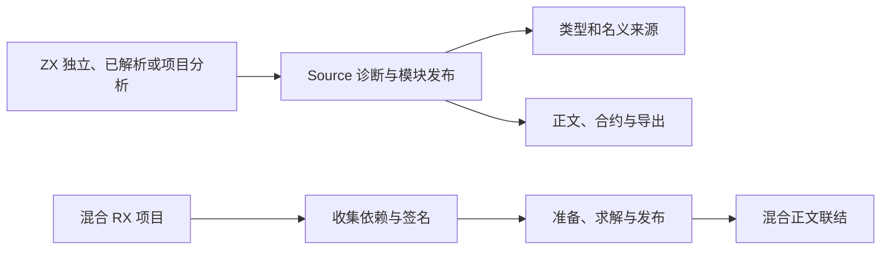
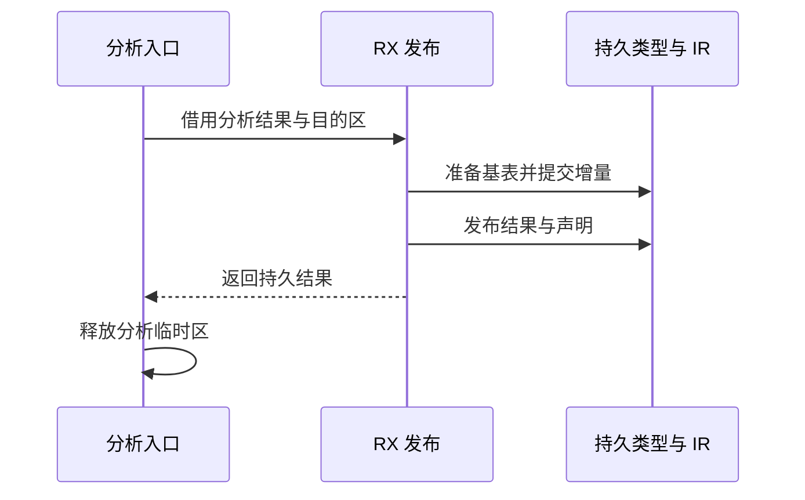

# 语义分析结果与 RX 推导发布自举

## Intent

推进收敛计划第 4.2 项。将 ZX 模块结果从分析成功到类型、正文、合约和导出的发布，以及混合项目从签名推导到约束结果发布的连续调用，接入正式 RX/ZX 入口。

## Data

独立、已解析和项目分析共用 ZX 分析器。旧的宿主发布函数决定何时复制类型基表，提交增量，发布正文和对外声明。混合项目已由 Source 生成阶段常量表，阶段实际由 Zig 循环推进。保留既有分析器、类型表提交、正文所有权和混合项目历史记录接口。

## Edges

项目已有的类型表只追加本次增量，独立分析拥有自己的类型文本，已解析分析继续借用项目基表文本。保留首条诊断、错误传播和分配失败回收。RX 约束区在求解结束后及时释放，历史帧与 Store 的借用方式保持一致。

## Answer

沿原调用入口核对实际退出的 Zig 阶段和仍持有的物理数据。集中核验名义类型、模块联结、诊断、混合项目、资源失败和生成一致性。沿用固定基线对照生成与常驻编辑，更新收敛计划后提交推送。

### 已迁移的职责

- ZX 模块分析和表达式分析用可空诊断交付结果。模块发布在同一条 RX 链决定独立分析拥有类型文本、已解析分析借用已有文本，或项目直接使用已有基表。类型和名义来源的增量沿用现有提交器。正文、文件名、合约和对外声明在持久区按原序写入。
- 签名与模块结果共用 Source 导出写入。公开类型和常量按原结构直接写入已有目标行，退出 Zig 的逐条名称复制与常量载荷分派。Zig 列接口负责分配和写入既有 ABI，Source 选择整数、浮点、字符串、布尔值或枚举的写入。
- RX 项目的帧选择、依赖图与签名推导、Store 与流程准备、约束收集和求解发布由 Source 推进。既有派生状态和约束区保持原位置，Source 编排调度在空分配器下运行。初始 seed 保留对应的顺序调用。

项目上下文、类型表尾部借用、RX 求解器的物理图存储和约束区释放仍由宿主提供。混合正文窗口和最终输出继续使用原阶段表，独立 ZX 的递归入口登记与最终验证也仍由宿主推进。

### 回归定位

首轮库联结和语义缓存显示内存不足。带符号复现确认名称已成功复制，实际失败是读取类型编号时越界，宿主进入了假定不可达的错误分支。入口中的并列名称和编号列长度相等。插桩使相同测试通过，单独改用两个只读视图或合并成一个视图仍能在未插桩时复现。

模块发布改为和签名发布共用独立的 Source 导出及常量写入入口。名称和类型编号在同一借用视图中传给写入函数，目标行在调用内完成写入。按原优化配置补验语义缓存 7 项，全部通过，其中两项覆盖逐次分配失败。

### 引导验收

正式候选由 `7312ba784` 的 Source 引导器构建，26 个步骤通过。初始 Zig seed 的词法和语法生成通过 33 个步骤。最终候选重生成四份清单，15,554 份产物逐字节一致。候选 SHA-256 为 `f841fc44ff6291846a617381062a140d000d7ecb972dd52173b6fd9559af415b`。

### 集中回归

表达式绑定、合约、库联结、名义类型、模块记录、语义缓存、RX 推导、RX 项目和 RX watch 九组通过。共 126 个步骤，266 项测试全部通过。回归复用了 `7312ba784` 引导器为最终源码生成的接口与步骤，正式候选重生成的同一清单与之逐字节一致。

### 性能对照

固定基线、上一批和候选各运行三轮相同的 735 入口冻结清单。生成配置为 `ReleaseSmall`、16 个分区，表中为中位数。

| 指标                       | 固定基线 | 上一批 |  候选 |
| -------------------------- | -------: | -----: | ----: |
| 冷生成墙钟（秒）           |     2.86 |   2.64 |  2.67 |
| 冷生成 CPU（秒）           |    12.45 |  12.87 | 12.88 |
| 冷进程树采样峰值 RSS（MB） |    897.2 |  711.8 | 708.3 |
| 冷单进程最大 RSS（MB）     |    926.9 |  737.9 | 734.4 |
| 热生成墙钟（秒）           |     2.21 |   1.98 |  1.97 |
| 热生成 CPU（秒）           |     8.44 |   8.30 |  8.28 |

与上一批相比，冷生成墙钟增加 0.03 秒，CPU 增加 0.01 秒，进程树采样峰值下降 3.5 MB。较固定基线，冷生成墙钟累计减少 0.19 秒，CPU 增加 0.43 秒，进程树峰值下降 188.9 MB。无改动时生成命令中位数保持 0.03 秒。

候选与上一批的 11,753 份冻结产物一致。候选冷暖产物一致，memo 载荷哈希保持 `cdf9fa7e0f33002a95dc097b2837de781d67e6e519a452fb97f89f7c0bbf3a23`。

常驻编辑中位数为 0.424 → 0.425 秒，采样峰值为 1,270.2 → 1,269.6 MB。编辑和恢复产物逐项一致。

### 下一批

沿混合项目 `Transaction.execute` 贯通窗口准备、缓存前缀恢复、ZX/RX 正文派发和联结结果提交。和现在已迁移的推导阶段共用历史帧及失败诊断，完成后收掉混合编译剩余的阶段表。同步核对独立 ZX 的递归入口登记、原生表借用及最终验证。[混合正文](../../packages/compiler/src/rx/analysis/project/mixed.zig) · [独立分析](../../packages/compiler/src/zx/analysis/analyze.zig)
