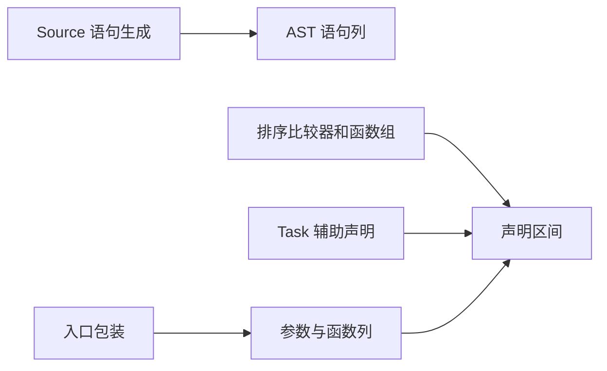
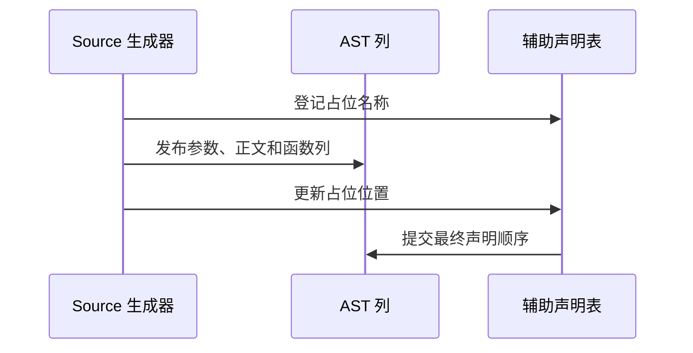

# 语句与辅助声明列发布自举

## Intent

让正式生成器的语句结果、入口包装和辅助函数组从现有 Source 列直接发布到 AST。统一清除语句的平坦前缀和已生成声明的重复转换。

## Data

语句计划由 RX/ZX 执行，表达式丢弃、分支、Store 写入与解构仍传入空的原生语句暂存。入口包装先物化参数与函数记录，排序先物化已经提交的函数列，然后重新写回 AST。Task 与排序的辅助常量先通过声明数组再写入共用辅助列。

## Edges

保持分支及解构的求值顺序，保留公开入口参数与错误集合。排序命名空间包含比较器、排序接口与 Ordering，`less` 继续留在 Ordering 内。排序与 Task 保留先登记名称再更新原位置的约定，动态名称必须由最终存储持有。

## Answer

表达式丢弃、分支、Store 写入及解构直接提交生成列。正式遍历帧移除原生暂存，通用提交接口移除平坦前缀参数。初始 seed 继续使用其原有语句表示。

公开 arena 和 State 视图包装直接由 ZX 生成函数声明列，公开别名也直接写入列。State 视图的参数在准备完成时提交，引用与转换的正文合到语句尾部后由 Source 追加返回并构造声明。

排序用比较器、Ordering 和 sort 的已提交行合并命名空间。排序与 Task 的占位和替换直接使用生成常量列，函数前置辅助常量复用同一路径。动态名称在离开临时分配区前持有，后续替换沿用其原始位置。

[语句列提交](../../packages/genz/src/builder.zig) · [入口函数列](../../packages/genz/src/zx/entry/emitting.zig) · [排序声明区间](../../packages/genz/src/zx/sorting/root.zig) · [辅助声明表](../../packages/genz/src/zx/auxiliary.zig)

### 引导一致性

上一代 Source 引导器 `9a654c884` 生成候选。25 个构建步骤通过，初始 seed 的 19 个步骤通过。候选重新生成主、增长、集合和执行四份清单，排除工具身份戳后 16,037 个文件逐字节一致。候选 SHA-256 为 `e0e15dfe9e72fcde65f42b966ddb7508b5877d9b1c99419ca6516e92f152483b`。

### 运行回归

八组回归通过 222 个构建步骤及 441 项 Zig 测试。入口进程另通过 46 项集成检查，借用原型通过 6 项检查。范围包括普通、RX 与 Store 的 Process 入口，Task 取消和并行，分支求值、解构、类型化错误、Store 提交及借用视图分配。借用视图及直接读取的样本仍各为一次分配、80 字节。

### 性能

macOS arm64、Zig 0.17.0、ReleaseSmall。沿用 735 个入口、16 分区的冻结清单，关闭常驻，取三轮交错测量的中位数。三套工具本体均由 Source 生成，测量时使用 Source 分析与生成。

| 场景   | 工具     | 墙钟（秒） | CPU（秒） | 进程树峰值（字节） | 单进程峰值（字节） |
| ------ | -------- | ---------: | --------: | -----------------: | -----------------: |
| 冷生成 | 固定基线 |       2.82 |     12.43 |        884,768,768 |        934,051,840 |
| 冷生成 | 上一阶段 |       2.61 |     13.05 |        660,275,200 |        685,178,880 |
| 冷生成 | 本批     |       2.55 |     12.92 |        664,256,512 |        685,735,936 |
| 热重建 | 上一阶段 |       1.90 |      8.23 |        644,808,704 |        644,841,472 |
| 热重建 | 本批     |       1.91 |      8.23 |        644,808,704 |        644,841,472 |

冷生成较同轮上一阶段墙钟下降 0.06 秒，CPU 下降 0.13 秒，进程树峰值增加 3.98 MB，单进程峰值增加 0.56 MB。物理内存峰值采样中位数增加 0.08 MB。较固定基线，墙钟下降 0.27 秒，CPU 累计增加 0.49 秒，进程树峰值下降 220.51 MB。无改动的墙钟和 CPU 均为 0.03 秒。[固定基线](AST载荷导入与容量自举.md)

冻结清单的 11,753 个文件逐字节一致，各自暖缓存重建与冷生成一致。所有权缓存正文 SHA-256 均为 `cdf9fa7e0f33002a95dc097b2837de781d67e6e519a452fb97f89f7c0bbf3a23`。

### 自我审查

公开包装函数的参数和声明从 Source 直接写入 AST。通用函数签名仍通过 `node.Function` 交接已有形参，辅助声明表仍有宿主存储适配。下一批沿证明发布入口处理证据写出和格式。当前性能证据覆盖分析和 Zig 生成，完整后端冷构建与三阶段自编译仍待验收。
