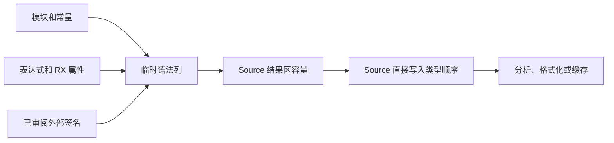
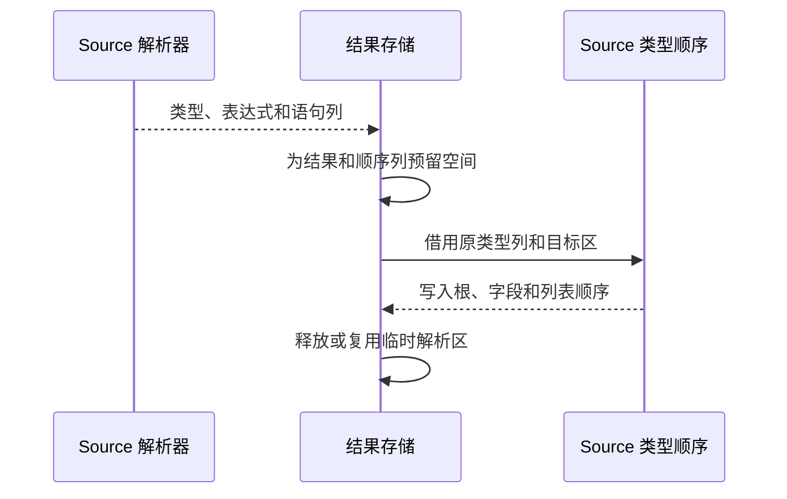

# 语法结果与类型顺序持久化

## Intent

贯通 ZX 模块、独立表达式、RX 属性和已审阅外部签名的类型语法发布。让类型顺序列直接生成在调用方指定的结果区，并在临时解析区释放前完成交接。

## Data

模块、表达式和常量各自计算类型顺序。旧路径在临时区逐步增长三组索引，保留语法时再次复制。索引的大小等于对应语法列的长度，可以一次预留。各行的前驱链接只指向此前已经解析的行。[解析保留](../../packages/compiler/src/zx/frontend/retention/host.zig) · [类型语法模型](../../packages/compiler/src/zx/frontend/parser/types/model.zx)

## Edges

语法行的索引、顺序、错误位置和源码借用契约保持以旧结果为准。持久路径沿用单块语法结果区，临时适配路径把相同的顺序列写入它自己的工作区。索引按确切长度预留并直接填充。其他语法行暂时按原布局保留。

## Answer

沿正式入口核对索引和诊断，确认类型顺序退出临时增长和保留复制。用现有解析、原生接口、RX 表达式和缓存回归覆盖不同生命周期，比较引导产物及同输入的冷生成、常驻编辑和内存。

### 已迁移的职责

- 模块、常量和表达式的解析阶段交付原始类型树。Source 根据树的列长度确定持久区容量，并在最终区域直接填充类型根、字段后继和元组项后继。三列共用一个连续区间。
- 模块和常量的发布次序由 Source 推进。RX 属性借用调用方的源码，语法结果与普通表达式共用同一写入路径。直接调用解析器的外部签名 RX 路径先校验输入，再在临时区生成类型顺序。
- 兼容 AST 使用类型树的前驱链接，省去构建类型顺序索引。原生接口的专用解析器继续使用既有类型顺序入口。

Zig 提供单次分配、切片视图和其余语法载荷的物理保留。剩余语法行仍从解析区复制。它们独立放置后，才能继续移除递归复制及 ABI 布局适配。[直接写入](../../packages/compiler/src/zx/frontend/parser/types/order/write.zx) · [模块发布](../../packages/compiler/src/zx/frontend/retention/order.zx)

### 引导验收

候选由 `5af89ab49` 的 Source 引导器生成，26 个步骤通过。初始 seed 通过 33 个词法和语法生成步骤。正式候选重生成四份清单，15,581 份产物逐字节一致。候选的 SHA-256 为 `6025047114999b1aaace9ccb1b6e6d1b782b6f7986fab367fcbf665abcbe5d62`。

### 集中回归

解析缓存、表达式绑定、XML 表达式、RX 属性与原生声明等入口均完成回归。55 项属性运行和 6 项语义拒绝检查通过。首轮遗漏外部签名直接消费解析器的调用，5 项旧式外部枚举用例读取未填充的类型顺序。修复外部签名 RX 路径后，名义类型来源的 26 项测试全部通过。复用其余未受改变的结果，合计覆盖 300 项 Zig 测试。[外部签名](../../packages/compiler/src/zx/modules/external/load.rx)

### 性能对照

固定基线、上一批和候选均使用各自阶段生成的 Source 分析与生成实现。三套工具针对同一份 735 入口冻结清单各运行三轮。配置为 `ReleaseSmall` 和 16 个分区，下表为中位数。

| 指标                       | 固定基线 | 上一批 |  候选 |
| -------------------------- | -------: | -----: | ----: |
| 冷生成墙钟（秒）           |     2.83 |   2.61 |  2.63 |
| 冷生成 CPU（秒）           |    12.52 |  12.88 | 12.94 |
| 冷进程树采样峰值 RSS（MB） |    885.2 |  709.8 | 710.8 |
| 冷单进程最大 RSS（MB）     |    972.8 |  727.6 | 739.5 |
| 热生成墙钟（秒）           |     2.21 |   1.97 |  1.96 |
| 热生成 CPU（秒）           |     8.47 |   8.27 |  8.28 |

相对上一批，冷墙钟增加 0.02 秒，CPU 增加 0.06 秒，进程树采样峰值增加 1.0 MB，单进程最大 RSS 增加 11.9 MB。单进程峰值比上一批验收中记录的 739.4 MB 高约 0.1 MB，保留这项波动的跟踪。相对固定基线，冷墙钟减少 0.20 秒，CPU 累计增加 0.42 秒，进程树峰值减少 174.5 MB。无源码变化中位数为 0.03 秒。

上一批与候选的 11,753 份冻结产物一致，候选自身冷暖产物一致。memo 载荷哈希保持 `cdf9fa7e0f33002a95dc097b2837de781d67e6e519a452fb97f89f7c0bbf3a23`。常驻编辑产物与恢复序列一致，编辑中位数为 0.425 → 0.423 秒，常驻 RSS 峰值为 1,279.9 → 1,279.7 MB。固定清单验证了阶段总成本，后续语法列迁移继续核对解析临时区和持久区的单独成本。

### 下一批

4.2c 接续词法与语法列的物理保留。先从词法输出追踪真正随结果保留的 token 与注释，核对插值和扫描临时数据的释放边界。再沿模块、表达式和 RX 属性共用的语法结果接续类型、表达式及语句列。[物理复制](../../packages/compiler/src/zx/frontend/compact_output.zig) · [词法准备](../../packages/compiler/src/zx/frontend/parser/prepare.rx)
