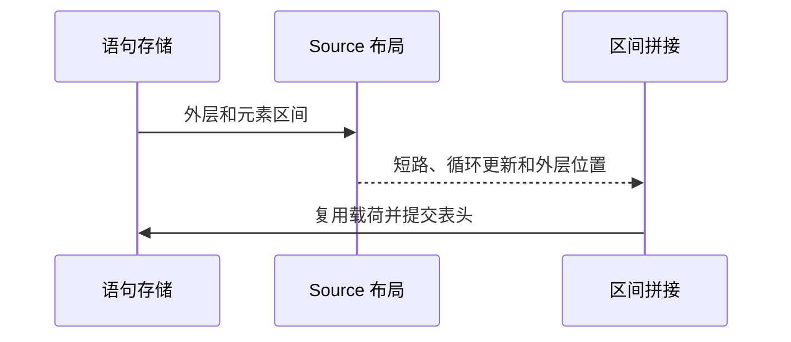

# 集合循环语句区间自举

## Intent

让 map、filter、reduce、every 和 some 直接保存 AST 语句区间，取消这些正式入口的 Zig 平坦语句数组。保持元素绑定、短路和累加器更新顺序。

## Data

集合生成器先计算各阶段的表头位置。宿主目前把若干 Source 语句列解码为 Zig 联合体，延后提交时再次编码。AST 已支持合并区间并复用其载荷。

## Edges

语句的执行顺序由区间中的顺序决定。刚好位于表尾的连续区间可以直接使用。需移动的区间只复制表头，字符串和子块继续复用原存储。保留 reduce 在原位置插入累加器更新的行为。

## Answer

五条正式集合路径均用语句区间保存待提交的正文。元素绑定单独生成，拼接时保持在回调语句前。Source 根据现有表尾计算 map 和 reduce 的循环起点，匹配时直接复用。filter 和谓词保留独立的条件分支，后续拼接复用原始载荷。reduce 以原回调区间长度为切点插入累加器更新。

[map 与 filter 的布局](../../packages/genz/src/analysis/transform/collect/publish.rx) · [reduce 的布局](../../packages/genz/src/analysis/transform/reduce/initialize.zx) · [谓词分支](../../packages/genz/src/analysis/predicates/build.rx) · [区间提交](../../packages/genz/src/node/blocks.zig)

Host 继续绑定实际 AST 列与输出表尾。初始 seed 保留原生平坦路径。增长、列表元素更新和引用构造还有与集合路径相邻的平坦入口，仍需收口。

### 引导一致性

Source 引导器通过 25 个构建步骤，初始引导入口通过 19 个构建步骤。上一代 Source 引导器 `348c95e92` 生成候选。候选用相同输入重新生成主、增长、集合和执行四份清单，16,035 个文件逐字节一致，比较时排除工具身份戳。

候选引导器 SHA-256 为 `3f045e127bd63881d2f3bba37ea7e53fac2293fd80cb62fe01fa08e1864ef224`。

### 运行回归

map、filter、reduce 回调轨迹，谓词调用顺序和分配，复合累加器以及集合初值所有权七组全部通过。构建汇总为 277 个步骤和 340 项 Zig 测试。轨迹回归同时执行源码和编译库消费路径。

### 性能

macOS arm64、Zig 0.17.0、ReleaseSmall。三轮交错取中位数，沿用 735 个入口和 16 分区的冻结清单，关闭常驻。各工具均由 Source 生成，并执行 Source 分析和生成。

| 场景   | 工具     | 墙钟（秒） | CPU（秒） | 进程树峰值（字节） | 单进程峰值（字节） |
| ------ | -------- | ---------: | --------: | -----------------: | -----------------: |
| 冷生成 | 固定基线 |       2.82 |     12.43 |        884,768,768 |        934,051,840 |
| 冷生成 | 上一阶段 |       2.54 |     12.90 |        664,469,504 |        682,262,528 |
| 冷生成 | 本批     |       2.54 |     12.85 |        661,995,520 |        687,538,176 |
| 热重建 | 上一阶段 |       1.88 |      8.13 |        643,383,296 |        643,416,064 |
| 热重建 | 本批     |       1.86 |      8.11 |        644,808,704 |        644,841,472 |

冷生成较上一阶段墙钟持平，CPU 减少 0.05 秒。进程树峰值下降 2.47 MB，单进程峰值增加 5.28 MB，同轮采样的物理内存峰值中位数增加 4.93 MB。相对固定基线，墙钟减少 0.28 秒，CPU 累计增加 0.42 秒，进程树峰值下降 222.77 MB。无改动的墙钟和 CPU 均为 0.03 秒。[固定基线](AST载荷导入与容量自举.md)

冻结清单的 11,753 个文件逐字节一致，暖缓存重建输出也与各自的冷生成一致。所有权缓存正文 SHA-256 均为 `cdf9fa7e0f33002a95dc097b2837de781d67e6e519a452fb97f89f7c0bbf3a23`。

### 自我审查

本批覆盖五条集合入口保存和拼接语句的方式。需要移动的区间复制表头及偏移，原载荷继续复用。宿主保留实际列写入和步骤间交接。增长、列表更新和引用构造仍有平坦入口，完整 Zig 后端冷构建和三阶段自编译仍待正式闭包收口后执行。
