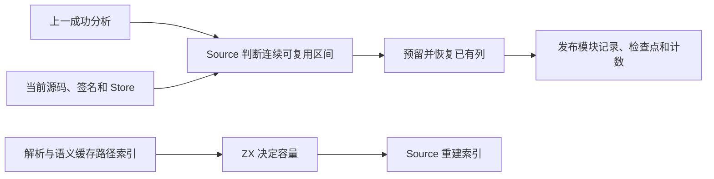
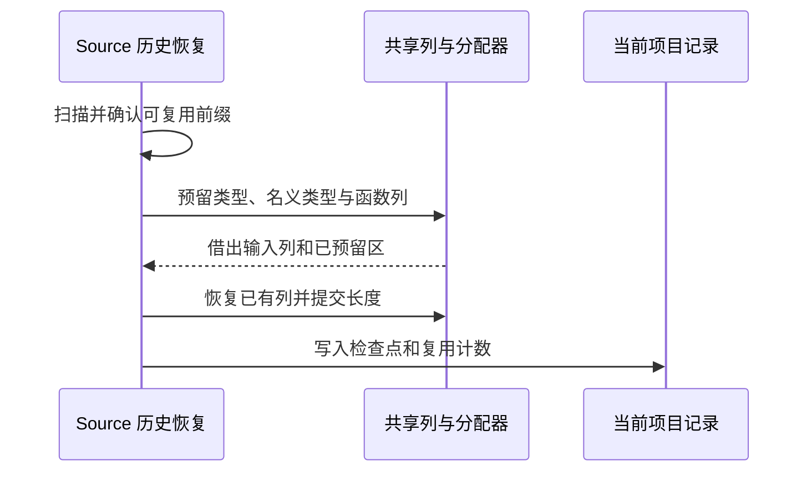

# 项目索引与历史前缀自举

## Intent

让 Source 推进混合项目的历史前缀，完成列恢复、检查点和进度计数的发布。把解析缓存与语义缓存共用的路径索引增长规则交给 ZX，沿用现有表表示和资源管理。

## Data

候选预取已由 RX/ZX 推进。历史复用目前调用 Source 扫描一次，遇到 Store 时由 Zig 比较并继续扫描。历史类型、名义类型和函数列已有 Source 写入，列长度仍由 Zig 更新。路径哈希查找和重建已使用 Source，容量阈值还在 Zig。[前缀恢复](../../packages/compiler/src/rx/analysis/project/mixed/reuse.zig) · [列写入](../../packages/compiler/src/rx/analysis/project/history/columns.zig) · [路径索引](../../packages/compiler/src/zx/modules/source_index/growing.zig)

## Edges

只有共享前缀仍对齐、源码和相关签名通过核对时才复用。Store 保持完整结构比较。先完成三组列的容量预留，再恢复列描述符并发布长度。复用来自上一成功分析的载荷。索引保持四分之一空桶阈值、原有翻倍规则和溢出语义。

## Answer

用现有增量、解析与语义缓存、Store 和路径图回归覆盖未改源码、失效重算、历史恢复和失败。以相同工具链验证完整候选引导器与固定清单，重点对照常驻编辑和冷暖生成。核对普通及原生语义缓存中仍由 Zig 执行的索引与提交职责。

正式入口由 Source 继续扫描可复用的前缀，按原有结构核对 Store，恢复类型、名义类型与函数列，然后发布检查点和计数。列装配与容量分配由 Zig 通用内存操作提供。解析与语义缓存共用的路径索引从 Source 取得增长容量，继续使用 Source 探测和重建。普通和原生语义缓存共用这套索引。

以 `a3de53122` 的 Source 引导器构建本阶段工具，25 个步骤通过。以候选和上阶段工具对相同源码执行 Source 分析与生成，四份清单的 15,602 份文件逐字节一致。集中回归 89 个步骤、31 项 Zig 测试和 16 项 Store 集成检查通过，覆盖解析缓存、语义缓存、模块记录和 Store 路径。

Zig 0.17.0、ReleaseSmall、16 分区和相同冻结清单下，候选与上阶段工具的 11,753 份冷暖生成输出逐字节一致。三次配对的中位数如下。

| 场景 | 工具     | 墙钟（秒） | CPU（秒） | 进程树峰值（字节） | 单进程峰值（字节） |
| ---- | -------- | ---------: | --------: | -----------------: | -----------------: |
| 冷   | 固定基线 |       2.82 |     12.43 |        885,063,680 |        920,911,872 |
| 冷   | 上阶段   |       2.57 |     12.84 |        660,799,488 |        677,543,936 |
| 冷   | 候选     |       2.57 |     12.89 |        658,685,952 |        685,031,424 |
| 热   | 固定基线 |       2.24 |      8.50 |        892,567,552 |        933,969,920 |
| 热   | 上阶段   |       1.92 |      8.26 |        643,547,136 |        643,563,520 |
| 热   | 候选     |       1.89 |      8.17 |        643,334,144 |        643,334,144 |

冷生成墙钟持平，CPU 增加 0.05 秒，进程树峰值下降 2.1 MB，单进程峰值增加 7.5 MB。相对固定冷基线，墙钟减少 0.25 秒，CPU 增加 0.46 秒，进程树峰值下降 226.4 MB。常驻编辑中位数从 0.424 秒到 0.425 秒，峰值下降 4.2 MB，逐次输出哈希一致。

接续迁移目标生成的区间打印与声明发布，沿公开库入口、分区和 Gateway 核对真正写入目标的路径。
