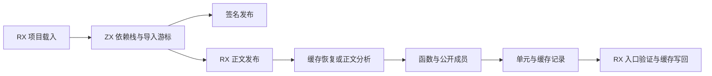
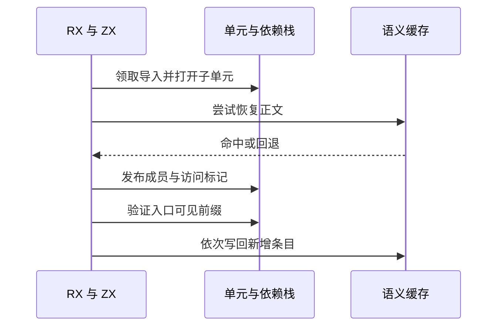

# 项目载入与语义缓存收尾

## Intent

将项目依赖遍历、正文缓存选择、项目入口验证和缓存写回迁入 Source。覆盖签名入口与正文入口，沿原入口确认 Zig 的两层遍历及项目缓存发布循环退出正式路径。

## Data

`Project.loadFrames` 原本持有依赖栈循环，`loadInput` 循环读取外部步骤结果并访问每条导入。`Project.finishInput` 决定恢复缓存或重新分析，再登记模块与缓存记录。`analyzeWithCaches` 验证入口并调用 `CachePublication.publish` 写回。既有 Source 已提供导入准入、路径选择、函数发布判定和语义缓存恢复。这一批复用这些规则。

## Edges

导入恢复保留暂停行和原绑定顺序。对缓存命中或失效的计数发生在正文分析前，旧缓存的编码和摘要保持兼容。正文发布后才能完成访问标记，验证入口后才能提交缓存。缓存写入失败时保留已经成功登记的条目。借用宿主现有 AST、IR 和缓存存储，逐次写回后重置提取的临时空间。原有 seed 继续执行同一套资源原语。

## Answer

候选通过同一套项目路径、联结、语义缓存、缓存编码和跨进程持久化回归。对照固定输入的冷暖产物及同一份冻结清单的耗时和峰值 RSS。结果随本批提交写入收敛计划。

### 迁移结果

- 签名和正文入口均已接到 Source 依赖栈。ZX 负责进入、恢复、访问和完成顺序。宿主仍持有栈槽、头部视图与路径 arena。
- RX 正文入口连接缓存命中或重新分析、函数登记、所有权检查、公开成员发布和记录登记。RX 入口发布先核对验证前缀，再由 ZX 顺序写回。
- 由 `4bfb47a69` 的 Source 引导器构建候选，构建通过 26 个步骤。候选运行自身的项目编排，再生成四份当前清单，15,402 份可比较产物逐字节一致。候选 SHA-256 为 `a81d943e2c99bdf05e84ba960442314558ccb0dda5ebd805c290ce589f4523a0`。
- 缓存条目在原地址登记。原生模块新增和绑定发布后仍由 Zig 清除旧验证标记。这些职责列入项目联结与缓存的下一条迁移链。

### 实施复核

首次生成指出可空的缓存根编号不能直接与记录编号比较。先判定根编号存在，再比较记录。用同一执行清单确认类型收窄，随后构建完整候选。与此前的 C 回调方案相比，本批沿用现有执行分组的静态 Zig 导入，并在读取每个帧时借用同一份 AST 头部；帧内扫描复用已选的视图。[前次依赖装载记录](../2026-11-18/ZX依赖装载与导入恢复自举.md)

沿三个生成入口检查 Source 调用链，均无临时堆分配调用。宿主沿用原项目、路径和工件提取的分配器，Source 编排使用空缓冲分配器。

静态适配仍借用 Zig 的项目表、缓存条目和两种解析版本。待 Source 可直接读取解析版本的头部列以及发布项目表后，移除 `ProjectWalk` 和 `ProjectBody` 的专用句柄。入口的 `ProjectEntry` 在 Source 能直接提交结果与缓存载荷后移除。平台分配器和文件读写继续按各自的通用接口调用。

### 阶段验收

初始 seed 的词法引导通过 14 个构建步骤。统一库、原生库、联结边界、磁盘缓存编码、语义缓存、解析缓存、RX 项目和跨进程缓存八组回归通过，共 129 个构建步骤、130 项 Zig 测试及 14 项 CLI 集成。集成覆盖跨进程复用、失效与恢复、文件丢失后的诊断和失败时保留上一版应用。

### 性能对照

固定基线、上一批与候选各运行三轮同一份 735 入口的冻结清单，配置为 `ReleaseSmall`、16 个分区。下表记录生成阶段中位数。

| 生成指标                   | 固定基线 | 上一批 |  候选 |
| -------------------------- | -------: | -----: | ----: |
| 冷墙钟（秒）               |     2.89 |   2.64 |  2.63 |
| 冷 CPU（秒）               |    12.61 |  12.89 | 12.94 |
| 冷进程树采样峰值 RSS（MB） |    885.6 |  712.7 | 722.3 |
| 冷单进程最大 RSS（MB）     |    922.0 |  734.6 | 738.0 |
| 热墙钟（秒）               |     2.22 |   1.97 |  2.00 |
| 热 CPU（秒）               |     8.51 |   8.29 |  8.33 |

较上一批，冷生成墙钟减少 0.01 秒，CPU 增加 0.05 秒，进程树峰值增加 9.6 MB。较固定基线，冷墙钟累计减少 0.26 秒，CPU 增加 0.33 秒，进程树峰值下降 163.3 MB。未改动时生成命令的中位数仍为 0.03 秒。

候选与上一批的 11,753 份冻结产物一致，候选自身冷暖产物一致，固定基线的历史差异与上一批一致。所有权 memo 的 SHA-256 与上一批相同，为 `cdf9fa7e0f33002a95dc097b2837de781d67e6e519a452fb97f89f7c0bbf3a23`。常驻编辑中位数分别为 0.425 和 0.426 秒，峰值分别为 1,273.87 和 1,273.99 MB。各次编辑及恢复产物一致。

### CLI 后端编译的峰值复核

两次回归的 Zig 构建摘要分别显示 `3G` 和 `4G`。该摘要以十进制 GB 取整。使用同一份隔离源码目录、各自已验收的生成产物、同一 Zig 工具链和相同缓存设置，依次以冷局部缓存直接运行各自的 CLI `build-exe`，读取 `/usr/bin/time -lp` 的完整数值。

| CLI 编译指标       | 上一批 |   候选 |  变化 |
| ------------------ | -----: | -----: | ----: |
| 墙钟（秒）         | 116.14 | 116.48 | +0.34 |
| CPU（秒）          | 118.80 | 119.23 | +0.43 |
| 最大 RSS（MB）     | 5156.3 | 5185.0 | +28.8 |
| 峰值内存占用（MB） | 4481.9 | 4495.3 | +13.4 |

独立复测的 CLI 最大 RSS 增加约 0.56%。冷生成与 CLI 编译的峰值按各自的入口记录，后续批次继续沿用固定生成基线跟踪累计变化。
