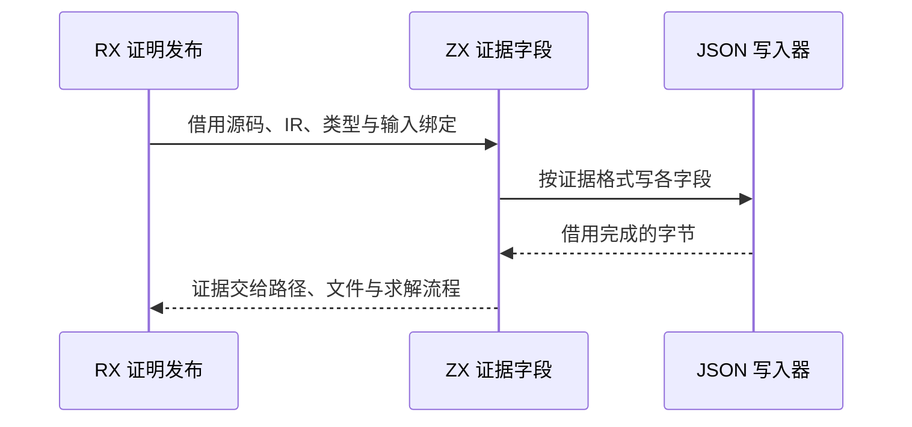

# 验证证据 JSON 写出自举

## Intent

让正式 `verify` 由 RX/ZX 决定证据文件的字段、顺序和发布时机，移出 Zig 中完整的证据对象构造。

## Data

`verification.check` 共用于独立验证、公开库和下游编译门禁。当前证据由 Zig 构造整个记录再序列化，默认证明路径对证据和两份查询依次计算 SHA-256。旧 JSON 的字段顺序、缩进和字节影响证明目录身份。

## Edges

源码记录、输入绑定、类型表和 IR 借用现有存储。Zig 标准库处理单个值的编码和转义。证据只写入一份缓冲区，最后由证明发布读取。保留诊断短路、原字段形状、错误、摘要和输出顺序。初始 seed 保留完整记录序列化，用于独立引导。

## Answer

用同一候选核对默认和指定路径的实际 JSON、查询、诊断及退出码，独立复算默认路径摘要。复用现有验证和分配失败回归，再对照证据写出及固定引导清单开销。

### 实现

RX 在诊断短路后执行证据写出，再准备摘要、路径和求解请求。ZX 按 `sources`、`entry`、`ir_version`、`types`、`inputs` 和 `ir` 的顺序发布。Zig 的接口按静态类型向同一个 `std.json.Stringify` 交付单个值。原生数据和最终字节均在调用内借用，省去为证据缓冲区收尾而搬运完整字节的可能。原先构造完整记录的代码只由初始 seed 使用。

[发布顺序](../../packages/compiler/src/verification/solver/publication/run.rx) · [证据字段](../../packages/compiler/src/verification/solver/publication/evidence/write.zx) · [JSON 写入器](../../packages/compiler/src/verification/solver/publication/evidence/output.zig)

### 引导一致性

上一代 `0d5a91068` 的 Source 引导器生成候选，通过 25 个构建步骤。初始 seed 通过 19 个构建步骤。两代引导器对同一份主、增长、集合和执行清单输出的 16,045 个文件逐字节一致，排除工具身份戳。

两代引导器二进制也逐字节一致，SHA-256 均为 `e0e15dfe9e72fcde65f42b966ddb7508b5877d9b1c99419ca6516e92f152483b`。证据写出在 CLI 的正式验证路径执行，引导生成性能沿用上一阶段的固定清单对照。[引导性能](语句与辅助声明列发布自举.md#性能)

### 运行回归

同一候选通过 92 项 Zig 测试、20 项独立验证、8 项公开入口和 74 项枚举验证。硬件求值使用仓库中已经安装的 YoWASP Yosys 补跑，144 项组合输入与故障检查、14 个周期的 56 条信号记录通过。初次硬件求值仅缺少 `ZXC_TEST_YOSYS` 设置，补齐后复用同一编译产物。没有新增回归用例。

12 组前后对照通过，覆盖默认与指定路径、反例、不可满足、未知、求解器版本或执行失败和无效应答。83 份实际文件逐字节一致，命令诊断和退出码一致。证据通过 JSON 解析，字段顺序与缩进符合原格式。三个默认目录分别从证据 JSON 和两份查询重新计算 SHA-256，与旧工具和目录名一致。

### 验证性能

两套 CLI 都由 Source 生成并运行 Source 分析和生成。macOS arm64、Zig 0.17.0、ReleaseSmall，关闭缓存与常驻生成。第一轮预热，其后七轮交错取中位数。额外六个分支各验证一次产物和行为。

| 验证输入             | 墙钟旧 → 新（毫秒） | CPU 旧 → 新（毫秒） |  峰值 RSS 旧 → 新（字节） |
| -------------------- | ------------------: | ------------------: | ------------------------: |
| 复合端口，默认路径   |         9.93 → 9.86 |         9.03 → 9.00 |   24,985,600 → 24,985,600 |
| 4,096 字段，默认路径 |       26.77 → 26.73 |       25.88 → 25.86 |   26,492,928 → 26,509,312 |
| 4,096 字段，指定路径 |       26.08 → 26.14 |       25.22 → 25.26 |   26,492,928 → 26,492,928 |
| 4,096 字段，隔离求解 |       21.28 → 21.25 |       20.08 → 20.10 |   16,154,624 → 16,154,624 |
| 512 分支，指定路径   |     364.60 → 365.28 |     363.50 → 364.26 | 200,228,864 → 200,212,480 |
| 反例，默认路径       |       11.99 → 11.91 |       10.86 → 10.82 |   25,378,816 → 25,378,816 |

重复测量中墙钟最大增加 0.67 毫秒，CPU 最大增加 0.76 毫秒，峰值 RSS 最大增加 16 KiB。引导器和固定基线关系沿用上一阶段，冷生成墙钟比固定基线少 0.27 秒、CPU 累计增加 0.49 秒。

### 自我审查

本阶段迁出证据的外层结构、字段顺序和写出调度。嵌套值继续由 Zig 标准库根据现有表示编码，宿主仍提供原生数据视图和 I/O 资源。验证覆盖实际证明与引导生成，完整冷构建和三阶段自编译仍待验收。
