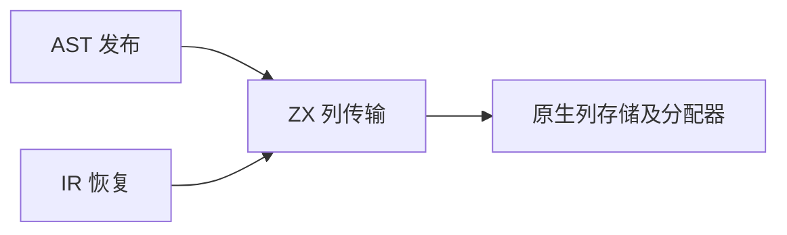

# AST 与 IR 列传输自举

## Intent

让 AST 导入和项目历史恢复共用 ZX 的列遍历、容量预留、范围校验、拥有载荷的写入和失败回滚。RX 继续按原顺序组织 AST 的校验、写入和发布。

## Data

起点为 `fd0644f6f`。AST 稠密列、按索引列和独立字段的 Source 路径调用六个执行列组遍历的内存入口，历史恢复也用相同入口复制并发布 IR。现有测试覆盖 AST、模块生成、工件、历史和缓存恢复。[AST 入口](../../packages/genz/src/analysis/node_headers/payload/validated.rx) · [IR 恢复](../../packages/compiler/src/zx/ir/columns/restore.zx) · [列传输](../../packages/core/src/memory/column_transfer.zig)

## Edges

保持批量原始字节传输和元素级拥有拷贝。数字和借用视图不分配载荷，深拷贝仍为拥有的值分配独立存储。检查原有的失败顺序，保留稠密复制失败时释放暂存行、按索引发布时保留成功前缀、容量失败时不改变可见长度的约定。仅内部构建可使用无额外分配的借用列描述符。

## Answer

核对六个原列组接口已退出正式路径。复用引导和历史恢复证据，验证实际输出、生命周期、错误前缀和冷暖性能。仍涉及平台读写和单值所有权的边界逐项记录。

### 已迁移的正式路径

稠密 AST、按索引 AST、独立字段和 IR 历史恢复共用 ZX 的列操作。Source 判断供给的行数、预留每列容量、区分原始传输与拥有载荷、复制并释放尚未发布的前缀，最后由调用路径提交可见长度。旧的六个列组入口从内存接口移除，seed 保留原始导入实现。宿主提供借用的列描述符、单列的存储操作和单个嵌套载荷的类型分派。字符串列表内部的保留和释放仍由原生实现，后续沿这一边界继续迁移。

候选由上一阶段 Source 引导器构建，通过 26 个步骤。上一阶段和候选分别用本批源码生成主、执行、宿主、集合及增长清单，17,117 个输出逐字节一致。冻结性能对照采用 705 个入口、16 分区、关闭常驻生成器，同配置交错三轮。三组工具本体来自 Source 自编译，运行各自的 Source 分析和发射。

| 对照     | 冷墙钟 | 冷 CPU | 冷进程树 RSS | 冷系统峰值 | 热墙钟 | 热 CPU |
| -------- | -----: | -----: | -----------: | ---------: | -----: | -----: |
| 固定基线 | 2.05 s | 8.96 s |     738.1 MB |   768.9 MB | 1.61 s | 6.33 s |
| 上阶段   | 1.90 s | 9.33 s |     534.6 MB |   559.9 MB | 1.41 s | 6.19 s |
| 候选     | 1.94 s | 9.38 s |     533.6 MB |   552.4 MB | 1.44 s | 6.23 s |

相比上阶段，冷墙钟增加 0.04 秒，CPU 增加 0.05 秒，进程树峰值减少 1.1 MB，系统峰值减少 7.5 MB。相比固定基线，冷墙钟减少 0.11 秒，CPU 增加 0.42 秒，进程树峰值减少 204.5 MB。冻结清单的 9,894 个输出保持一致。候选引导器 SHA-256 为 `e81d4909c6afb7b51c3b06c124fe5697c97ce71405c66a51b22e372bfb3f06f1`。

模块生成、模块循环、模块工件、缓存编码、语义缓存及 RX 项目推导集中回归通过 159 个步骤和 435 项测试。
