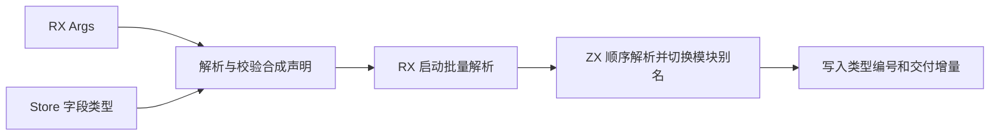
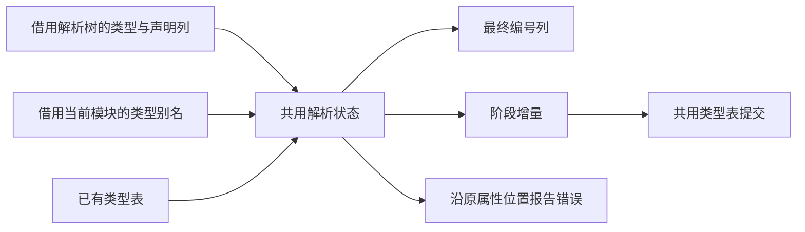

# RX 参数与 Store 字段类型自举

## Intent

由 Source 批量解析 RX Args 和 Store 字段，从解析树直接读取声明，将类型编号写入结果列，并共用类型增量交付。保留模块自己的类型别名、声明顺序和原始属性诊断。

## Data

起点为 `5adc2f96a`。Args 和 Store 已共用合成 ZX 声明的渲染和校验。Zig 分组或遍历声明，每一行独立启动类型解析、创建暂存区和提交类型增量。Store 通过 Zig 遍历生成步骤表来检查声明、拒绝 void 并记录字段类型。

## Edges

解析上下文仅借用真实类型树，合成声明的内部名字不会进入用户别名。Args 跟随声明所属模块切换别名，只借用当前模块的行。Store 在原声明位置报告首个错误，前序字段的错误优先于后续名称校验错误，void 诊断仍定位到相应字段。失败时丢弃暂存区及未交付结果。初始 seed 保留原路径。

## Answer

- Args 和 Store 共用 Source 批量解析器，整批复用暂存区与解析状态。每条声明直接将编号写入预分配的最终列，整批成功后一次提交类型增量。原 Zig 按字段解析和提交的循环退出生成版路径。
- Args 在模块变化时借用新模块的别名行。Store 的声明核对和 void 检查由同一批量解析器按原顺序执行，生成步骤表中的 Store 字段类型分支已移除。
- Zig 绑定已有解析列及结果缓冲，调用共用类型表提交并映射原属性诊断。别名切换使用通用的命名行借用原语，直接读取已有行视图。

### 正确性核验

用 `5adc2f96a` 的 Source 工具构建候选，27 个引导步骤通过。候选 SHA-256 为 `be0989d03310682a6620df052a9bf1ab6b462a52cdb2f298ee401ef1e54db26f`。五份当前引导清单的 17,588 个生成文件逐字节一致。十次常驻请求的分析、复用、发射计数和产物哈希与上阶段一致。修改的 RX 和 ZX 文件通过格式与 lint 检查。

正式候选通过 83 个构建步骤、153 项 Zig 测试和 17 项 CLI 测试，覆盖 RX 推导、XML 属性位置、真实磁盘项目恢复与 Store 应用状态。初始 seed 通过解析器构建和 39 项 RX 回归。

### 性能对照

固定 705 个入口和 16 个分区，关闭常驻生成器，交错三轮取中位数。三个工具均由 Source 构建，并运行各自的 Source 分析与生成。固定输入的 9,894 个生成文件及所有权 memo 逐字节一致。

| 对照     | 冷生成墙钟 | 冷生成 CPU | 冷进程树峰值 RSS | 冷系统记录峰值 RSS | 热生成墙钟 | 热生成 CPU |
| -------- | ---------: | ---------: | ---------------: | -----------------: | ---------: | ---------: |
| 固定基线 |     2.10 s |     9.04 s |         737.1 MB |           759.8 MB |     1.64 s |     6.43 s |
| 上阶段   |     1.95 s |     9.52 s |         527.9 MB |           551.8 MB |     1.44 s |     6.24 s |
| 候选     |     1.93 s |     9.43 s |         527.0 MB |           551.0 MB |     1.43 s |     6.25 s |

较上阶段，冷生成墙钟减少 0.02 秒，CPU 减少 0.09 秒，进程树与系统记录峰值分别减少 0.8 MB。热生成墙钟减少 0.01 秒，CPU 增加 0.01 秒。无改动检查墙钟为 0.03 秒。较固定基线，冷生成墙钟减少 0.17 秒，CPU 累计增加 0.39 秒，进程树峰值减少 210.1 MB。
