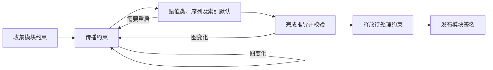

# RX 图求解与签名发布自举

## Intent

让正式 RX 类型推导在 Source 中执行图求解轮次、重启和签名发布。保持约束处理及报错顺序，继续直接写入端口、绑定和任务类型列。

## Data

起点为 `005941fed`。此前 Zig 按 Source 提供的步骤表执行求解，负责重启轮次。签名行内的检查和写入已有 ZX 实现，Zig 负责解析未决节点后继续扫描，并在收集和发布之间释放临时约束。

## Edges

初始传播仍以索引步骤结束后的图修订号决定是否重启。赋值类构建、物化及最后的非空、选择与对象约束分别保留原有修订检查。序列和索引默认值使用各自明确返回的重启结果。求解工作区按原时机回收，临时约束释放后才发布签名。

签名继续按绑定、输入、任务和输出的原顺序推进。遇到未决节点时暂停在原游标，解析后使用同一张图的列继续。解析可更新既有节点并登记最终类型，借用的节点列保持有效。初始 seed 保留同顺序的原生引导路径。

## Answer

- 收集、求解、临时约束释放和签名发布按正式入口的调用顺序执行。RX 执行传播、默认值和校验阶段，并直接控制每轮是否重启。旧的求解步骤表和 Zig 轮次解释已移除。
- 签名发布沿用 ZX 批量写列，RX 接管未决节点的暂停、解析、继续扫描及完成条件。端口及绑定列仍直接用作发布目标。
- 定向生成确认求解和签名发布的游标使用栈上状态，两个入口使用空暂存分配器。Zig 保留底层约束操作、图存储与未决类型的工作区管理。后续可接续类型节点解析的帧和值栈，以及类型构造后的继续推进。

### 自编译与产物一致性

用 `005941fed` 的 Source 工具构建候选，27 个引导步骤通过。候选 SHA-256 为 `e30fac83e90fc67f09944b5b778f7b0b2bda13d7453a1ea80f0867bfa3133f24`。五份引导清单的 17,621 个生成文件逐字节一致。十次常驻编辑请求的计数及产物哈希与上阶段一致。修改的 RX 和 ZX 文件通过格式与 lint 检查。

签名发布移入执行清单后，借用的图节点枚举与 Source ABI 分别由两份清单生成。该边界使用已有的列借用接口做编译期布局校验，省去逐行转换。

正式候选通过 83 个构建步骤、153 项 Zig 测试和 17 项 CLI 集成，覆盖 RX 类型推导、赋值和可空规则、任务绑定、分配失败及 Store 应用。初始 seed 通过解析器构建和 39 项 RX 回归。

### 性能对照

固定 705 个入口和 16 个分区，关闭常驻生成器，交错三轮取中位数。三个工具均由 Source 构建，并执行各自的 Source 分析与生成。对照的 9,894 个生成文件及所有权 memo 逐字节一致。

| 对照     | 冷生成墙钟 | 冷生成 CPU | 冷进程树峰值 RSS | 冷系统记录峰值 RSS | 热生成墙钟 | 热生成 CPU |
| -------- | ---------: | ---------: | ---------------: | -----------------: | ---------: | ---------: |
| 固定基线 |     2.09 s |     9.01 s |         737.5 MB |           762.7 MB |     1.63 s |     6.42 s |
| 上阶段   |     1.96 s |     9.51 s |         529.2 MB |           544.3 MB |     1.43 s |     6.25 s |
| 候选     |     1.94 s |     9.45 s |         526.0 MB |           551.1 MB |     1.46 s |     6.24 s |

较上阶段，冷生成墙钟减少 0.02 秒，CPU 减少 0.06 秒，进程树峰值减少 3.1 MB，系统记录峰值增加 6.8 MB。热生成墙钟增加 0.03 秒，CPU 减少 0.01 秒。无改动检查墙钟为 0.03 秒。较固定基线，冷生成墙钟减少 0.15 秒，CPU 累计增加 0.44 秒，进程树峰值减少 211.5 MB。
