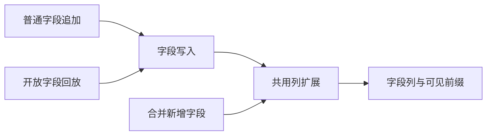

# RX 字段存储复用与修订发布自举

## Intent

从 `9c0acca37` 接续。把字段追加、开放字段回放和合并三个正式入口的列扩展规则迁到 Source。只有末次发布的前缀能直接扩展，其他视图原样可读。移除旧扩展实现、合并专用预留和追加专用修订回调。

## Data

字段名称与节点 ID 在同一次对齐分配中分列保存，头部记录容量和末次发布长度。追加先登记节点，再保留名称，最后扩展字段列。合并有新增字段时才扩展，共享旧字段名称的底层字节。[布局与增长](../../packages/compiler/src/rx/analysis/inference/fields.zig) · [追加与开放回放](../../packages/compiler/src/rx/analysis/inference/fields/target.rx) · [类型合并](../../packages/compiler/src/rx/analysis/inference/unification/fields/merge.rx)

## Edges

保留增长上限、体积校验、分配顺序、单次物理分配与批量前缀复制。新名称继续分配到类型表的存储区。追加最后发布节点形状和图修订；合并沿原调用链提交根及修订。现有 seed 按原路径构建。

## Answer

普通字段和开放字段共用追加编排。先登记未知节点，再把字段名保留到类型表，按旧前缀长度扩展，最后写入新字段、节点形状和图修订。合并只在有新增字段时扩展，提交根节点的顺序保持原样。

两个入口共用 Source 的容量判断、前缀复制和可见长度提交。能继续使用原分配时只绑定新范围。新分配时批量复制名称视图及节点 ID，名称的底层存储继续复用。定向生成时发现既有复制接口要求等长，改用通用的带偏移复制以覆盖增长后的目的列。初始 seed 的整列分配和复制仍走原入口。

原生层保留打包布局、对齐分配和借用绑定。删除旧 `Fields.extend`、合并专用预留及字段修订宿主回调。追加公开的原生操作只创建未知节点并刷新节点列借用，后续步骤由 RX 显式推进。

### 行为与引导验证

- 普通字段读取、合并、构造及选择四个编译入口完成定向生成。生成只借用字段扩大后的原列，未增加描述符分配。
- 上一版本的 Source 引导器构建候选，27 个引导步骤通过。主编译器、执行、宿主、集合和增长五份清单共 17,690 个生成文件逐字节一致。10 个常驻编辑及错误恢复场景的结果与上一批一致。
- 正式 Source 路径的 153 项 Zig 回归和 17 项 CLI 集成通过，包括嵌套字段推导及分配失败。初始 seed 通过 50 个步骤和 39 项 RX 测试。
- 候选 Source 引导器 SHA-256 为 `9841a95a5d5b73552f75582e1bba5248dad7d9d697e674f93aaf3e9c7be7beb1`。

### 性能

固定 705 个入口和 16 个分区，关闭常驻生成器，三轮交错取中位数。三套工具都由 Source 构建，并运行各自的 Source 分析与生成。候选与上一批的 9,894 个冻结生成文件及所有权 memo 一致，各工具冷、热生成的输出也分别一致。

| 对照     | 冷生成墙钟 | 冷生成 CPU | 冷进程树峰值 RSS | 冷系统记录峰值 RSS | 热生成墙钟 | 热生成 CPU |
| -------- | ---------: | ---------: | ---------------: | -----------------: | ---------: | ---------: |
| 固定基线 |     2.06 s |     8.90 s |         737.9 MB |           788.4 MB |     1.58 s |     6.26 s |
| 上一批   |     1.93 s |     9.42 s |         525.5 MB |           551.1 MB |     1.37 s |     6.05 s |
| 候选     |     1.92 s |     9.47 s |         524.9 MB |           549.6 MB |     1.45 s |     6.21 s |

较上一批，冷生成墙钟减少 0.01 秒、CPU 增加 0.05 秒，进程树峰值减少 0.5 MB，系统记录峰值减少 1.4 MB。热生成墙钟增加 0.08 秒、CPU 增加 0.16 秒，无修改生成墙钟同为 0.03 秒。较固定基线，冷生成墙钟减少 0.14 秒、CPU 累计增加 0.57 秒，进程树峰值减少 213.0 MB。热生成墙钟减少 0.13 秒、CPU 减少 0.05 秒。本次对照覆盖引导生成阶段。
