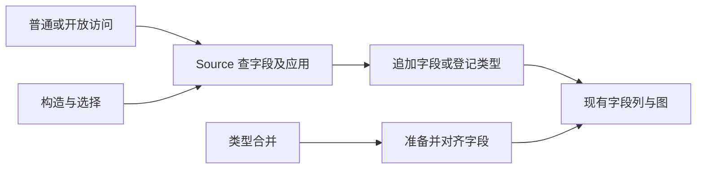

# RX 字段访问与合并准备自举

## Intent

贯通普通字段、开放对象及对象重放中的同一字段读写路径。把字段追加、声明类型登记、缺失处理，以及合并字段的索引准备和结果交付接到 Source。维持既有字段内存布局和前缀寿命。

## Data

起点为 `0fa6c515d`。普通访问和开放对象的旧 Zig 分流分别调用字段计划和成员查找，随后在 Zig 决定效果。对象构造及选择从 RX 折返这条路径。类型合并已用 RX 推进子项，字段工作区的长度、索引选择与结果增长仍由原生入口推进。[对象状态调查](../2026-11-23/对象字段推导的宿主状态与迁移边界调查.md)

## Edges

保留根、字段及跨度读取的原顺序。普通访问和开放访问沿用各自的判定。追加先创建节点并保留名字，再扩展列，容量不足或借到旧前缀时沿用布局的复制规则。合并保留顺序查找或索引的阈值、字段位置和释放范围。

## Answer

- 普通和开放字段访问现在使用同一 Source 计划与应用流程。Source 决定读取、追加、登记类型、登记长度约束或报告诊断。追加复用原字段布局，在名字保留和尾部扩展后写入字段、发布形状及修订号。[字段读取](../../packages/compiler/src/rx/analysis/inference/fields/read.rx) · [追加](../../packages/compiler/src/rx/analysis/inference/fields/write.rx)
- 构造和选择在 RX 中直接调用共用字段流程，两条路径借用同一个字段视图。移除了三项对象重放专用回调，包括读取、追加和目标类型登记。当前仍由原生帧绑定已有图、分配尾部并提交合并等物理操作。[字段目标](../../packages/compiler/src/rx/analysis/inference/fields/target.rx) · [视图绑定](../../packages/compiler/src/rx/analysis/inference/fields/replay.zig)
- Source 决定合并字段的顺序或索引查找、清空索引，以及有新增字段时预留并填写结果。工作区保留原分配器和异常退出顺序。定向生成覆盖字段读取、索引准备、合并发布及两条重放入口，生成代码直接借用描述符，游标使用栈上值。[合并准备](../../packages/compiler/src/rx/analysis/inference/unification/fields/prepare.rx) · [合并发布](../../packages/compiler/src/rx/analysis/inference/unification/fields/merge.rx)

首次候选在第二次生成中崩溃。将复现缩小到集合清单的现有参数登记入口，定位到字段追加写入形状时借用了已退出的预留回调中的切片描述符。字段帧现在持有描述符直到写入和发布结束，数据列仍借用原图内存。[尾部预留](../../packages/compiler/src/rx/analysis/inference/fields/host.zig)

### 自编译与产物一致性

远端发布后撤回了另一批选择整合。本批沿用撤回后的选择入口，并接入共用字段读写。最终提交的源码与本节验收候选完全一致。

由 `0fa6c515d` 的 Source 工具构建 ReleaseSmall 候选，27 个引导步骤通过。候选 SHA-256 为 `2ca6e558b9b2f9fc048526d9989a68c06c3225ea46c9e9bb76342b22237e66f8`。集合清单中曾崩溃的单项生成已通过。五份清单的 17,650 个生成文件逐字节一致，十次常驻编辑的输出哈希与计数也与上阶段一致。RX 和 ZX 代码通过格式与 lint 检查。

候选通过 83 个正式构建步骤、153 项 Zig 测试和 17 项 CLI 集成。已有回归覆盖 RX 推导、字段访问、对象约束、分配失败、诊断位置与 Store 执行。初始 seed 通过解析器构建和 39 项 RX 回归。

### 性能对照

固定 705 个入口和 16 个分区，关闭常驻生成器，交错三轮取中位数。三个工具均由 Source 构建，并使用各自的 Source 分析与生成。对照的 9,894 个生成文件及所有权 memo 逐字节一致。

| 对照     | 冷生成墙钟 | 冷生成 CPU | 冷进程树峰值 RSS | 冷系统记录峰值 RSS | 热生成墙钟 | 热生成 CPU |
| -------- | ---------: | ---------: | ---------------: | -----------------: | ---------: | ---------: |
| 固定基线 |     2.05 s |     8.93 s |         738.4 MB |           760.3 MB |     1.58 s |     6.27 s |
| 上阶段   |     1.91 s |     9.45 s |         524.0 MB |           559.8 MB |     1.43 s |     6.19 s |
| 候选     |     1.93 s |     9.43 s |         525.5 MB |           552.9 MB |     1.43 s |     6.18 s |

较上阶段，冷生成墙钟增加 0.02 秒，CPU 减少 0.02 秒，进程树采样峰值增加 1.4 MB，系统记录峰值减少 6.9 MB。热生成墙钟持平、CPU 减少 0.01 秒，无改动检查仍为 0.03 秒。较固定基线，冷生成墙钟减少 0.12 秒，CPU 累计增加 0.50 秒，进程树采样峰值减少 213.0 MB，系统记录峰值减少 207.4 MB。

下一批把对象构造和选择的整行交接接入 Source，贯通对象就绪性、投影、类型登记、约束写入与结果诊断。继续复用单对象暂存区和跨轮就绪快照，在源码流程接管原职责后清理专用接口。[对象状态调查](../2026-11-23/对象字段推导的宿主状态与迁移边界调查.md)
