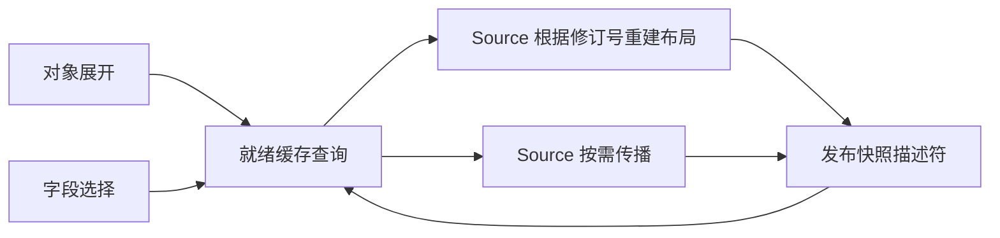
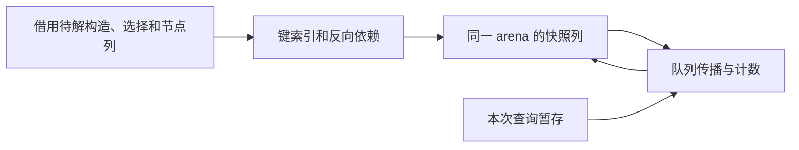

# RX 对象就绪缓存发布自举

## Intent

沿正常轮和最终轮收口对象展开、字段选择共用的就绪缓存。让 Source 负责快照重建、分配规模、传播结果和缓存发布，去掉 Zig 在布局生成、传播和查询之间的交接。

## Data

起点为 `db0891757`。正式路径由 `Graph.finish` 进入构造和字段选择。展开经 `proveObjectSpreadReady` 进入查询，选择在批量扫描中直接查同一缓存。两端未命中时经 `ObjectClosure.rebuild` 与 `ObjectClosure.propagate` 进入两套 Zig 交接，目前由 Zig 分配传播缓冲、组装快照和发布结果。[求解入口](../../packages/compiler/src/rx/analysis/inference/solve.zig) · [查询](../../packages/compiler/src/rx/analysis/inference/object_closure/query.zx)

## Edges

共享同一图修订号，保留已知字段快速路径、就绪列共享条件及快照恢复。快照沿用可重置 arena，传播队列及计数借用栈优先工作区。发布只换切片描述符。Zig 保有物理图列借用和作用域退出清理，Source 决定何时失效、分配和发布。初始 seed 保留原查询。

## Answer

展开与选择共用缓存发布流程。`ObjectClosure.rebuild`、`ObjectClosure.propagate` 和 `object_closure/project.zig` 已移除，内部布局与传播不再各自注册生成入口。Source 先清空旧键索引，再重置 arena。新快照在各列写入后发布键索引，查询由此区分无效与可用快照。传播只借用已经发布的快照，并按当前策略将同一就绪列交给展开、选择或两者。[更新编排](../../packages/compiler/src/rx/analysis/inference/object_closure/update.rx) · [快照发布](../../packages/compiler/src/rx/analysis/inference/object_closure/publish_snapshot.zx)

缓存规则与列布局由 Source 描述。Zig 的 `updateObjectReadiness` 仍绑定物理图列、栈优先工作区和作用域清理。跨编排传递切片描述符，保留求解图和布尔就绪列的原始存储。定向生成覆盖更新、查询、字段选择和对象展开四个入口，生成的 RX 调用代码未新增请求描述符的堆分配。

### 引导与行为

候选由 `fa9b8d8d3` 的 Source 工具构建，27 个引导步骤通过。候选 SHA-256 为 `56d0ea03213fca0148b771cb3b208f1ea5ca010c97bb9a7ddf5e68becd7c5382`。五份引导清单的 17,645 个生成文件逐字节一致。10 个常驻编辑场景的计数、诊断及产物哈希与上一批一致。

正式推导、XML 表达式共 153 项 Zig 回归通过。CLI 磁盘项目和原生 Store 共 17 项通过。初始 seed 解析器构建与 39 项 RX 回归通过。

### 性能对照

固定 705 个入口、16 个分区，关闭常驻生成器，交错三轮取中位数。三套工具均由 Source 构建，测量时各自执行 Source 分析和生成。上一批与候选的 9,894 个冻结生成文件及所有权 memo 一致。

| 对照     | 冷生成墙钟 | 冷生成 CPU | 冷进程树峰值 RSS | 冷系统记录峰值 RSS | 热生成墙钟 | 热生成 CPU |
| -------- | ---------: | ---------: | ---------------: | -----------------: | ---------: | ---------: |
| 固定基线 |     2.04 s |     8.94 s |         738.0 MB |           760.5 MB |     1.64 s |     6.33 s |
| 上一批   |     1.90 s |     9.40 s |         524.1 MB |           548.7 MB |     1.43 s |     6.23 s |
| 候选     |     1.91 s |     9.41 s |         526.0 MB |           553.5 MB |     1.39 s |     6.13 s |

较上一批，冷生成墙钟、CPU 各增加 0.01 秒，进程树峰值增加 2.0 MB，系统记录峰值增加 4.7 MB。热生成墙钟减少 0.04 秒、CPU 减少 0.10 秒，无改动生成墙钟保持 0.03 秒。较固定基线，冷生成墙钟减少 0.13 秒，CPU 累计增加 0.47 秒，进程树峰值减少 212.0 MB。冷生成用时在单批容差内，内存仍低于固定基线。
