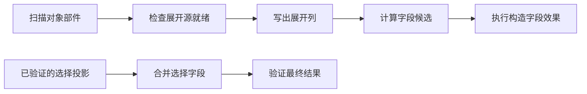

# RX 对象投影与字段写回自举

## Intent

把展开部件扫描、对象构造候选的字段效果及选择字段合并放到正式 Source 流程。保留现有借用列、短生命周期暂存区、就绪性证明和在原位置报错的顺序。

## Data

起点为 `3b0f9b649`。对象约束的外层扫描已迁移。对象展开、逐字段构造、字段选择合并的内部循环仍在手写 Zig 中。已有 ZX 提供扫描、就绪性、字段地址选择及最终结果校验。

## Edges

保持展开字段名登记与就绪错误的原有先后。展开缓冲在首个候选之后才预留。字段效果按原字段顺序提交，目标先于来源登记。每次图更新后借用当前列，位置信息继续来自原部件或原选择请求。

## Answer

- 对象展开先登记显式字段并找到首个展开部件，再预留展开列。RX 推进就绪性检查、借用字段写入和下一部件的扫描。各部件继续使用自己的诊断位置。[展开投影](../../packages/compiler/src/rx/analysis/inference/construction/projection/run.rx)
- RX 分别推进构造与选择。每一轮先使用共用的字段目标解析。构造按原顺序登记来源并应用约束，选择合并字段后在最终轮检查结果覆盖。宿主绑定图列、提供单次写入及错误报告。[字段目标](../../packages/compiler/src/rx/analysis/inference/fields/target.rx) · [构造](../../packages/compiler/src/rx/analysis/inference/construction/application/run.rx) · [选择](../../packages/compiler/src/rx/analysis/inference/selection/application/run.rx)
- 定向生成时发现展开首个游标被转换成堆上的对象。初始化现直接交出循环状态，部件的行号、根和分类保存在栈上。三个生成入口均复用原列和暂存区，生成的执行函数没有新增分配。

### 自编译与产物一致性

用 `3b0f9b649` 的 Source 引导器构建候选，27 个引导步骤通过。候选 SHA-256 为 `8048c4421cbba689cddfb4b67e7f29fa9d2e4ff8508067cbd6b58a8ebd252507`。五份引导清单共 17,650 个生成文件逐字节一致。十次常驻编辑的输出哈希和计数与上阶段一致。修改的 RX 和 ZX 文件通过格式与 lint 检查。

候选通过 83 个构建步骤、153 项 Zig 测试及 17 项 CLI 集成，覆盖 RX 推导、对象展开、字段选择、诊断位置、分配失败和 Store 执行。初始 seed 通过解析器构建及 39 项 RX 回归。

### 性能对照

固定 705 个入口和 16 个分区，关闭常驻生成器，交错三轮取中位数。三个工具均由 Source 构建，使用各自的 Source 分析与生成。对照的 9,894 个生成文件及所有权 memo 逐字节一致。

| 对照     | 冷生成墙钟 | 冷生成 CPU | 冷进程树峰值 RSS | 冷系统记录峰值 RSS | 热生成墙钟 | 热生成 CPU |
| -------- | ---------: | ---------: | ---------------: | -----------------: | ---------: | ---------: |
| 固定基线 |     2.06 s |     8.94 s |         737.4 MB |           759.8 MB |     1.61 s |     6.35 s |
| 上阶段   |     1.95 s |     9.44 s |         524.2 MB |           542.9 MB |     1.44 s |     6.24 s |
| 候选     |     1.94 s |     9.43 s |         523.8 MB |           553.9 MB |     1.42 s |     6.15 s |

较上阶段，冷生成墙钟和 CPU 均减少 0.01 秒，进程树采样峰值减少 0.4 MB，系统记录峰值增加 11.0 MB。热生成墙钟减少 0.02 秒，CPU 减少 0.09 秒。无改动检查仍为 0.03 秒。较固定基线，冷生成墙钟减少 0.12 秒，CPU 累计增加 0.49 秒，进程树采样峰值减少 213.7 MB，系统记录峰值减少 205.9 MB。

下一批接续绑定查询、非空投影、序列、长度和索引的约束重放。沿正式求解入口合并扫描、应用和刷新视图三个步骤的验收。[普通求解](../../packages/compiler/src/rx/analysis/inference/solve/propagate.rx) · [最终求解](../../packages/compiler/src/rx/analysis/inference/solve/finalize.rx)
